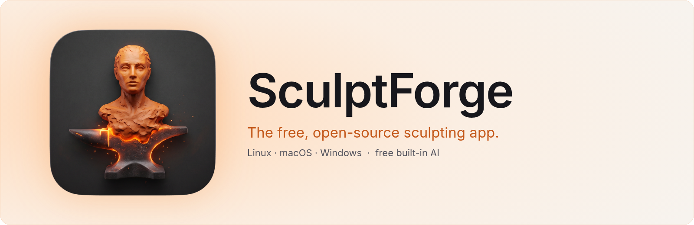
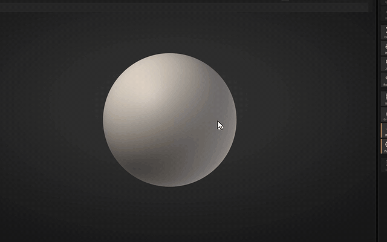

<p align="center">
  <picture>
    <source media="(prefers-color-scheme: dark)" srcset="docs/images/readme/banner-dark.png">
    
  </picture>
</p>


<p align="center">
  <strong>New in 0.12.16:</strong> pop-ups and the guide take colour by role, and sculpts with Micro detail show again in PBR shading (<a href="https://sculptforge.app/guide/whats-new.html#version-01216">how it works</a>)
</p>

<p align="center">
  <a href="https://github.com/islandmed/SculptForge/actions/workflows/ci.yml"></a>
  <a href="https://github.com/islandmed/SculptForge/releases/latest"></a>
  <a href="LICENSE"></a>
  
</p>

This workspace contains **SculptForge CRKW**, the customized build based on upstream **v0.12.16**. Build it from `ckw/crookedtools` using [the CRKW workflow](CKW_WORKFLOW.md) and install only into `out/crkw-app`; the desktop shortcut points there. Upstream downloads below describe the stock project and do not contain the CRKW tools. Automatic and manual upstream binary updates are disabled in this build.

**Sculpt with the brushes, symmetry and navigation you already know.** Free, open source, no subscription, no account.

- **Fast and native:** starts instantly, works offline, on Linux, macOS and Windows.
- **Free AI, built in:** describe a brush and Brush Lab builds it, or turn a sketch or a description into a sculptable model.
- **Made for pipelines:** LOD chains, blend shapes, Send to Unreal, Blender, OpenUSD, FBX and glTF.

<p align="center">
  <b><a href="https://github.com/islandmed/SculptForge/releases/latest">Download</a></b> ·
  <a href="https://sculptforge.app/guide/">Guide</a> ·
  <a href="https://discord.gg/gWrYkEmQhH">Discord</a>
</p>

<p align="center">
  
</p>

## Install

**[Download for Windows](https://github.com/islandmed/SculptForge/releases/latest/download/SculptForge-windows-x86_64-setup.exe)** ·
**[Download for macOS](https://github.com/islandmed/SculptForge/releases/latest/download/SculptForge-macos.dmg)** ·
**[Download for Linux](https://github.com/islandmed/SculptForge/releases/latest/download/SculptForge-linux-x86_64.AppImage)** (AppImage, x86_64)

Every link gets the newest version straight from GitHub. **[install/](install/README.md)** lists every package (.deb, .rpm, ARM64, portable .zip, Arch). Or install with one command:

```sh
# macOS / Linux
curl -fsSL https://raw.githubusercontent.com/islandmed/SculptForge/main/install/install.sh | sh
```

```powershell
# Windows (PowerShell)
irm https://raw.githubusercontent.com/islandmed/SculptForge/main/install/install.ps1 | iex
```

The builds aren't code-signed yet:
- **macOS:** right-click the app and choose **Open** the first time
- **Windows:** if SmartScreen appears, choose **More info → Run anyway**

Studio builds ([Rez](packaging/rez/package.py)), older versions and checksums are on the [releases page](https://github.com/islandmed/SculptForge/releases).

## More

[Features](docs/features.md) · [Pipelines and automation](docs/pipelines.md) · [Controls](docs/controls.md) · [Building from source](docs/building.md) · [Project layout](docs/project-layout.md) · [Studios](docs/studios.md)

Video review by [askNK](https://www.youtube.com/watch?v=8oMCKB_7TRs). If sculptforge.app is blocked on your network, the [guide is on GitHub](docs/guide/index.md) too.

## Privacy

SculptForge has no telemetry, no account and no servers of its own. AI features are optional and talk directly to the service you choose; [what is sent where](docs/ai-services.md).

## Membership

SculptForge is free, and nothing in the app is ever paywalled. Every release stays free for everyone; bug-fix and security releases go out to all the same day.

- **[Member](https://sculptforge.app/support.html?utm_campaign=github)** ($5 / month or $48 / year):
  - Betas and early builds, and the monthly feature vote
  - One Member Request a month, built first and credited to you
  - #members on Discord and your name in the [credits](https://sculptforge.app/supporters.html)
  - The first 100 are Founding Members, price locked for good
- **[Studio](https://sculptforge.app/studios.html?utm_campaign=github#membership)** ($300 / month flat, any number of artists; Founding Studio $150 for the first 5): your own isolated build with your assets built in, a pinned version with security fixes, an offline signed installer, support and a private channel.

<!-- Studio members' logos go here. -->

## Contributing

Contributions are welcome: bug reports, brushes, docs and code. Read [CONTRIBUTING.md](CONTRIBUTING.md)
and the [Code of Conduct](CODE_OF_CONDUCT.md). For questions, tips and showing your work, join the
[SculptForge Discord](https://discord.gg/gWrYkEmQhH); bugs and feature requests go to [GitHub issues](https://github.com/islandmed/SculptForge/issues). Please report security issues privately (see
[SECURITY.md](SECURITY.md)).

## License

Copyright © 2026 The SculptForge contributors.

SculptForge is free software, licensed under the [GNU General Public License v3.0 or later](LICENSE). You own
everything you make with it; the GPL covers the program, not your models. Third-party components and their
licences are listed in [THIRD_PARTY_NOTICES.md](THIRD_PARTY_NOTICES.md).

<sub>SculptForge is an independent project and is not affiliated with or endorsed by Epic Games,
Autodesk, Pixar, the Khronos Group, Hugging Face, Tencent, Microsoft, Stability AI, Anthropic, fal or Meshy.
Unreal and Unreal Engine are trademarks of Epic Games, Inc. FBX is a trademark
of Autodesk, Inc. glTF is a trademark of the Khronos Group Inc. Other names are trademarks of their respective
owners.</sub>


## Local Blender add-on maintenance

For the Blender integration in this workspace, start with [addons/blender/README.md](addons/blender/README.md). It identifies the source modules, exchange contract, packaging and validation entry points. The application and bridge versions can differ.

## Historical CRKW maintenance — 2026-11-02

Source reviewed: 2026-11-02. The customized `ckw/crookedtools` branch integrates upstream `main` at `e55d3e0` (0.10.7), preserving CRKW sculpt tools, MetaHuman masks, camera/canvas controls, materials and texture manager. Camera controls and upstream navigation share the `Camera::ortho` state; shape masks use upstream mirror/radial symmetry; layout version 5 combines the camera/mask buttons with Undo/Redo migration. Renderer and project/undo state retain CRKW previews and saved mask data alongside upstream features. Source version is distinct from any installed/running application. In the new task-menu layout, use **Mesh > CrokedWillo** for the custom tools; the Classic layout keeps its CrokedWillo palette. Borderless mode retains the chosen CRKW display, while windowed mode supports upstream window placement.

Windows verification uses a workspace-local CMake (`out/build-tools/cmake/data/bin/`) with Visual Studio 2026. The Release application, CLI and tests built successfully; all eight native core test shards passed. Blender extension and legacy ZIPs passed `build_addon.py --check`. Local README links and the CRKW diff whitespace check passed (upstream contains two existing trailing-whitespace lines in font licence text).

The merge reconciles duplicate OpenGL declarations in `src/render/GL.h`. `src/app/SettingsPath.h` supplies an explicit per-process settings directory for UI tests because SDL's Windows shell lookup ignores `APPDATA`; normal launches continue using SDL's user settings folder. Scripted minus-key input is independent of the host keyboard layout. UI regression scripts explicitly choose their expected layout/input style, quote fixture paths with spaces, account for CRKW's built-in Gold when loading a custom Gold image, and keep selection coordinates inside the updated canvas.

The first Windows UI run exposed the previous settings-isolation bug and touched project preferences (recent files/update/support flags), window state and ImGui state. The saved `ui.json` layout and `crkw-workspace.json` were unchanged; a post-discovery snapshot is retained in `out/update-main-preferences-snapshot`. Original recent-file history cannot be reconstructed from that snapshot. Subsequent isolated UI checks left the real project/layout/workspace/window preference hashes unchanged. No live Blender, external sculpting app or Unreal round trip was run. Final UI/integration run: 121 passed, no failures; upstream-disabled `ui_stroke_resize` was not run. Together with the eight passing native core shards, all 129 enabled CTest targets passed. The desktop launcher uses `out/crkw-app/bin/sculptforge.exe`; the installed-copy smoke test passed (CRKW menu/camera/masks and the Version 0.10.7 guide), with screenshots in `out/update-main-installed-smoke`. The installed executable hash matches the verified build. Its source commit is `388364b`; the earlier executable is backed up in `out/update-main-pre-0107`. The existing desktop shortcut already targets this location.


## CRKW release update — 2026-11-15

Source reviewed: 2026-11-15. Upstream release `v0.12.16` (`11f6a536`) was merged from the previous CRKW baseline `e55d3e0` (0.10.7) on `ckw/update-upstream-2026-11-14`. Production source commit: `5ed58abc`. The source build preserves CRKW Clay Polish, Mesh Sharpen, Auto Retopo + Project, MetaHuman tools and masks, camera/canvas controls, silhouettes/backgrounds, materials and Texture Manager. No stock binary is used.

CRKW integration follows upstream Parts/PartData, Lit Sphere, Face Group and Vertex Paint APIs. Project payloads `crkw_metahuman` and `crkw_mask_manager` retain artist-owned keys; linked Parts retain MetaHuman identity. Mask toggle state follows undo and subdivision changes. The thirteen custom material slots remain stable; importing another Gold image creates Gold 2. Layout version 6 migrates upstream view toggles from CRKW version 5. The right shelf shrinks and folds its controls to fit compact windows while retaining Camera and Masks. The held resize popup, high-scale AI image consent and native Windows PNG/DIB/DIBV5 clipboard paths are reconciled with upstream.

CRKW labels use the four upstream translations, with regenerated licensed Noto CJK 2.004 subsets. Source coverage is 100% for Spanish, Traditional Chinese, Simplified Chinese and Japanese, with no untranslated raw interface labels. The updater action and installer controls are disabled with `SCULPTFORGE_UPDATE_CHECK=OFF`; Preferences explains that CRKW updates are installed manually. `SCULPTFORGE_DEV_BUILD=OFF` displays the release version without a development suffix. See [CKW_WORKFLOW.md](CKW_WORKFLOW.md) for the exact build, test and installation handoff.

Validation recorded so far: all eight native shards passed (1,580 cases; 591,742 checks). Targeted production checks passed: i18n 12 cases/204 checks, CRKW 19 cases/3,380 checks and CKW polish 3 cases/988 checks. Focused UI retests passed the previously failing consent, workspace, view toggles, materials, clipboard and Maya toolbar paths. The final complete non-nightly production run is in progress; installation remains 0.10.7 until it passes.

Both Blender bridge 1.0.0 ZIP variants passed packaging checks. A fully isolated Blender 5.2.1 LTS process passed 192 integration checks. Legacy 0.10.7 camera and synthetic MetaHuman/custom-mask projects passed load/save/reload UI checks. The initial Blender run omitted extension-path isolation and its wheel cleanup removed shared Pillow files; the exact cached 12.2.0 wheel was restored and all 120 files verified byte-for-byte. The fully isolated repeat left the shared cache unchanged. Installed Blender add-ons and open Blender documents were preserved.

Limitations: nightly heavy-mesh/fuzz benchmarks, native Blender 5.3+ splat exchange, live Maya/other sculpting application round trips and Unreal MetaHuman conform were not run. MetaHuman validation uses synthetic assets. Update-dependent stock UI tests are inapplicable to this manual-update build; the dedicated CRKW updater-disabled test covers its interface. User settings are isolated through `SF_USER_DATA_DIR` (legacy `SF_TEST_SETTINGS_DIR` remains supported).

Test maintenance: feed-driven card scripts load an explicit local fixture through the UI-test harness, so they retain coverage while the real updater stays disabled. Brush resizing keeps upstream's move-then-click confirmation; the held-drag regression presses the knob at its opening position and still checks mouse/pen release behavior. These final harness/popup checks await the rebuilt executable.

The native clipboard fixture waits for the opening palette's scroll animation before locating its hover target; this avoids moving the target away from the scripted pointer.
