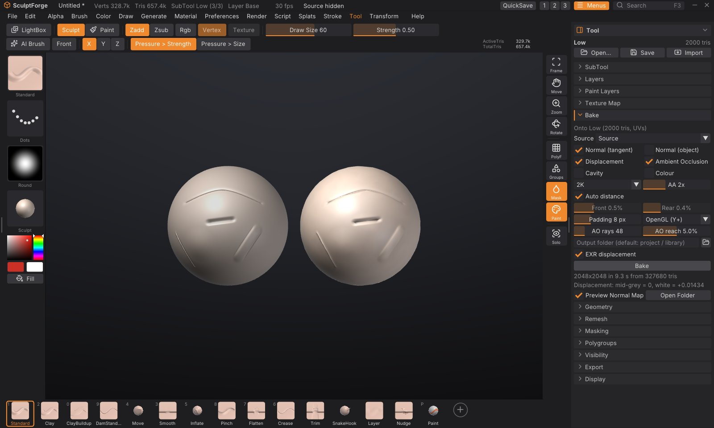

# Baking normal and displacement maps

Game engines and renderers want light meshes. Baking captures the detail of your high-poly sculpt as images
laid over the UVs of a low-poly version: a **normal map** makes the low-poly shade as if it had every crease and
pore, a **displacement map** stores how far the surface moves, and **ambient occlusion**, **cavity** and
**colour** maps feed materials. **Tool > Bake** makes all of them in one go, in the background, and shows the
normal map on the low-poly right away so you can compare it with the sculpt.



## What you need

- **A high-poly source**: one or more SubTools with the detail. They stay as they are.
- **A low-poly SubTool with UVs**, in the same place as the high-poly. It can come from another app (import it
  with **Tool > SubTool > Append**; models with UVs keep them), or you make it in SculptForge: **Duplicate** the
  sculpt, **Tool > Geometry > Decimate** it, then **Tool > Texture Map > Auto UV**.

The maps go onto the **active** SubTool, so select the low-poly before baking.

## Bake in five steps

1. Select the low-poly SubTool and open **Tool > Bake** in the right tray. The first line says which SubTool
   the maps go onto, or "No UVs" if it needs Auto UV first.
2. **Source**: leave **All visible SubTools** to bake from everything that is shown (except the low-poly), or
   pick one SubTool.
3. Tick the maps you want, and choose the **size** (1K, 2K, 4K or 8K).
4. Click **Bake**. A progress bar shows while it works on every processor core; you can keep working, or click
   **Cancel Bake**.
5. When it is done, the status line reports what was baked and where the files went, and the low-poly shows its
   normal map. Hide the high-poly (**Tool > SubTool**, the eye) to compare, or untick **Preview Normal Map** to
   see the bare low-poly.

## The maps

| Map | File | What it holds |
|---|---|---|
| **Normal (tangent)** | `<name>_normal.png` | The high-poly's surface direction relative to the low-poly, in tangent space. The map for game engines |
| **Normal (object)** | `<name>_normal_object.png` | The high-poly's normals in model space. For tools that want object-space maps |
| **Displacement** | `<name>_displacement.png` and `.exr` | The distance from the low-poly to the high-poly along the low-poly's normal |
| **Ambient Occlusion** | `<name>_ao.png` | How much of the sky each point sees: darker in creases, folds and cavities |
| **Cavity** | `<name>_cavity.png` | The fine surface curvature: mid-grey where the surface is smooth, dark in cracks, light on ridges |
| **Colour** | `<name>_color.png` | The source's polypaint, or its painted texture |

`<name>` is the low-poly SubTool's name. Colour is skipped when the source has neither polypaint nor a texture.

### Tangent-space normal maps that look right everywhere

SculptForge computes tangents with **MikkTSpace**, the same method Blender, Unreal Engine, Unity, Godot,
Substance and xNormal use. A map baked here shows correctly in all of them, as long as the low-poly is exported
with its normals and UVs (every SculptForge export keeps them). Choose the green channel convention under the
map settings:

- **OpenGL (Y+)**: Blender, Unity, Godot, Substance, three.js. The default.
- **DirectX (Y-)**: Unreal Engine's native convention. **Send to Unreal** flips an OpenGL map on import (see
  below), so you only need DirectX when you import into Unreal by hand.

### Displacement: mid-grey is zero

The 16-bit PNG stores zero displacement as mid-grey, the high-poly outside the low-poly as lighter and inside as
darker. White means **+scale** and black **-scale** in world units; the scale is the largest distance found,
shown under the Bake button ("Displacement: mid-grey = 0, white = +0.0143") and in the status line. Use it as the
displacement strength in your renderer (with a midlevel of 0.5). With **EXR displacement** ticked, a 32-bit
float OpenEXR holds the real distances in world units, with no scale to set.

## Settings

| Setting | What it does |
|---|---|
| **Source** | The high-poly: one SubTool, or every visible SubTool except the active one. Hidden faces of the source are ignored |
| **Size** | 1K, 2K (default), 4K or 8K square |
| **AA** | Anti-aliasing: 1 to 4 means 1, 4, 9 or 16 rays per texel, averaged. 2 (the default) gives clean edges |
| **Auto distance** | Measure how far the high-poly lies in front of and behind the low-poly, and cast rays just that far. After a bake, **Front** and **Rear** show what it measured |
| **Front** / **Rear** | With Auto off: how far in front of the low-poly rays start, and how far behind it they look, as a percentage of the model's size (its bounding-box diagonal). ZBrush and Substance call these the max frontal and rear distances |
| **Padding** | Texels around each UV island filled with the island's edge colours, so seams don't show once an engine mipmaps the map. 8 suits 2K; use 16 for 4K and 8K |
| **OpenGL / DirectX** | The normal map's green channel convention (see above) |
| **AO rays**, **AO reach** | Ambient occlusion quality, and how far away geometry still darkens a point (a percentage of the model's size) |
| **Output folder** | Where the files go. Empty: beside your last export, else the project's folder, else **Bakes** in your library folder. **Open Folder** shows it after a bake |
| **EXR displacement** | Also write the displacement as a 32-bit float EXR |

## How the bake works

For every texel of the low-poly's UVs, SculptForge finds the matching point on the low-poly and casts a ray
along its smoothed normal, from **Front** outside the surface to **Rear** inside it (a "cage"), and keeps the
high-poly hit nearest to the low-poly. The normal, distance, occlusion and colour found there go into the maps.
Rays follow the smoothed normals, so hard edges of the low-poly don't leave gaps.

- **Missing detail** ("x% of texels found no surface" in red under the Bake button): rays didn't reach the
  high-poly. Turn off Auto distance and raise **Front** and **Rear**.
- **Detail from the wrong place** (for example the inside of an ear showing on its back): the rays reach too
  far. Lower **Rear** (or **Front**), or bake the parts from separate SubTools with **Source**.
- The bake works on copies, so you can keep sculpting meanwhile. If the low-poly's triangles or UVs change
  afterwards, the normal map preview turns off because it no longer fits (undo brings it back).

> **Tip:** Bake time grows with the map area and the number of rays. On a 10-core Apple M1 Pro, from a
> 1.3-million-triangle sculpt: a 4K tangent normal map plus displacement (AA 2) takes about 4 seconds, the same at
> 8K about 11 seconds. Ambient occlusion costs the most: adding it at 4K with 48 rays per texel brings the bake to
> about 30 seconds. Try settings at 1K, then bake the final maps at 4K.

## Send to Unreal with the normal map

When the last bake made a normal map, its low-poly SubTool is shown and still fits the map, **Send to Unreal**
(**Tool > Export**) imports the map too, as `T_<Name>_N` next to the mesh, set up as a normal map (linear, normal
map compression), with Unreal's **Flip Green Channel** set for an OpenGL map. This works with an Unreal Editor
on the same computer; for one on another computer, import the PNG by hand. See
[Exporting, Unreal and ZBrush](exporting.md#send-to-unreal).

## Commands

| Command | What it does |
|---|---|
| `bake` | Bake onto the active SubTool and write the maps. Options: `source=all` or a SubTool name, `maps=normal,object_normal,displacement,ao,cavity,color` (or `all`), `size=2048` (512 to 8192, or `1k`...`8k`), `out=folder`, `name=prefix`, `front=0.02` and `rear=0.02` (fractions of the model's size, or `auto`), `samples=2`, `padding=8`, `ao_rays=48`, `ao_distance=0.05`, `green=opengl` or `directx`, `displacement_scale=` (world units at white), `exr=true` |

For example, from the console or `sculptforge-cli`:

```
subtool_select name=Body_low; bake source=Body maps=normal,ao,displacement size=4096 out=maps
```

The command runs in the foreground (scripts wait for it); the **Bake** button runs the same bake in the
background. See [Scripting and automation](scripting.md).
