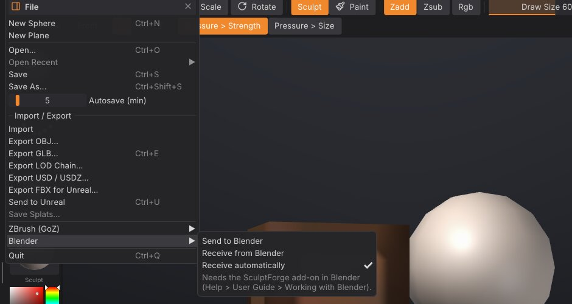

# Working with Blender

Keep Blender for the scene, rigging, shading and animation, and sculpt in SculptForge: the **SculptForge Bridge**
add-on sends the selected objects from Blender to SculptForge with one click, and one click in SculptForge sends
them back. The objects update in place in Blender: their transform, materials and modifiers stay as they were.
It works like GoZ between ZBrush and other apps, on Linux, Windows and macOS, with Blender 4.2 or newer.

## Install the add-on

1. Download `sculptforge_bridge.zip` from the
   [latest release](https://github.com/islandmed/SculptForge/releases/latest/download/sculptforge_bridge.zip)
   (or the [SculptForge website](https://islandmed.github.io/SculptForge/)).
2. In Blender choose **Edit > Preferences > Get Extensions**, open the menu at the top right and choose
   **Install from Disk...**, then pick the zip. (You can also drag the zip into Blender's window.)
3. The **SculptForge** tab appears in the 3D View's sidebar (press <kbd>N</kbd>). Send and Receive are also in the
   **Object** menu and in **File > Import / Export**.

Start SculptForge once after installing it: it records where it is installed, so the add-on can start it for
you. If the add-on still can't find it (for example an AppImage you keep somewhere unusual), set its path in the
add-on's preferences (**Edit > Preferences > Add-ons > SculptForge Bridge**).

> **Tip:** Older Blender versions or a classic add-on install: `sculptforge_bridge-<version>-legacy.zip` installs
> through **Edit > Preferences > Add-ons > Install from Disk**. The add-on needs Blender 4.2 or newer either way.

## A round trip

1. In Blender, select one or more mesh objects and click **Send to SculptForge** in the SculptForge tab.
   SculptForge starts, or, if it's already open, loads them within a second. Each object becomes a SubTool with
   the object's name, placed as it is in the Blender scene.
2. Sculpt, paint, mask, divide, remesh: anything SculptForge does.
3. In SculptForge choose **File > Blender > Send to Blender**. Every visible SubTool goes back.
4. Blender picks it up by itself within a second (or click **Receive from SculptForge**). Each object that came
   from Blender is updated; a SubTool you added in SculptForge becomes a new object.

Sending again from Blender updates the same SubTools: each update is one undo step on that SubTool in
SculptForge, and each receive in Blender is one undo step there.

## What comes across

| | Blender | SculptForge |
|---|---|---|
| Shape | The object's mesh, in its own space | The SubTool, placed in the scene with the object's transform |
| Faces | Triangles and quads; n-gons as triangle fans | Triangles and quads (PolyF shows the quads) |
| UVs | The active UV map | UVs |
| Colour | The active colour attribute (point or face corner) | Polypaint |
| Mask | The sculpt mask | Mask |
| Face sets | Sculpt mode face sets | Polygroups |
| Name | Object name | SubTool name |

Blender is Z-up and SculptForge Y-up, both in metres; the add-on and SculptForge convert between them, so the
model stands the same way in both and a round trip changes nothing. Objects with a negative scale (mirrored)
come across the right way out.

**When the topology doesn't change** (you only sculpted, painted or masked), Blender's mesh keeps everything
it had: its n-gons, edges, seams, creases, custom attributes and the other UV maps; only the positions, the active
UV map, colour, mask and face sets are updated.

**When the topology changes** (Divide, a remesh, QRemesh, Subdivide...), the object's mesh is rebuilt from what
SculptForge sent. The object keeps its transform, materials, modifiers and the names of its active UV map and
colour attribute; things tied to the old faces (material per face, seams, other UV maps, shape keys) can't
follow and are reset.

## Modifiers

The **Modifiers** setting in the SculptForge tab chooses what an object with modifiers sends:

- **Keep live** (the default): the mesh under the modifiers. They keep working in Blender on the sculpted mesh,
  for example a Mirror or a Subdivision Surface.
- **Apply**: what you see, with the modifiers applied. When it comes back, the mesh holds their result, so the
  add-on turns those modifiers off (they stay on the object, switched off, if you want them again).

## Settings

In the SculptForge tab:

- **Receive automatically**: after a send, load what SculptForge sends back as soon as it arrives (on by
  default). Off: click **Receive from SculptForge** yourself.

In SculptForge's **File > Blender**:

- **Receive automatically**: load what Blender sends as soon as it arrives (on by default).

The add-on's preferences add the path of SculptForge and the exchange folder (below).

## How it works

The two programs share a folder in your user data: `~/.local/share/SculptForge/SculptForge/blender` on Linux,
`%APPDATA%\SculptForge\SculptForge\blender` on Windows, `~/Library/Application Support/SculptForge/SculptForge/blender`
on macOS. Each side writes its meshes there as `.GoZ` files (the format SculptForge also uses with ZBrush) with a
small list of the objects, and checks the other side's list once a second. Nothing goes over the network.

To use another folder, set it in the add-on's preferences and start SculptForge with the environment variable
`SCULPTFORGE_BLENDER_EXCHANGE` set to the same folder.

From scripts and the MCP server: `blender_send` and `blender_receive` (both take `folder=`). Starting
SculptForge with `--blender` loads what Blender last sent.

## Limits and troubleshooting

- **Blender as a Flatpak or Snap** sees a different user data folder and may not be allowed to start other
  programs. Set the add-on's exchange folder to a folder both can reach, start SculptForge yourself with
  `SCULPTFORGE_BLENDER_EXCHANGE` set to it, and send.
- **Linked duplicates** (objects sharing one mesh) all show the last one received.
- **Shape keys**: only the Basis is updated when the topology stays the same; the other keys keep their shapes.
- **Subdivision levels** don't go to Blender: it receives the level you're on (like GoZ).
- **Sculpt layers** and textures stay in SculptForge; the mesh goes back with the layers as they show.
- **Nothing arrives in SculptForge?** Check **File > Blender > Receive automatically**, or choose **Receive from
  Blender**. **Nothing arrives in Blender?** Click **Receive from SculptForge**; automatic receiving starts after the
  first send from that Blender session.
- Objects in Edit Mode or Sculpt Mode are updated too: the add-on switches to Object Mode for the update and back.

## See also

- [Exporting, Unreal and ZBrush](exporting.md): files, game engines and GoZ
- [SubTools](subtools.md): each Blender object is a SubTool
- [Polygroups and visibility](polygroups.md): Blender's face sets
