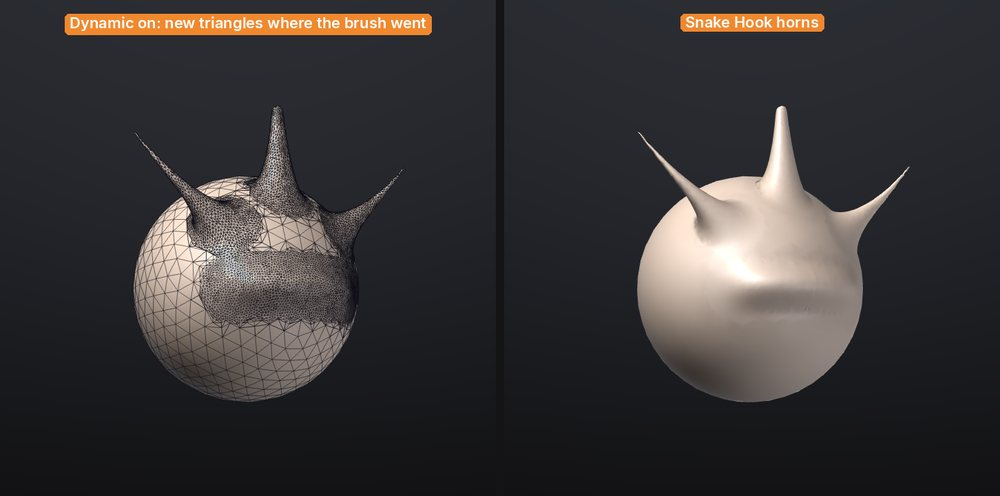

# Dynamic topology

With **Dynamic** on, the brush adds triangles where it needs detail and removes them where it doesn't, as
ZBrush's **Sculptris Pro** and Blender's **Dyntopo** do. Pull a sphere out into horns, ears or fingers and the
new shapes get triangles of their own instead of stretched ones; block in a creature from a ball without
remeshing first.



## Turn it on

| Control | Where | What it does |
|---|---|---|
| **Dynamic** | Top shelf, Draw palette | Turns dynamic topology on or off (ZBrush's Sculptris Pro button) |
| **Detail** | Top shelf (while Dynamic is on), Draw palette | How small the triangles get: 0 coarse, 100 fine (default 50) |
| **Constant detail** | Draw palette | Off: the size follows the brush. On: one size for the whole mesh |

Then sculpt as usual. Every brush works with it except **Move** (it drags the surface without remeshing), the
mask and paint brushes, and **DragRect** strokes. **Smooth** remeshes towards larger triangles, so smoothing
also simplifies, as in ZBrush.

> **Tip:** Turn on **PolyF** (<kbd>Shift</kbd>+<kbd>F</kbd>) to see the triangles appear under the brush.

## How big the triangles get

By default the triangle size follows the brush size on screen, as in Sculptris Pro: **zoom in or make the brush
smaller for finer triangles**, zoom out or make it bigger for coarser ones. At Detail 50 an edge is about an
eighth of the brush radius; Detail 100 makes them about three times smaller, Detail 0 three times bigger.

With **Constant detail** on, every stroke aims for the same size whatever the zoom and brush, set by Detail
relative to the size of the mesh (at 50, about a hundredth of its bounding box diagonal). Use it to bring a
whole model to an even density, or to keep the density while you change brush sizes. It is a preference: Store
Config (<kbd>Ctrl</kbd>+<kbd>Shift</kbd>+<kbd>I</kbd>) keeps it.

Under the brush, edges longer than the target are split, edges much shorter are merged away, and the new
triangles are evened out. Outside the brush nothing changes, so you can have big triangles on the back of a head
and fine ones around the eyes.

## What it keeps and what it doesn't

- **Symmetry.** With X (or Y, Z) symmetry on, both sides are remeshed together and get mirrored triangles, not
  just mirrored shapes.
- **Mask and visibility.** Fully masked and hidden parts are left alone. Partly masked areas are remeshed but
  move less, as usual.
- **Borders.** Open edges and the borders between polygroups stay where they are; their vertices only slide
  along them. New triangles take the polygroup of the triangle they came from.
- **Polypaint, mask values and sculpt layers** are carried onto new vertices (blended between their
  neighbours).
- **Quads** under the brush become triangles. The rest of the mesh keeps its quads.
- **UVs are dropped** the first time a stroke remeshes a SubTool (the status bar says so), since the new
  triangles have none. Undo brings them back. Unwrap again with **Auto UV** when you are done.

## Subdivision levels

Dynamic topology works on meshes without [subdivision levels](subdivision-levels.md), as in ZBrush. On a SubTool
with levels, **Dynamic** stays off and the status bar says why: go to the level you want to keep and use **Del
Lower** and **Del Higher** in **Tool > Geometry** first. If you turn it on and then pick a SubTool that has
levels, strokes sculpt it without remeshing.

A good workflow: block in with Dynamic, then [QRemesh](retopology.md) or [Voxel Remesh](geometry.md) for an even
base, **Divide** for levels, and sculpt the fine detail on them.

## Undo and speed

Each stroke is one undo step. Undo puts every triangle back exactly, and it only keeps the part of the mesh the
stroke changed, so it costs little memory even on millions of triangles (a few megabytes per stroke).

Dynamic topology is fastest on meshes of up to a few million triangles. On the benchmark computer (an M1 Pro), a
dab with a medium brush on a one-million-triangle sphere takes 4 to 12 milliseconds including the screen
update; undoing a stroke on such a mesh takes about a tenth of a second. A very big brush over very small
triangles merges them over several dabs rather than all at once, to keep the brush responsive. See
[Performance and big meshes](performance.md).

## From a script

```
dyntopo enabled=true detail=60
stroke points="0.3,0.6,1 0.5,0.4,1" brush=SnakeHook radius=0.2 symmetry=x
dyntopo enabled=false
```

`dyntopo` without arguments reports the settings; `constant=true` switches to a constant detail size. It works
the same from the console, `sculptforge-cli`, MCP and Python. See [Scripting and automation](scripting.md).

## See also

- [Sculpting and brushes](sculpting.md)
- [Subdivision levels](subdivision-levels.md)
- [Subdivide, remesh, decimate and LODs](geometry.md)
- [Coming from ZBrush](coming-from-zbrush.md)
