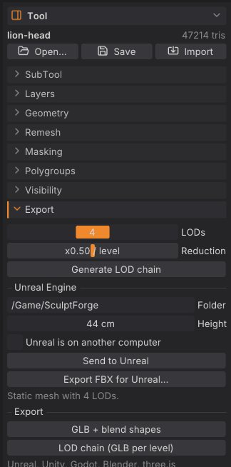

# Exporting, Unreal and ZBrush

This chapter covers getting your sculpt out of SculptForge: the export formats and what each one keeps, LOD
chains for games, sending a mesh straight into a running Unreal Editor, and exchanging models with ZBrush
through GoZ. To keep everything (SubTools, layers, mask, polypaint, brushes) use a project file instead; see
[Projects, autosave and QuickSave](projects.md).

## Export formats at a glance

Exports write every **visible** SubTool. Hidden SubTools are left out. Exporting doesn't rename the document
or mark it saved, so your next <kbd>Ctrl</kbd>+<kbd>S</kbd> still saves the project.

| Format | Where in the app | Keeps | Use it for |
|---|---|---|---|
| glTF binary (`.glb`) | **File > Export GLB...** (<kbd>Ctrl</kbd>+<kbd>E</kbd>) | One node per SubTool, sculpt layers as morph targets, polypaint as vertex colour | Games, Blender, three.js, web viewers |
| LOD chain (`.glb` per level) | **File > Export LOD Chain...** | As GLB, one file per level, blend shapes on every level | Game engines |
| OpenUSD (`.usda`, `.usdz`) | **File > Export USD / USDZ...** | One Mesh prim per SubTool, quads, layers as UsdSkel blend shapes, polypaint as `displayColor`, loaded splats | Film pipelines, Omniverse, Apple AR Quick Look |
| FBX for Unreal (`.fbx`) | **File > Export FBX for Unreal...** | Unreal naming and scale, quads, LOD group, layers as blend shapes | Unreal Engine (by hand) |
| Wavefront OBJ (`.obj`) | **File > Export OBJ...** | One `o` object per SubTool, quads, polygroups as `g` groups, polypaint as vertex colour. Layers are baked into the current blend | Any 3D app, ZBrush |
| ZBrush GoZ (`.GoZ`) | **File > ZBrush (GoZ) > Export GoZ...** | Quads, polygroups, mask, polypaint, UVs | ZBrush |
| STL (`.stl`) | **File > ZBrush (GoZ) > Export STL...** | Geometry only (triangles), visible SubTools merged | 3D printing |
| PLY (`.ply`) | `export_ply` command | Geometry, quads and polypaint, visible SubTools merged | Scan tools, MeshLab, Blender |
| FBX (general) | `export_fbx` command | One model per SubTool, quads, blend shapes, optional LOD groups | Other FBX pipelines |

The GLB, LOD chain and FBX for Unreal exports are also in the **Tool** palette under **Export**, together with
the LOD and Unreal settings.

"Quads" means the quads the model came in with (or got from Plane, Cube, Subdivide or Voxel Remesh) are written
as quads, the rest as triangles; see [Quads and triangles](geometry.md#quads-and-triangles). glTF and STL can
only hold triangles.



> **Not yet:** SculptForge has no UV unwrapping, so exported meshes carry no UVs unless they came in with them
> (GoZ and project files keep imported UVs). Texture baking (normal and displacement maps) is also on the
> roadmap. Engines that need lightmap UVs can generate them on import.

### Scale and axes

- glTF, USD and OBJ are written Y-up with 1 unit = 1 metre, the same space you sculpt in.
- FBX uses centimetres: `export_fbx` multiplies positions by 100 by default (`scale=`), so 1 unit = 1 m.
- STL and PLY keep positions as they are (no unit conversion).
- For Unreal, **Height** sets the real-world size directly (see below).

## Export a model

1. Show the SubTools you want to export and hide the others (the eye icon in **Tool > SubTool**).
2. Choose the export in the **File** palette and pick a file name.
3. The status line confirms the export ("Exported ...").

From a script, each format is one command:

```sh
sculptforge-cli -c 'open path=bust.sfproj; export_glb path=bust.glb'
sculptforge-cli -c 'open path=bust.sfproj; export_usd path=bust.usdz'
sculptforge-cli -c 'open path=bust.sfproj; save_obj path=bust.obj'
sculptforge-cli -c 'open path=bust.sfproj; export_fbx path=bust.fbx lods=3 ratio=0.5'
sculptforge-cli -c 'open path=bust.sfproj; export_stl path=bust.stl; export_ply path=bust.ply'
```

## LOD chains for games

A LOD (level of detail) chain is the same model at decreasing triangle counts, so an engine can draw distant
objects cheaply. SculptForge builds it with quadric decimation, keeping blend shapes on every level.

1. Open **Tool > Export**.
2. Set **LODs** (2 to 6 levels, including LOD0) and **Reduction** (0.1 to 0.9: the triangle ratio from one
   level to the next, default 0.5).
3. Click **Generate LOD chain**. A table lists each level with its triangle count and its share of LOD0.
4. Click a level (**LOD0**, **LOD1** ...) to inspect it in the viewport; the wireframe turns on. Click
   **Sculpt** to go back to the editable mesh.
5. Export with **LOD chain (GLB per level)**, or send it to Unreal (below). Changing the sliders clears the
   preview; click **Generate LOD chain** to build it again.

The LOD chain export writes `<name>_LOD0.glb`, `<name>_LOD1.glb` and so on next to the path you choose. With
several visible SubTools, each SubTool is decimated on its own.

```sh
sculptforge-cli -c 'open path=rock.obj; export_lods path=out/rock.glb levels=4 ratio=0.5'
```

To reduce the sculpt itself instead of exporting copies, use **Tool > Geometry > Decimate**; see
[Subdivide, Remesh, Decimate and LODs](geometry.md).

## Send to Unreal

**Send to Unreal** exports an Unreal-ready FBX and imports it into a running Unreal Editor (5.x) on this
computer or another one on your network. Nothing is installed into your project: it uses Unreal's built-in
Python remote execution.

| Your sculpt | What arrives in Unreal |
|---|---|
| No sculpt layers | A **static mesh** `SM_<Name>` with the LOD chain from **Tool > Export** |
| Sculpt layers | A **skeletal mesh** `SK_<Name>` with one **morph target** per layer (Unreal adds a single root bone) |
| Several visible SubTools | One FBX model per SubTool, combined into one asset on import |
| Any | A material slot `M_Clay`, and the real-world size from **Height** |

Sending the same asset again updates it in place (same name and folder), so references in your levels stay
intact.

### One-time setup in Unreal

1. **Edit > Plugins**: enable **Python Editor Script Plugin**, then restart the editor.
2. **Edit > Project Settings > Plugins > Python**: tick **Enable Remote Execution?**.

That's all when Unreal runs on the same computer.

### Send

1. Open **Tool > Export** and find the **Unreal Engine** section.
2. Set **Folder** (the content folder, default `/Game/SculptForge`) and **Height** (the model's height in
   Unreal, in centimetres; it starts at the model's current height with 1 unit = 1 m).
3. For a static mesh, set **LODs** and **Reduction** above (default 4 levels).
4. Click **Send to Unreal**, or press <kbd>Ctrl</kbd>+<kbd>U</kbd>. The status line reports the result.

The line under the buttons tells you what will be sent: "Static mesh with 4 LODs" or "Skeletal mesh with 2
morph targets".

### Unreal on another computer

1. On the Unreal machine, in **Project Settings > Plugins > Python**, open **Advanced** and set **Multicast
   Time-To-Live** to `1` and **Multicast Bind Address** to `0.0.0.0`.
2. In SculptForge, tick **Unreal is on another computer**.
3. Both computers must be on the same network, and the SculptForge computer's firewall must allow incoming
   connections from the Unreal machine: the editor connects back to SculptForge to fetch the file.

### Import by hand

**Export FBX for Unreal...** (in the **File** palette and in **Tool > Export**) writes the same file. The file
name becomes the asset name. Drag it into the Content Browser: static meshes pick up their LODs from the
file's LOD group; for skeletal meshes choose **Skeletal Mesh** and tick **Import Morph Targets**.

### From scripts

```sh
sculptforge-cli -c 'open path=statue.obj; unreal_send destination=/Game/Props height_cm=200 lods=4'
sculptforge-cli -c 'unreal_editors network=true'                  # list editors on the network
sculptforge-cli -c 'open path=statue.obj; export_unreal folder=out height_cm=200'
```

`unreal_send` also takes `name=`, `project=` (pick one editor when several are open) and `network=true`.

> **Note:** Layered sculpts are sent as skeletal meshes without the LOD chain, because Unreal's morph targets
> need a skeletal mesh (Unreal can generate skeletal LODs itself). The Unreal link has been tested against a
> stand-in editor that speaks the same protocol but not yet against every Unreal version. If an import fails,
> Unreal's **Output Log** shows the importer's messages.

## Exchange models with ZBrush (GoZ)

SculptForge reads and writes ZBrush's GoZ format and can talk to a running ZBrush through the GoZ bridge on
Windows and macOS. The commands are in **File > ZBrush (GoZ)**:

| Item | What it does |
|---|---|
| **Send to ZBrush** | Writes every visible SubTool to the shared GoZ folder and tells ZBrush (starting it if needed). Each SubTool arrives as its own ZBrush SubTool. Turns on **Receive automatically** |
| **Receive from ZBrush** | Loads what ZBrush last sent with GoZ. Each object updates the SubTool it was sent from (one undo step), or becomes a new SubTool |
| **Receive automatically** | Checks once a second for a new GoZ send from ZBrush and receives it |
| **Custom GoZ folder** | Use another GoZ folder, for example inside a Wine prefix |
| **Import GoZ...** | Opens a `.GoZ` file, replacing the scene |
| **Export GoZ...** | Writes a `.GoZ` file. With several visible SubTools, one file per SubTool next to the path |
| **Export STL...** | Writes a binary STL of the visible SubTools |

The default GoZ folder is `C:\Users\Public\Pixologic` on Windows and `/Users/Shared/Pixologic` on macOS.
ZBrush doesn't run on Linux, so there the bridge needs a custom folder; GoZ files still import and export.

### A round trip

1. In SculptForge, choose **File > ZBrush (GoZ) > Send to ZBrush**. ZBrush starts or comes forward with the
   SubTools. If ZBrush was not running and does not import them, press **GoZ** in ZBrush.
2. Work in ZBrush, then press **GoZ** there to send the model back.
3. SculptForge receives it automatically and updates the matching SubTools. Each update is an undo step on
   that SubTool.

GoZ keeps polygroups, mask, polypaint and UVs. Quads from ZBrush stay quads: PolyF shows them as quads, and
they go back to ZBrush as the same quads. GoZ has no hidden-face flag, so hidden faces are sent like
any others.

> **ZBrush:** SculptForge cannot open ZBrush's own `.ZTL` and `.ZPR` files (they are proprietary and
> undocumented). Bring models over with GoZ, or export OBJ or FBX from ZBrush. Subdivision levels don't come
> across: SculptForge receives the mesh at the level you sent.

> **Note:** The GoZ bridge follows the format of the open-source Blender GoZ add-on (GoB) and is tested with
> files, but has not yet been tested against a live ZBrush. If a send does not arrive, export a `.GoZ` file
> and import it in ZBrush by hand, and please report it (**Help > Report a problem**).

From scripts: `goz_export path=`, `goz_import path=`, `goz_send`, `goz_receive` and `export_stl path=`.

## See also

- [Projects, autosave and QuickSave](projects.md): save everything, not just the mesh
- [SubTools](subtools.md): which SubTools are exported
- [Layers and blend shapes](layers.md): what becomes morph targets
- [Subdivide, Remesh, Decimate and LODs](geometry.md): decimate before exporting
- [Gaussian splats](splats.md): saving splats
- [For studios](studios.md): formats in a pipeline
