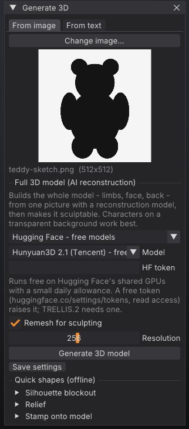

# Image and text to 3D

SculptForge can turn a picture or a written description into a full 3D model that you can sculpt straight
away. This chapter covers the **Generate 3D** window, the services it can use (free Hugging Face models, your
own ComfyUI server, paid fal.ai or Meshy, your own command line, or an offline blockout) and the offline image
tools: relief, inflate and stamp.



## How it works

1. You give SculptForge an image (a sketch, concept art, a photo of a figurine) or a short description.
2. The service you picked reconstructs a complete mesh: front, back, limbs and all.
3. SculptForge opens the result as a new scene and, unless you turn it off, **voxel-remeshes** it into one
   even, watertight surface, so the brushes behave the same as on any other sculpt.

Nothing leaves your computer until you choose a hosted service and press **Generate 3D model**. For exactly
what is sent where, see [AI services and privacy](#privacy-and-model-licences) below.

> **ZBrush:** ZBrush has no built-in image-to-3D. The closest workflow is blocking out a base mesh by hand
> with DynaMesh or ZSpheres; here you get a starting shape in seconds and refine it with the usual brushes.

## Open the Generate 3D window

Any of these opens it:

- Drop an image file (PNG, JPG, BMP, TGA, PSD or GIF) onto the SculptForge window. The image is loaded as the
  picture for the **From image** tab and the window opens.
- Open the **Generate** palette and click **Generate 3D**.
- Press <kbd>F3</kbd>, type `generate` and press <kbd>Enter</kbd>.

The window has two tabs, **From image** and **From text**.

> **Warning:** A generated model replaces the current scene without asking, and arrives as a new, untitled
> scene. Save your work (<kbd>Ctrl</kbd>+<kbd>S</kbd>) before you generate.

## Generate from an image

1. On the **From image** tab, click **Choose image...** (or drop a file onto the window). A preview and the
   image size appear.
2. Pick a service in the drop-down under **Full 3D model (AI reconstruction)**. The default is **Hugging Face
   - free models**.
3. Set the service's options (model, token or key, see below).
4. Leave **Remesh for sculpting** on and set its **Resolution** (96 to 400, default 256). Higher keeps more
   detail and makes more triangles.
5. Click **Generate 3D model**. A progress bar shows the queue position and progress; **Cancel** stops the
   job.

When it finishes, the status line reports the triangle count before and after remeshing, for example
"Generated model imported (412000 tris, remeshed to 180000) - ready to sculpt".

### Pictures that work well

- One character or object per image.
- A plain or transparent background. SculptForge crops the subject out of a transparent background, centres it
  on a square and scales it to at most 1024 pixels before sending it.
- The whole subject in frame, seen from the front or a three-quarter view.
- A clean concept turnaround pose works better than a busy illustration with scenery.

## Generate from text

1. On the **From text** tab, type one object into the box, for example "a stylised dragon head with curled
   horns" or "a cartoon fox sitting".
2. Pick **Hugging Face - free models**, **fal.ai**, **Meshy** or **ComfyUI - your server**. Text to 3D does
   not work with **My generator command** or **Offline blockout**.
3. Click **Generate 3D model**.

Which model runs depends on the service:

| Service | Text-to-3D model |
|---|---|
| Hugging Face | Hunyuan3D 2 mini Turbo (Tencent), or Hunyuan3D 2 if you chose it in **Model**. Any other choice uses Turbo |
| fal.ai | Hunyuan3D 3.1 Rapid (Tencent) |
| Meshy | Meshy's own text-to-3D model |
| ComfyUI | The text workflow you choose (the bundled `text-to-3d` uses FLUX.1 schnell and Hunyuan3D 2.1) |

## Services

| Service | Cost and setup | Good for |
|---|---|---|
| **Hugging Face - free models** | Free, no account. A free token raises the daily allowance | Trying things out, personal work |
| **fal.ai - paid, your key** | Paid per generation, needs a fal.ai key | Reliable capacity, newer models |
| **Meshy - paid, your key** | Paid, needs a Meshy key | Meshy's own models |
| **ComfyUI - your server** | Free, runs on your own GPU or a studio server | Privacy, custom workflows, studios |
| **My generator command** | Free, any program you run locally | Your own model or a studio service |
| **Offline blockout (inflate silhouette)** | Free and instant, no network | Simple shapes, a quick start |

### Hugging Face (free)

This runs each model author's own public demo on Hugging Face's shared ZeroGPU hardware. Pick a **Model**:

| Model | Notes |
|---|---|
| Hunyuan3D 2.1 (Tencent) | The default. Detailed shapes, about 20 seconds |
| TRELLIS.2 (Microsoft) | The most detail. Needs a Hugging Face token |
| Hunyuan3D 2 mini Turbo (Tencent) | The fastest, about 6 seconds |
| Hunyuan3D 2 (Tencent) | |
| Stable Fast 3D (Stability AI) | Quick and simple, removes the background itself |

GPU time is rationed per person per day, there can be a queue at busy times, and a demo can be paused or
changed by its owner. To raise the allowance, create a free token with read access at
huggingface.co/settings/tokens and paste it into **HF token** (or set the `HF_TOKEN` environment variable).
When the allowance runs out you see "Hugging Face's free GPU time is used up for now"; add a token, wait for
it to refill, or pick another model.

> **Warning:** The Hunyuan3D models are under the Tencent Hunyuan Community License, which does not cover use
> in the European Union, the United Kingdom or South Korea. If you work there, choose TRELLIS.2, Stable Fast
> 3D or a paid service. Each model has its own licence; read it before using results commercially.

### fal.ai and Meshy (paid)

- **fal.ai**: choose a **Model** (TRELLIS.2, Hunyuan3D 3.1 Pro, Hunyuan3D 3.1 Rapid or Meshy 6) or type any
  fal model id into **Model id**. Paste your key from fal.ai/dashboard/keys into **API key**, or set
  `FAL_KEY`.
- **Meshy**: paste your key from meshy.ai (API settings) into **API key**, or set `MESHY_API_KEY`.

Generations are billed to your account with that service. Errors such as "The API key was rejected", "Out of
credits on this account" or "Rate limited" come from the service.

### ComfyUI (your own server)

Runs any ComfyUI workflow on your own computer or a studio GPU server, with whatever models it has. Nothing is
sent anywhere else.

1. Start ComfyUI. It listens on `http://127.0.0.1:8188` by default. If SculptForge runs on another computer,
   start ComfyUI with `--listen` (only on a network you trust: ComfyUI has no login).
2. Install the models your workflow needs. The bundled Hunyuan3D 2.1 workflow needs
   `hunyuan_3d_v2.1.safetensors` in `ComfyUI/models/checkpoints`.
3. In **Generate 3D**, pick **ComfyUI - your server**, enter the **Server** address and click **Test
   connection**. A good answer looks like "Connected: ComfyUI 0.42.0 - NVIDIA GeForce RTX 4090 (24.0 GB)".
4. Choose a **Workflow**: a bundled one, or **Other file (API format)...** for your own.
5. Click **Generate 3D model**. The progress bar shows your place in ComfyUI's queue.

Bundled workflows:

| Workflow | Tab | Needs |
|---|---|---|
| `hunyuan3d-image-to-3d` | From image | The Hunyuan3D 2.1 checkpoint (7.4 GB) and a GPU with about 10 GB of memory |
| `text-to-3d` | From text | FLUX.1 schnell, BiRefNet and Hunyuan3D 2.1 (about 25 GB of downloads) and a GPU |
| `sculptforge-inflate` | From image | The ComfyUI-SculptForge node pack; no GPU. A quick blockout to check your setup |

Your own workflows must be saved in ComfyUI's **API format** (in ComfyUI: **Workflow > Export (API)**). To
tell SculptForge where the inputs go, give nodes these titles:

| Node title | What SculptForge does |
|---|---|
| `sf_image` | Puts the uploaded picture into this Load Image node. Without one, the first Load Image node is used |
| `sf_prompt` | Puts your description into this node's `text`, `prompt` or `string` input. Without one, the first CLIP Text Encode not titled "negative" is used |
| `sf_seed` | Sets the seed. Inputs named `seed` or `noise_seed` get it too |

SculptForge imports the first mesh file the workflow saves (Save GLB, Preview 3D and most 3D node packs work).
For error messages and their fixes, see [Troubleshooting](troubleshooting.md#comfyui-errors).

### My generator command

Runs any command line on your computer: a local open-source model, a studio service, or a script that calls a
cloud API. Type the command into the box. It must contain `{input}` (replaced with the image path) and
`{output}` (replaced with the path to write, ending in `.glb`). Both are quoted for you, so don't add quotes.
The command must write a GLB file to `{output}` and exit with status 0.

The box starts with a command that runs SculptForge's own silhouette inflation, which is a quick way to check
that the pipeline works:

```text
sculptforge-cli --set input={input} --set output={output} -c 'image_inflate path=$input subdivisions=2; export_glb path=$output'
```

A wrapper for your own model can be as small as this:

```python
# my_generator.py {input} {output}
import sys
image_path, output_path = sys.argv[1], sys.argv[2]
# load your model, run it on image_path, write a .glb to output_path
```

Keep API keys in environment variables that your script reads, not in the command line.

### Offline blockout

**Offline blockout (inflate silhouette)** inflates the outline of the picture into a rounded, closed mesh. It
is instant and needs no network, but it is a puffy blockout, not a reconstruction: fine for simple shapes, not
for characters.

## Save your settings

**Save settings** (the small button under **Generate 3D model**) stores the service, model, keys, token,
ComfyUI address and generator command in your `ai.json` settings file, so they are set the next time you start
SculptForge. Keys in `ai.json` are readable only by your user account. See
[where settings live](troubleshooting.md#where-settings-live).

## Quick shapes from an image (offline)

The **From image** tab also has three offline tools under **Quick shapes (offline)**. They need no network and
run instantly. The same tools are in the **Generate** palette as **Relief**, **Inflate** and **Stamp**.

| Tool | What it makes | Settings |
|---|---|---|
| **Silhouette blockout** > **Inflate** | A rounded, closed base mesh from the outline. Replaces the scene | **Thickness** (0.2 to 2, lower is flatter), **Detail** (64 to 384) |
| **Relief** > **Make relief** | A height-field relief: light areas rise. For logos, coins, emblems, height maps and texture photos. Replaces the scene | **Depth** (0.01 to 0.5 of the width), **Detail** (64 to 1024), **Dark is high** |
| **Stamp onto model** > **Stamp from this view** | Projects the image onto the current model from the current view as surface detail, into the active sculpt layer | **Depth** (0.001 to 0.1 of the model size), **Dark is high** |

> **Tip:** Stamp writes into the active sculpt layer, so add a layer first (**Tool > Layers**) if you want to
> dial the detail in and out afterwards. See [Layers and blend shapes](layers.md).

## After generating

Generated meshes are a starting point. A typical next pass:

1. Check the size of the remeshed result in the title strip (Verts, Tris). If the detail is too soft, generate
   again with a higher **Resolution**, or run **Tool > Remesh > Voxel Remesh** at a higher value on the
   result.
2. Turn on **X** symmetry if the subject is symmetrical, and sculpt the forms with Clay Buildup, Move and Dam
   Standard ([Sculpting and brushes](sculpting.md)).
3. Save a project (<kbd>Ctrl</kbd>+<kbd>S</kbd>): generated scenes start untitled.

## From scripts and agents

The same services are available as commands, in the console, `sculptforge-cli`, Python and MCP agents:

```sh
# free (Hunyuan3D 2.1 on Hugging Face)
sculptforge-cli -c 'image_to_3d path=hero.png; export_glb path=hero.glb'

# TRELLIS.2 with a Hugging Face token
HF_TOKEN=hf_... sculptforge-cli -c 'image_to_3d path=hero.png model=trellis-2; export_glb path=hero.glb'

# fal.ai, keeping the raw (not remeshed) result
FAL_KEY=... sculptforge-cli -c 'image_to_3d path=hero.png service=fal model=fal-ai/trellis-2 remesh=false; export_glb path=hero.glb'

# text to 3D on your own ComfyUI, repeatable with a seed
sculptforge-cli -c 'text_to_3d prompt="a carved stone owl" service=comfyui url=http://gpu-box:8188 seed=42; export_usd path=owl.usdz'

# is the ComfyUI server up?
sculptforge-cli -c 'comfyui_check'

# offline tools
sculptforge-cli -c 'image_relief path=logo.png depth=0.08; export_stl path=logo.stl'
sculptforge-cli -c 'image_inflate path=sketch.png thickness=0.7; save_project path=blockout.sfproj'
```

| Command | Key parameters |
|---|---|
| `image_to_3d` | `path` (required), `service` (`huggingface`, `fal`, `meshy`, `comfyui`, `command`, `inflate`), `model`, `workflow`, `url`, `seed`, `remesh` (default true), `resolution` (64 to 512, default 256) |
| `text_to_3d` | `prompt` (required), `service` (`huggingface`, `fal`, `meshy`, `comfyui`), `model`, `workflow`, `url`, `seed`, `remesh`, `resolution` |
| `image_relief` | `path` (required), `depth` (default 0.12), `resolution` (default 384), `invert` |
| `image_inflate` | `path` (required), `thickness` (default 1), `resolution` (default 160), `subdivisions` (default 1) |
| `image_project` | `path` (required), `depth` (default 0.03), `invert`. Projects from the front (+Z) |
| `comfyui_check` | `url` |

Without `service=`, commands use the settings you saved in the app. See
[Scripting and automation](scripting.md).

## Privacy and model licences

- SculptForge has no servers of its own and no telemetry. A hosted service receives only the prepared image
  (or your text) and your key or token, if any.
- The free Hugging Face option runs the model authors' own demos; SculptForge does not host or bundle any
  model.
- Each model has its own licence: TRELLIS.2 is MIT; Hunyuan3D models use the Tencent Hunyuan Community License
  (not for use in the EU, UK or South Korea); Stable Fast 3D uses the Stability AI Community License (free
  under US $1M annual revenue). Read the licence before commercial use.
- With ComfyUI, the picture goes only to the server address you entered.

The full table of what is sent where is in `docs/ai-services.md` in the SculptForge repository.

## See also

- [Sculpting and brushes](sculpting.md): refine the generated model
- [Subdivide, Remesh, Decimate and LODs](geometry.md): voxel remesh in detail
- [Gaussian splats](splats.md): start from a phone capture instead of a picture
- [Scripting and automation](scripting.md): batch generation from the command line
- [Troubleshooting](troubleshooting.md#ai-services): quota and connection messages
