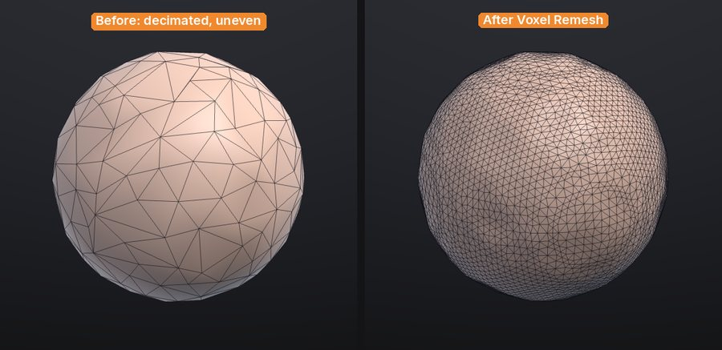

# Subdivide, remesh, decimate and LODs

These tools change the topology of the active SubTool: add resolution for detail, rebuild an even surface,
reduce the triangle count, or make a chain of levels of detail for a game engine. This chapter explains what each
one does to your mesh and its attributes, and when to use it.

All of them work on the **active SubTool** and, except the LOD preview, are undoable with
<kbd>Ctrl</kbd>+<kbd>Z</kbd>.

## At a glance

| Tool | Where | Triangles | Quads | Keeps sculpt layers | Keeps mask and polypaint | Keeps polygroups, hidden faces, UVs |
|---|---|---|---|---|---|---|
| Subdivide | **Tool > Geometry > Subdivide**, <kbd>Ctrl</kbd>+<kbd>D</kbd> | x4 per level | Each quad becomes four | Yes | Yes (interpolated) | Yes |
| Voxel Remesh | **Tool > Remesh > Voxel Remesh** | Set by resolution | All quads (new ones) | Baked in | Yes (transferred) | No (reset) |
| Decimate | **Tool > Geometry > Decimate** | Reduced | No, all triangles | Yes | Yes | Yes |
| LOD chain | **Tool > Export** | One level per ratio step | LOD0 keeps them; lower levels are triangles | Yes, on every level | Yes | Yes |

## Quads and triangles

SculptForge sculpts on triangles, but it remembers which pairs of triangles were one quad. A model you open
from ZBrush (GoZ), Blender or Maya (OBJ, FBX, PLY, USD) keeps its quads: **PolyF** draws them as quads, without
the diagonal, and OBJ, FBX, PLY, USD and GoZ exports write them back as quads, corner for corner. Polygons with
more than four sides are split into triangles. The new **Plane** and **Cube** are made of quads, and so is the
result of a voxel remesh.

Sculpting, masking, polypaint, sculpt layers, undo, SubTools and project files all keep the quads. Subdivide
turns every quad into four quads. Two things turn quads into triangles:

- **Decimate** (and the lower levels of a LOD chain) collapses edges, so its result is all triangles.
- When the two halves of a quad end up in different polygroups, or one half is deleted, they show and export as
  two triangles.

glTF (`.glb`) and STL only hold triangles, so those exports always write triangles.

> **ZBrush:** This keeps the quads you bring in; it doesn't make new ones from a triangle mesh. Quad retopology
> (ZRemesher) is on the roadmap.

## Subdivide

**Tool > Geometry > Subdivide** (<kbd>Ctrl</kbd>+<kbd>D</kbd>) smooths the mesh with Loop subdivision. Each level
multiplies the triangle count by four and rounds off the shape slightly, like ZBrush's Divide with Smt on.

- Sculpt layers are subdivided with the mesh, so blend shapes keep working.
- Mask, polypaint and UVs are interpolated; polygroups and hidden faces carry over.
- Each quad becomes four quads; triangles become four triangles.
- SculptForge refuses to subdivide past 50 million triangles.

> **Not yet:** multiresolution sculpting. Subdivide replaces the mesh with a denser one; there are no subdivision
> levels to step down to (ZBrush's SDiv, <kbd>D</kbd> / <kbd>Shift</kbd>+<kbd>D</kbd>) and no reconstruct. Use
> [undo](#undo-and-safety) or a duplicate SubTool to keep the lighter version. Multiresolution and dynamic topology
> are on the roadmap.

> **Tip:** The title strip shows the vertex and triangle counts of the whole scene. A few million triangles sculpt
> smoothly on a recent GPU; go up a level only when you need finer detail.

## Voxel remesh

**Tool > Remesh > Voxel Remesh** rebuilds the active SubTool as an even, watertight surface, like ZBrush's DynaMesh.
Use it to:

- fuse overlapping pieces into one surface (append a sphere, overlap it, merge, remesh);
- even out stretched triangles after heavy Move or Snake Hook work;
- clean up scans, splat conversions and AI-generated models before sculpting.

The **Resolution** slider next to the button sets how many voxels span the longest side of the model (64 to 400 in
the palette, default 200). Higher keeps more detail and makes more triangles.



What happens to your data:

- Sculpt layers are baked into the surface: the result has no layers.
- Mask and polypaint are transferred from the nearest original vertex.
- Polygroups, hidden faces and UVs are reset (everything becomes visible, one polygroup, no UVs). Hidden parts are
  remeshed too.
- Separate pieces that don't touch stay separate pieces; overlapping ones are merged.
- The new surface is made of even quads (the original's quads are rebuilt, not kept).

To remesh several SubTools into one, first combine them with **Merge visible...** or **Merge down...** in
[SubTools](subtools.md#merge-subtools).

> **ZBrush:** There is no Project option, Groups-aware remesh or Blur slider yet. Like DynaMesh, the remesh
> produces an even grid of quads, not flowing edge loops. For quad retopology (ZRemesher) see the roadmap: it is
> not available yet.

## Decimate

**Tool > Geometry > Decimate** reduces the triangle count while keeping the shape, using quadric edge collapse (the
same family of algorithm as ZBrush's Decimation Master). The **Keep** slider next to the button sets the fraction
of triangles to keep (0.05 to 0.95, default 0.50).

Decimation keeps open borders in place, and because it only removes vertices, every remaining vertex keeps its
exact sculpt layer offsets, mask and polypaint. Polygroups, hidden flags and UVs survive on the remaining
triangles. The result is all triangles: quads are not kept.

Use it to make a lighter version of a finished sculpt for export, 3D printing or a review, or to bring a dense
scan down to something you can work with.

> **Tip:** Decimate a duplicate SubTool (**Tool > SubTool > Duplicate**) when you want to keep the full-resolution
> sculpt in the same project.

## LOD chains

A level-of-detail chain is a series of lighter copies of the model for game engines: LOD0 is the full sculpt, and
each level after it has a fixed fraction of the triangles of the one before.

1. Open **Tool > Export**.
2. Set **LODs** (2 to 6 levels, including LOD0) and **Reduction** (the triangle ratio from one level to the next,
   0.1 to 0.9, default 0.50).
3. Click **Generate LOD chain**.


A table lists each level with its triangle count and its budget as a percentage of LOD0. Click a level to preview
it on the canvas (wireframe turns on and sculpting pauses); click **Sculpt** in the table to go back to the
editable mesh. The next stroke, or a change to **LODs** or **Reduction**, clears the chain; click
**Generate LOD chain** again to rebuild it.

Blend shapes ([sculpt layers](layers.md)) are kept on every level, so morph targets work at every LOD.

To write the chain to disk:

- **LOD chain (GLB per level)** in the same sub-palette, or **File > Export LOD Chain...**, writes one GLB per level
  named `<name>_LOD0.glb`, `<name>_LOD1.glb` and so on.
- **Send to Unreal** and **Export FBX for Unreal...** pack the LODs into one FBX for Unreal's automatic LOD import.

See [Exporting](exporting.md) for these exports and their options.

> **Note:** The preview in **Tool > Export** is of the active SubTool. The exports themselves build a chain for
> every visible SubTool.

## Undo and safety

Subdivide, remesh, decimate and delete hidden are single undo steps on the active SubTool. They can use a lot of
memory on dense meshes, and undo keeps a full copy of the previous mesh for each of them. Before a big change on a
heavy sculpt:

- **QuickSave** (title strip) keeps a timestamped copy of the scene without touching your project file; see
  [Projects](projects.md#quicksave).
- **Duplicate** the SubTool to keep the old version side by side.

## Scripting

| Command | Options |
|---|---|
| `subdivide` | `levels` 1-4 (default 1) |
| `remesh` | `resolution` 32-512 voxels across the longest side (default 200) |
| `decimate` | `ratio` 0.01-1 of the triangles to keep (default 0.5), or `triangles` for an exact target |
| `export_lods` | `path` (base name), `levels` 1-8 including LOD0 (default 4), `ratio` 0.1-0.9 (default 0.5) |

```sh
sculptforge-cli -c 'open path=scan.obj; remesh resolution=256; decimate triangles=200000; export_lods path=out/rock.glb levels=4 ratio=0.5'
```

The command line accepts a wider remesh range (32-512) than the palette slider.

## See also

- [SubTools](subtools.md): merge pieces before a remesh, duplicate before a decimate
- [Sculpt layers and blend shapes](layers.md)
- [Exporting](exporting.md): LOD chains, FBX for Unreal, Send to Unreal
- [Image and text to 3D](generate-3d.md): generated models are voxel-remeshed for sculpting
