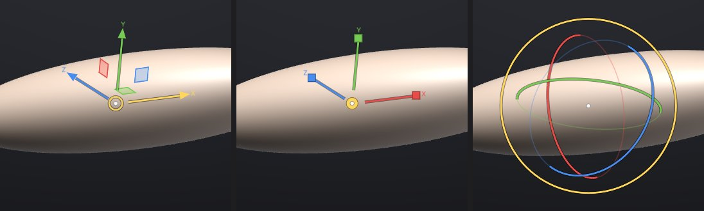
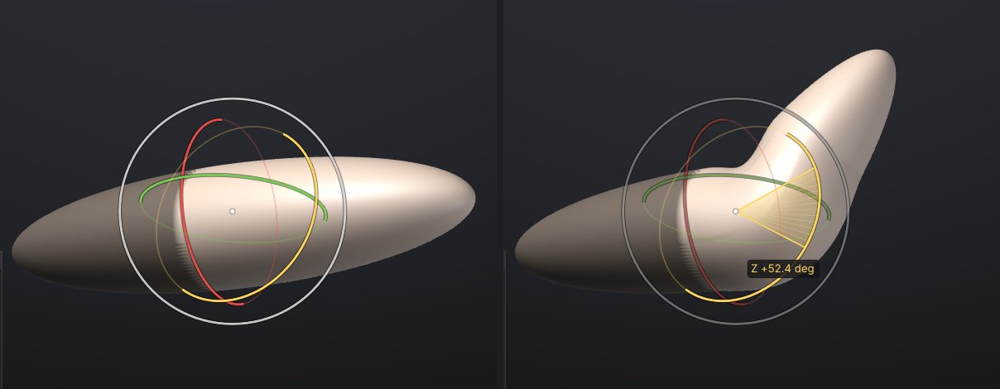

# Moving, rotating and posing (Gizmo 3D)

The Gizmo 3D moves, rotates and scales a whole SubTool, or only the part of it you haven't masked. Use it to
place parts (an eye in its socket, a sword in a hand), to fix proportions, and to pose: mask the body, put the
pivot at the shoulder and swing the arm. It works like ZBrush's Gizmo 3D, with the same keys.



## The three modes

Press a key, or click the button on the top shelf (they're also in the **Transform** palette):

| Key | Mode | What you drag |
|---|---|---|
| <kbd>W</kbd> | **Move** | An **arrow** moves along that axis. A **square** moves in its plane. The **ring in the centre** moves freely in the view plane |
| <kbd>E</kbd> | **Scale** | A **box** stretches along that axis. The **disc in the centre** scales evenly: drag right or up to grow, left or down to shrink |
| <kbd>R</kbd> | **Rotate** | A **ring** turns about that axis. The **outer white ring** turns about the view direction |
| <kbd>Q</kbd> | **Draw** | Back to sculpting: brushes work again and the gizmo goes away |

Pressing the same key again also goes back to Draw. X is red, Y green and Z blue; the handle under the cursor
turns yellow. While the gizmo is on, dragging anywhere off its handles still turns, pans and zooms the view, and
<kbd>Ctrl</kbd> still paints the mask, so you can mask and move without leaving the gizmo.

While you drag, the amount shows beside the gizmo (the distance, the angle or the percentage), and a rotation
draws the swept angle as a slice. Each drag is **one undo step** (<kbd>Ctrl</kbd>+<kbd>Z</kbd>), and the gizmo
goes back with it.

### Snapping

Hold <kbd>Shift</kbd> while dragging to snap:

- **Rotate**: 15 degree steps.
- **Move**: whole steps of the grid, a round number about a twentieth of the model's size (0.1, 0.2, 0.5, 1...).
- **Scale**: 10% steps.

You can press and release <kbd>Shift</kbd> during the drag.

## Moving only part of a SubTool

The gizmo respects the [mask](masking.md): masked parts stay where they are, partly masked parts move partly,
and hidden parts never move. To move only the head of a figure, mask everything else (or paint the mask on the
head and invert it with <kbd>Ctrl</kbd>+click on the background), then drag.

Turn **Mask** off in the Gizmo 3D panel to move the whole SubTool whatever the mask.

## Posing a limb

1. Mask what should stay: for an arm, everything but the arm (<kbd>Ctrl</kbd>+paint, or **MaskLasso**).
2. Press <kbd>R</kbd>. The gizmo jumps to the centre of the unmasked arm.
3. Put the pivot at the joint: hold <kbd>Alt</kbd> and click the model at the shoulder or elbow. (Or click
   **To Surface**, then click the model.)
4. Raise **Falloff** in the Gizmo 3D panel, for example to 15%. The turn then eases in over that distance from
   the mask's edge, so the joint bends smoothly instead of creasing along the mask line.
5. Drag a ring. Release, then drag again to refine; each drag is its own undo step.



Falloff only ever eases in on the unmasked side: the masked part stays exactly where it was. It is measured
along the surface, as a share of the SubTool's size, so it bends the same way on a rough model and on one with
millions of polygons.

### Symmetry

With **X**, **Y** or **Z** symmetry on (top shelf), a masked transform is mirrored: the unmasked part on the
other side of the symmetry plane takes the mirror image of the move, so both arms rise together. This needs a
mask and a pivot off the plane; a SubTool moved as a whole just moves.

## The pivot

The pivot is the point rotation and scaling turn about, and where the gizmo sits. It starts at the centre of what
will move (the SubTool, or its unmasked part) and follows it when you change the mask or pick another SubTool.

| To | Do this |
|---|---|
| Move the gizmo without moving the model | <kbd>Alt</kbd>+drag any Move handle |
| Turn the gizmo's axes without turning the model | <kbd>Alt</kbd>+drag a Rotate ring (the axes switch to **Surface**) |
| Put the pivot on the surface | <kbd>Alt</kbd>+click the model, or **To Surface** then click the model |
| Type the pivot | The three numbers under the mode buttons in the Gizmo 3D panel |
| Go back to the centre, with world axes | **Reset** |

After a drag the gizmo moves (and with **Surface** axes, turns) with what it moved.

### World or Surface axes

**World** keeps the gizmo's arrows and rings on the world's X, Y and Z. **Surface** lines them up with the
surface where you put the pivot (Y along the surface normal) and turns them with your rotations, which is handy
for sliding a part along itself, or for twisting a forearm about its own length.

## Typing exact values

The **Gizmo 3D** panel opens in the corner of the canvas while the gizmo is on. Under the options it has
**Move** (X, Y, Z), **Rotate** (degrees about X, then Y, then Z) and **Scale** (percent). Type the amounts and
click **Apply**: the model moves, turns and scales by them about the pivot, along the gizmo's axes, in one undo
step. **Clear** sets them back to 0 and 100%. The values stay after Apply, so clicking Apply again repeats the
step (rotate by 15 degrees, again, again).

## All SubTools

Turn on **All SubTools** in the panel to move every visible SubTool together (ZBrush's Transpose All), for
example to turn a whole character with its eyes, teeth and clothes. The pivot is the centre of all of them. Each
SubTool gets its own undo step: undo goes back in the active SubTool, and selecting another SubTool undoes its
part.

## What a transform keeps

A transform only changes where the vertices are. Polygroups, quads, UVs, polypaint, textures, the mask and
the topology stay as they are. [Sculpt layers](layers.md) move with the surface: the base and every layer's
offsets are transformed together, so a layer you sculpted on a forearm stays on it after posing, and layer
sliders keep working. With [subdivision levels](subdivision-levels.md) you can pose at a low level: the detail of
the higher levels, sculpt layers included, turns with it when you step back up. Projects save the result, and the gizmo's pivot and options too.

## Scripting

Every gizmo drag appears in the console as the `transform` command that repeats it, so **Copy session as
script** replays your posing. You can also type it, or use it in scripts and `sculptforge-cli`:

```
transform translate=0,0.5,0
transform rotate=0,0,45 pivot=1.2,0.4,0 falloff=0.15
transform scale=2 all=true
```

| Parameter | Meaning |
|---|---|
| `translate` | Movement x,y,z in world units |
| `rotate` | Degrees about X, then Y, then Z (of `orient`) |
| `scale` | One number, or x,y,z along the axes of `orient` (above 0) |
| `pivot` | `center` (default: the centre of what moves), `origin`, or x,y,z |
| `orient` | `world` (default), or the axes as x,y,z Euler degrees |
| `masked` | `true` (default) leaves masked parts; `false` moves everything |
| `falloff` | Soft joint width as a share of the size, 0-1 (default 0) |
| `symmetry` | Mirror a masked transform across these planes, e.g. `x` |
| `all` | Every visible SubTool (Transpose All) |

## Speed

The gizmo recomputes every frame from where the drag started, touching only the vertices that move, and sends
only the changed range to the graphics card. On a 1.3 million triangle model a drag frame takes about 2 ms to
transform plus about 7 ms to upload, and the release about 20 to 40 ms; undo is as fast.

## See also

- [Masking](masking.md)
- [SubTools](subtools.md)
- [Sculpt layers and blend shapes](layers.md)
- [Keyboard and mouse](shortcuts.md)
