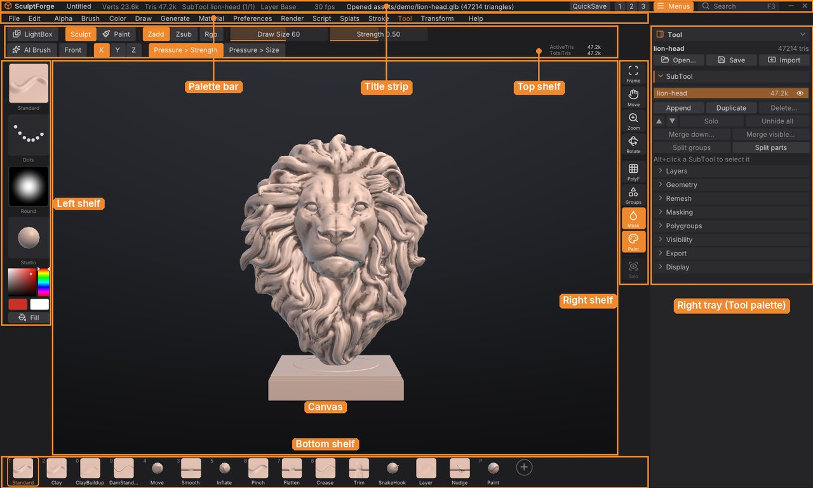

# SculptForge User Guide

This guide explains every part of SculptForge, the free, open-source sculpting app for VFX, animation and games:
how the interface is organised, how to sculpt, mask, paint and manage SubTools, how to generate models with AI,
and how to get your work into a game engine, a film pipeline or ZBrush. It is written for SculptForge
0.3.

You can read it inside SculptForge (**Help > User Guide**, or <kbd>Shift</kbd>+<kbd>F1</kbd>) or on the
[SculptForge website](https://islandmed.github.io/SculptForge/guide/). If you're coming from ZBrush, start with
[The interface](interface.md) and keep the [Glossary](glossary.md) at hand: most ZBrush habits work as they are.

## Getting started

1. [Welcome to SculptForge](welcome.md)
2. [Installing SculptForge](installing.md)
3. [The interface](interface.md)
4. [Navigating the view](navigation.md)

## Sculpting

5. [Sculpting and brushes](sculpting.md)
6. [Brush Lab and sharing brushes](brush-lab.md)
7. [Masking](masking.md)
8. [Polygroups and visibility](polygroups.md)
9. [SubTools](subtools.md)
10. [Polypaint and materials](polypaint.md)
11. [Sculpt layers and blend shapes](layers.md)
12. [Subdivide, remesh, decimate and LODs](geometry.md)

## AI and capture

13. [Image and text to 3D](generate-3d.md)
14. [Gaussian splats](splats.md)

## Files and pipelines

15. [Exporting, Unreal and ZBrush](exporting.md)
16. [Projects, autosave and QuickSave](projects.md)
17. [Scripting and automation](scripting.md)
18. [SculptForge for studios](studios.md)

## Reference

19. [Keyboard and mouse](shortcuts.md)
20. [Troubleshooting and FAQ](troubleshooting.md)
21. [Glossary](glossary.md)

## Getting help

- Hold <kbd>Ctrl</kbd> and point at any button for what it does, its shortcut and its script command.
- Press <kbd>F1</kbd> for every shortcut and mouse gesture, and <kbd>F3</kbd> to find any command by name.
- Ask questions and report problems on the
  [issue tracker](https://github.com/islandmed/SculptForge/issues) (**Help > Report a problem**).

SculptForge is free software under the GNU General Public License v3.0 or later. This guide is part of
SculptForge and is covered by the same licence.
