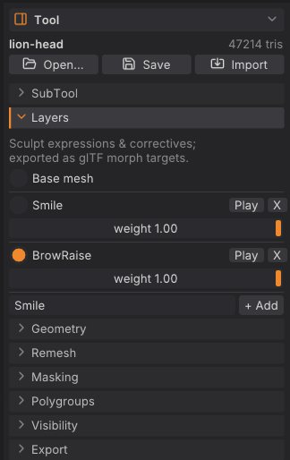

# Sculpt layers and blend shapes

Sculpt layers hold changes on top of the base mesh, each with its own weight: a smile, a blink, a corrective shape
or a variation you want to dial in and out. Because a layer is a set of per-vertex offsets, it exports straight
to game engines and DCC tools as a blend shape (morph target). This chapter covers creating, sculpting into,
weighting, playing and exporting layers.

## How layers work

- Each layer stores how far every vertex moves from the base. The shape you see is the base plus every layer
  times its weight.
- New strokes go into the **active** layer, or into the base mesh when **Base mesh** is selected.
- Layers belong to a [SubTool](subtools.md): each SubTool has its own list of layers.
- A weight of 0 turns a layer off, 1 shows it as sculpted. Scripts can also set negative weights or weights
  above 1 to exaggerate a shape.
- Layers survive [subdividing](geometry.md#subdivide), [decimating](geometry.md#decimate) and
  [LOD chains](geometry.md#lod-chains). A [voxel remesh](geometry.md#voxel-remesh) bakes them into the surface
  (the layers are gone afterwards).

> **Note:** Sculpt layers are not the **Layer** brush. The Layer brush raises the surface to a fixed height; sculpt
> layers are the blend-shape stack described here.

## The Layers sub-palette

Open **Tool > Layers** in the right tray.



From top to bottom:

- **Base mesh**: select it to sculpt the base shape.
- One block per layer: a radio button with the layer's name (select it to sculpt into that layer), **Play**, **X**
  (delete) and a **weight** slider from 0 to 1.
- A name field and **+ Add** at the bottom.

The title strip shows the active layer (`Layer Smile`, or `Layer Base`).

## Add a layer and sculpt into it

1. Type a name in the field at the bottom of **Tool > Layers**, for example `Smile` or `BlinkL`.
2. Click **+ Add** (or press <kbd>Enter</kbd> in the field). The new layer becomes the active one.
3. Sculpt. Every stroke goes into the layer until you select another layer or **Base mesh**.

A layer whose weight is 0 can't be sculpted into: SculptForge tells you to raise the weight first.

> **Tip:** Name layers the way your engine or rig expects (`jawOpen`, `BlinkL`): the names become the blend shape
> and morph target names in exported files.

## Adjust and preview weights

- Drag a layer's **weight** slider to blend it in and out.
- **Play** animates the layer from 0 to 1 and back, over and over, so you can judge the motion. Click **Stop** to
  end it; the weight returns to 1. Starting a stroke also stops playback.

Weights are saved with the project and used by exports that keep weights (USD writes the current weights).

## Delete a layer

Click **X** next to the layer. Its offsets are removed from the mesh and the base mesh becomes the active target.
Deleting a layer is undoable.

## Export blend shapes

| Format | What layers become |
|---|---|
| glTF / GLB (**File > Export GLB...**, <kbd>Ctrl</kbd>+<kbd>E</kbd>) | Morph targets |
| FBX | Blend shapes |
| USD / USDZ | UsdSkel blend shapes, with their current weights |
| Send to Unreal / Export FBX for Unreal | A skeletal mesh with morph targets |
| LOD chain | Blend shapes are kept on every LOD |
| Project (`.sfproj`) | Everything: layers, weights and the active layer |
| OBJ, PLY, STL | The current blended shape only |

Importing works the other way: glTF morph targets and FBX or USD blend shapes open as sculpt layers. See
[Exporting](exporting.md).

> **ZBrush:** Layers here are close to ZBrush's sculpt layers with the slider used as a morph. There is no
> record/eye toggle per layer, no layer folders and no per-layer mask yet.

## Scripting

| Command | What it does |
|---|---|
| `layer_add name=Smile` | Add a layer and make it active |
| `layer_set_active index=0` | Choose the layer strokes go into (`-1` = base mesh) |
| `layer_set_weight index=0 weight=0.5` | Set a layer's weight (negative or above 1 exaggerates) |
| `layer_remove index=0` | Delete a layer |

Layers are addressed by index, starting at 0 for the top layer.

```text
layer_add name=jawOpen; stroke points="0,-0.3,1 0,-0.5,1" brush=Inflate; export_glb path=head.glb
```

## See also

- [SubTools](subtools.md)
- [Subdivide, remesh, decimate and LODs](geometry.md)
- [Exporting](exporting.md): glTF morph targets, FBX blend shapes, Send to Unreal
