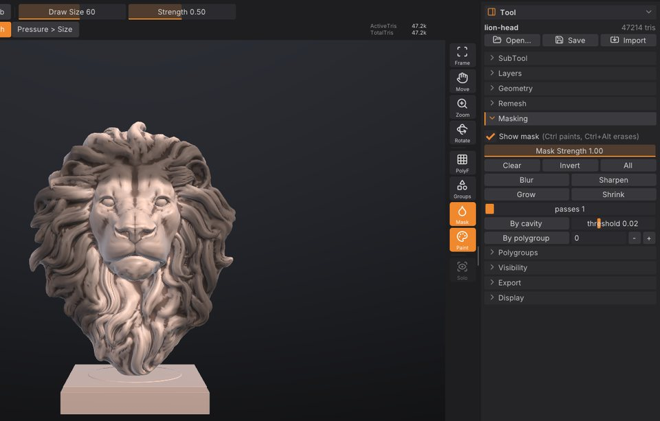

# Masking

A mask protects part of the model from change. Masked areas are drawn darker, and every brush, the Paint
brush and colour fills leave them alone. This chapter covers painting masks with <kbd>Ctrl</kbd>, the
background gestures, and the **Tool > Masking** controls for inverting, blurring, growing and building masks
from cavities or polygroups.



## How masks work

- A mask is a value per vertex from 0 (free) to 1 (fully masked). Values in between give partial protection,
  so a soft mask edge blends sculpting into the protected area.
- Masks belong to a SubTool: each SubTool has its own mask.
- Masks are saved in projects (`.sfproj`) and in `.GoZ` files, so they survive a round trip to ZBrush.
- Masking is not a layer and isn't affected by sculpt layers: a mask stroke always works on the model itself.
- Mask strokes and mask commands are undoable like any other change.

To see the mask, keep **Mask** on in the right shelf (it is on by default). The same toggle is **Show mask** in
**Tool > Masking**, and **Show Mask** in the **Render** palette. Turning it off hides the darkening; the mask
still protects the surface.

## Paint a mask

1. Hold <kbd>Ctrl</kbd> and drag on the model. The area under the brush becomes masked.
2. Hold <kbd>Ctrl</kbd>+<kbd>Alt</kbd> and drag to erase the mask.

Mask strokes use the current **Draw Size**, symmetry and, with a pen, pressure (when **Pressure > Strength**
is on). How much each stroke masks is set by **Mask Strength** in **Tool > Masking** (0.01 to 1, default 1):
lower values build up a soft, partial mask over several strokes. Mask strokes always use a round tip, whatever
alpha you have selected, and a **DragRect** stroke masks with dabs along the path instead of one stamp.

On macOS, <kbd>Cmd</kbd> works wherever this guide says <kbd>Ctrl</kbd>.

> **ZBrush:** this is ZBrush's Ctrl-masking with the MaskPen behaviour. Selecting a different masking brush
> (MaskLasso, MaskRect, MaskCurve) is not available yet.

## Background gestures

With <kbd>Ctrl</kbd> held, clicks and drags on the empty background act on the whole mask:

| Gesture | Effect |
|---|---|
| <kbd>Ctrl</kbd> + click the background | Invert the mask |
| <kbd>Ctrl</kbd> + drag on the background | Clear the mask |
| <kbd>Ctrl</kbd> + drag on the background, with nothing masked | Zoom the view |

A drag starts after the cursor moves a few pixels, so a slightly shaky click still inverts.

## The Masking sub-palette

Open **Tool > Masking** (the Tool palette is in the right tray by default). Every button is one undo step.

| Control | What it does | Command |
|---|---|---|
| **Show mask** | Darken masked areas in the viewport. | |
| **Mask Strength** | How much each mask stroke masks (0.01 to 1), and the mask value **By cavity** gives the deepest cavities. | |
| **Clear** | Unmask everything. | `mask_clear` |
| **Invert** | Masked becomes free and free becomes masked. | `mask_invert` |
| **All** | Mask every visible vertex. | `mask_all` |
| **Blur** | Soften the mask edges by averaging with neighbouring vertices. | `mask_blur` |
| **Sharpen** | Tighten soft edges, pushing values toward fully masked or free. | `mask_sharpen` |
| **Grow** | Expand the masked region by one ring of edges per pass. | `mask_grow` |
| **Shrink** | Contract the masked region by one ring of edges per pass. | `mask_shrink` |
| **passes** | How many times Blur, Sharpen, Grow and Shrink run (1 to 20 here, default 1). | `iterations=` |
| **By cavity** | Mask concave areas (creases, folds, pores), replacing the current mask. | `mask_by_cavity` |
| **threshold** | How concave a spot must be for **By cavity** (-0.2 to 0.5, default 0.02). 0 masks anything concave; higher values keep only deep creases. | `threshold=` |
| **By polygroup** | Mask one polygroup, replacing the current mask. The number field next to it is the polygroup id. | `mask_by_polygroup` |

Mask operations only change visible parts of the model; hidden parts keep their mask. **Clear** is the
exception and frees everything.

## Common tasks

### Protect detail while smoothing

1. Click **By cavity** to mask the creases and pores.
2. Smooth with <kbd>Shift</kbd>. The cavities keep their sharpness while the surface between them relaxes.
3. <kbd>Ctrl</kbd> + drag on the background to clear the mask when you're done.

Raise **threshold** if too much is masked; lower **Mask Strength** for partial protection.

### Sculpt one part only

1. Paint a mask over the part you want to work on with <kbd>Ctrl</kbd>.
2. <kbd>Ctrl</kbd> + click the background to invert it. Now everything *except* that part is protected.
3. Sculpt freely; strokes that cross the edge stop at the mask.

### Mask a whole polygroup

The quickest way works without knowing the group's number:

1. <kbd>Ctrl</kbd>+<kbd>Shift</kbd> + click the group to isolate it (see
   [Polygroups and visibility](polygroups.md)).
2. Click **All**: only visible vertices are masked.
3. <kbd>Ctrl</kbd>+<kbd>Shift</kbd> + click the background to show everything again. The mask stays.

**By polygroup** masks a group by its id. The viewport doesn't show ids, but the console does: isolate the
group, then open the console (<kbd>`</kbd>) and read the `isolate_polygroup group=N` line. Enter that number in
the field next to **By polygroup** and click it.

### A soft-edged mask

Paint the mask, then click **Blur** a few times (or set **passes** to 3-5 first). **Sharpen** does the
opposite.

### Turn a mask into a polygroup

Click **From mask** in **Tool > Polygroups**: the masked triangles become a new polygroup. See
[Polygroups and visibility](polygroups.md).

## Masks and painting

Polypaint respects the mask too: the Paint brush, **Rgb** strokes and **Fill** leave masked areas alone, so
you can mask an area and fill the rest with a colour. See [Polypaint and materials](polypaint.md).

## Masking from a script

| Command | Options |
|---|---|
| `mask_clear`, `mask_all`, `mask_invert` | |
| `mask_blur`, `mask_sharpen`, `mask_grow`, `mask_shrink` | `iterations` (1-100, default 1) |
| `mask_by_cavity` | `strength` (0-1, default 1), `threshold` (-1 to 1, default 0.02) |
| `mask_by_polygroup` | `group` (required), `add=true` to add to the current mask instead of replacing it |

```sh
sculptforge-cli -c 'open path=head.obj; mask_by_cavity threshold=0.05; mask_blur iterations=2; save_project path=head.sfproj'
```

> **Not yet:** masking by topology, by normals or by alpha, Mask By Smoothness, and lasso, rectangle or curve
> mask selections are not available yet.

## See also

- [Polygroups and visibility](polygroups.md): groups, isolating and hiding parts
- [Sculpting and brushes](sculpting.md): modifier keys and brush settings
- [Polypaint and materials](polypaint.md): fills that respect the mask
