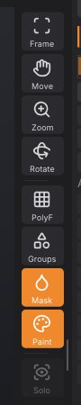

# Navigating the view

This chapter explains how to rotate, pan and zoom the camera with a mouse, a pen or the right-shelf buttons,
how to frame the model, and which display toggles help while you sculpt.

## How the camera works

The camera orbits around a target point. By default rotation is **free**, as in ZBrush: dragging turns the
model about the screen's own axes, so it follows the cursor and can roll right over the top. Hold
<kbd>Shift</kbd> while rotating to snap to the nearest front, back, side, top or bottom view; let go of
<kbd>Shift</kbd> and the drag carries on from where the cursor is. If you prefer the model to stay upright, as
in Blender or Maya, set **Preferences > Interface > Rotation** to **Turntable**: sideways drags then turn the
model around its vertical axis and up-down drags tilt it, stopping just short of looking straight down or up.

Panning moves the target; zooming moves the camera closer to it or further away. The view is a perspective
view with a 35 degree field of view.

Navigation starts only on the canvas. A drag that begins on a shelf, a tray or a palette never moves the
camera.

> **ZBrush:** the gestures are ZBrush's. Dragging on the background (or right-dragging) rotates, with
> <kbd>Shift</kbd> to snap; <kbd>Alt</kbd>+drag pans, and letting go of <kbd>Alt</kbd> while still dragging
> zooms; <kbd>Ctrl</kbd>+right-drag zooms and <kbd>Alt</kbd>+right-drag pans, as with ZBrush's right-click
> navigation. The right-shelf Move, Zoom and Rotate buttons work as in ZBrush.

## Mouse and pen

| To | Do this |
|---|---|
| Rotate | Left-drag on the background, or right-drag anywhere on the canvas; add <kbd>Shift</kbd> to snap to an axis view |
| Pan | <kbd>Alt</kbd>+left-drag on the background, <kbd>Alt</kbd>+right-drag, or middle-drag |
| Zoom | Mouse wheel; <kbd>Alt</kbd>+left-drag on the background, then let go of <kbd>Alt</kbd> and keep dragging; <kbd>Ctrl</kbd>+right-drag; <kbd>Ctrl</kbd>+middle-drag; or <kbd>Ctrl</kbd>+left-drag on the background |
| Frame the model | <kbd>F</kbd>, or **Frame** on the right shelf |

"Background" means any part of the canvas where the cursor isn't over the model. A left-drag that starts on
the model sculpts instead, so with a pen or a one-button mouse, start rotations beside the model. When the
model fills the view, zoom out a little or use the right-shelf buttons.

> **Note:** <kbd>Ctrl</kbd>+left-drag on the background clears the mask when something is masked (and
> <kbd>Ctrl</kbd>+click there inverts it); it zooms only while nothing is masked. Use the wheel or
> <kbd>Ctrl</kbd>+middle-drag to zoom on a masked model. See [Masking](masking.md).

On macOS, <kbd>Cmd</kbd> works wherever this guide says <kbd>Ctrl</kbd> for these gestures, except
<kbd>Ctrl</kbd>+middle-drag, which needs <kbd>Ctrl</kbd> itself.

## The right-shelf navigation buttons

The right shelf has three buttons you **drag on** rather than click, as in ZBrush. They are handy with a pen,
on a laptop trackpad, or when the model fills the canvas and there is no background to drag on.

| Button | Drag on it to |
|---|---|
| **Frame** | (click) Fit the whole scene in the view (<kbd>F</kbd>) |
| **Move** | Pan the view |
| **Zoom** | Zoom: drag up to come closer, down to move away |
| **Rotate** | Orbit the view |

The button stays orange while you drag. **Frame** is also in the **Render** and **Transform** palettes.

## Framing

**Frame** (<kbd>F</kbd>) points the camera at the centre of the scene and moves it back until everything fits:
every visible SubTool, plus the Gaussian splats when they are shown. SculptForge frames the scene for you when
you open a file or start from a new primitive. Use it after panning far away, or when a model comes in at an
unusual scale.

## Display toggles that help navigation

These live on the right shelf and in the **Render** palette:

- **PolyF** (<kbd>W</kbd> or <kbd>Shift</kbd>+<kbd>F</kbd>): shows the triangles of the active SubTool over
  the surface, ZBrush's PolyFrame. Useful for judging mesh density before you subdivide or remesh.
- **Groups**: colours each polygroup.
- **Mask**: darkens masked areas.
- **Paint**: shows polypaint colours (off shows the plain material).
- **Solo**: shows only the active SubTool, to get at parts hidden behind others.
- **Show Mesh** (Render palette): hides the sculpt, for example to look at a splat capture on its own.

**Fullscreen** (<kbd>F11</kbd>) and hiding the shelves (<kbd>Tab</kbd>) give the canvas the most room. See
[The interface](interface.md).

## Not yet

> **Not yet:** SculptForge has no orthographic view, no snapping to front, side or top views, no rotation
> around the point under the cursor (the camera always orbits its target, which Frame sets to the scene
> centre), no floor grid and no saved camera views. Pan the target onto the area you're working on to orbit
> around it.

## See also

- [The interface](interface.md)
- [Keyboard and mouse](shortcuts.md)
- [Sculpting and brushes](sculpting.md)
