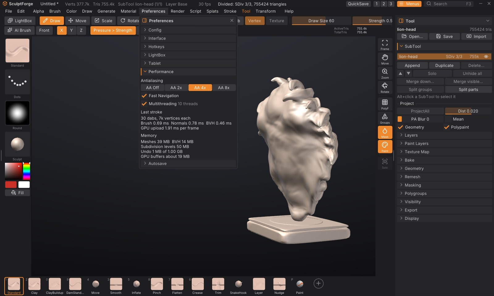

# Performance and big meshes

SculptForge is built to sculpt tens of millions of polygons. Brushes, normal updates and the picking structure
run on every core of your processor, a stroke sends the graphics card only the part of the mesh it changed, and
undo stores only the vertices a stroke touched, so it stays quick however big the model is. This chapter
explains what to expect, the settings in **Preferences > Performance**, and how to get the most out of a big
sculpt.

## What to expect

On a 2021 laptop (Apple M1 Pro, 10 cores, integrated GPU), with X symmetry on and a medium Draw Size:

| Mesh | One dab of a medium brush | Turning the view |
|---|---|---|
| 4 million triangles | about 2 ms | about 350 frames a second |
| 16 million triangles | about 4.5 ms | about 170 frames a second |
| 33 million triangles | about 7.5 ms | about 110 (4x antialiasing), 270 with Fast Navigation |

Turning the view stays smooth at 100 million triangles: about 50 frames a second with 4x antialiasing, 100 with
Fast Navigation. These figures are for closed models (no holes); see "Closed meshes draw faster" below.

A dab is one step of the brush along the stroke; the app draws several per frame when you move fast. Under
16 ms per dab a stroke keeps up with a 60 Hz display. Very large brushes cost more, since they move more
vertices: a brush covering a tenth of a 33 million triangle sphere (about a million vertices per dab with
symmetry) takes about 45 ms per dab with Standard, 21 ms with Smooth and 15 ms with Move, of which sending the
change to the graphics card is about a third.

[Performance figures](https://github.com/islandmed/SculptForge/blob/main/docs/performance.md) has the full
measurements, and how to run the same benchmark on your own machine.

## Preferences > Performance

Open **Preferences** and click **Performance**.

| Control | What it does |
|---|---|
| **Antialiasing** (Off, 2x, 4x, 8x) | How many samples per pixel the 3D view uses to smooth edges. 4x is the default. More samples look smoother and cost more on huge meshes. If the graphics card can't make room for them, the view quietly uses fewer and the panel says so |
| **Fast Navigation** | While you rotate, pan or zoom a scene of 10 million triangles or more, draw it without antialiasing and draw big meshes as a lighter version with about a fifth of their triangles, so the view keeps up. The full mesh, smooth again, is back as soon as the view stops. On by default |
| **Multithreading** | Run brushes, normal and picking updates and project saving on every core (the number of threads is shown beside it). The results are exactly the same with it off; turn it off only to compare speeds or rule it out when something goes wrong |
| **Last stroke** | What your last stroke cost per dab: **Brush** (finding and moving the vertices), **Normals** (shading), **BVH** (the structure that finds the surface under the cursor), and the **GPU upload** per frame |
| **Memory** | What the scene holds: the meshes, the BVHs, the subdivision levels kept for stepping between them, the undo history (up to 1 GB; the oldest steps are dropped beyond that) and, roughly, the graphics card's buffers |

Like the other preferences, these last until you quit; **Preferences > Config > Store Config** keeps them. Every
setting is also in the <kbd>F3</kbd> command palette (type "antialiasing", "fast navigation" or
"multithreading").

## Working with big meshes

- **Sculpt at the lowest level that holds the detail.** With [subdivision levels](subdivision-levels.md) you can
  shape the forms a few levels down and only go to the top for fine detail. Each level down is four times
  lighter.
- **Hide what you're not working on.** Hidden SubTools aren't drawn and hidden parts of a SubTool aren't
  sculpted (**Tool > Visibility**). A hidden SubTool costs no drawing time at all.
- **Memory.** A divided model takes about 85 bytes per triangle: about 37 for the sculpting mesh, 17 for its
  BVH and 29 for its subdivision levels. A 33 million triangle sculpt with levels needs about 3.4 GB of memory, a 100
  million one about 9 GB (and a little more while dividing). Opening a project needs only a little more than the
  model itself. A mesh without levels (an import, a remesh) takes about 60 bytes per triangle for the mesh. Project
  files over 4 GB are saved in the ZIP64 format.
- **How far Divide goes** depends on the memory: about 160 million triangles on a computer with 32 GB.
- **The graphics card.** A mesh needs about 15 bytes per triangle on the graphics card (polypaint and a mask add
  about 3; the wireframe, while it is on, about 4; the lighter version Fast Navigation draws, once you move
  the view, about 1.5). If a SubTool doesn't fit, SculptForge doesn't draw it and says so in the status bar
  instead of failing: hide other SubTools or step down a subdivision level.
- **Closed meshes draw faster.** Parts of a mesh that face away from you are skipped when the mesh is closed
  (no holes or hidden parts) and you look at it from outside. A mesh with holes, hidden polygons, or a view from
  inside it draws everything, which can take about twice as long on huge meshes.
- **Undo** keeps only what each stroke changed, so a stroke on a 33 million triangle mesh undoes in a few tens of
  milliseconds, and the history holds many such strokes within its 1 GB.

## Dynamic topology

[Dynamic topology](dynamic-topology.md) only works where the brush is, so its speed depends on how many
triangles the brush covers rather than on the size of the mesh: on an M1 Pro a medium dab takes 4 to 12
milliseconds on a one-million-triangle sphere. It gets slower when a big brush (or a low Detail) has to merge
many small triangles at once; it then spreads the work over several dabs. Undoing a stroke rebuilds the mesh's
connections, which takes about a tenth of a second per million triangles. `sculptforge --bench --bench-dyntopo`
measures it on your machine.

## Measuring your own machine

`sculptforge --bench` builds a sphere at 4, 16 and 32 million triangles and measures every brush, undo,
stepping subdivision levels, saving and opening a project, and turning the view, then prints a report.
`sculptforge-cli --bench` measures the same without the graphics card. Options:

| Option | What it does |
|---|---|
| `--bench-sizes 4,16,32` | The sizes, in millions of triangles |
| `--bench-dabs 40` | Dabs per test stroke |
| `--bench-brushes large` | Only the brushes whose name contains the text (here the large-radius ones) |
| `--bench-no-project` | Skip saving and opening the project (which needs twice the memory) |
| `--bench-view` | Measure only what the view costs: uploading to the graphics card, a few strokes, and turning the view |
| `--bench-out report.md` | Write the report to a file |

The `perf_info` command (also in the [Console](scripting.md)) prints the threads in use and the memory the
scene holds; `set_multithreading enabled=false` turns multithreading off from a script.

## See also

- [Subdivision levels](subdivision-levels.md)
- [Troubleshooting and FAQ](troubleshooting.md)
- [Glossary](glossary.md)
