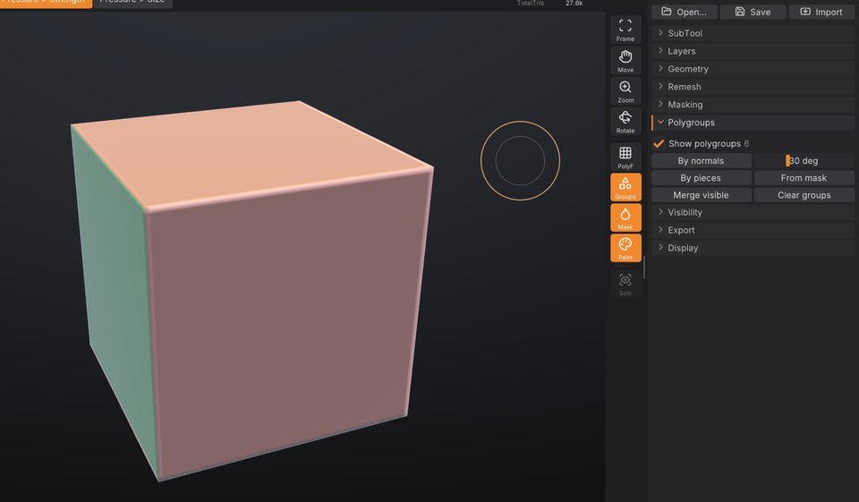

# Polygroups and visibility

Polygroups divide a SubTool's surface into named regions, shown as flat colours when you turn them on. You use
them to hide and isolate parts of a model so you can reach what you want to sculpt, to build masks, and to
split a model into SubTools. This chapter covers creating polygroups, the <kbd>Ctrl</kbd>+<kbd>Shift</kbd>
visibility gestures and the **Tool > Polygroups** and **Tool > Visibility** controls.



## Show polygroups

Click **Groups** in the right shelf to colour each polygroup of the active SubTool. The same toggle is
**Show polygroups** in **Tool > Polygroups** and **Show Polygroups** in the **Render** palette. The grouping
buttons turn the colours on for you, so you see the result straight away.

The number next to **Show polygroups** is how many polygroups are visible right now.

A mesh without polygroups is one group. Polygroups come from:

- the grouping buttons below;
- OBJ files: each `g` group becomes a polygroup, as ZBrush writes them (SculptForge also writes polygroups as
  `g` groups when it exports OBJ);
- `.GoZ` files from ZBrush and SculptForge projects, which keep polygroups.

## Create polygroups

Open **Tool > Polygroups**. Grouping works on the **visible** part of the SubTool only; hidden parts keep their
groups. So you can isolate one part and regroup just that part.

| Control | What it does | Command |
|---|---|---|
| **By normals** | A new group wherever the surface turns more than the angle next to it (1 to 90 degrees, default 30). Each flat side of a box becomes its own group. | `polygroup_auto_by_normals` |
| **By pieces** | One group per disconnected piece, such as separate eyes or buttons in one mesh. | `polygroup_by_connectivity` |
| **From mask** | Masked triangles move into a new group. | `polygroup_from_mask` |
| **Group by UVs** | One group per UV island: triangles that touch without a UV seam between them share a group. Needs UVs (**Tool > Texture Map > Auto UV** or an imported model's). | `polygroup_uv` |
| **Merge visible** | Everything visible becomes one group. | `polygroup_merge_visible` |
| **Clear groups** | Remove all polygroups; the whole SubTool becomes one group again. | `polygroup_clear` |

Each button is one undo step.

> **ZBrush:** **By normals** is Auto Groups / Groups By Normals, **By pieces** is Auto Groups on a mesh with
> separate parts, **From mask** is Group Masked, **Group by UVs** is UV Groups, and **Merge visible** is Group Visible.
> <kbd>Ctrl</kbd>+<kbd>W</kbd> works as in ZBrush: the masked part becomes a new group and the mask is cleared
> (with nothing masked, everything visible becomes one group).

### Group a region you painted

1. Paint a mask over the region with <kbd>Ctrl</kbd> (see [Masking](masking.md)).
2. Click **From mask** in **Tool > Polygroups**.
3. <kbd>Ctrl</kbd> + drag on the background to clear the mask.

## Hide and show parts

Visibility is the main reason to have polygroups: hide what is in the way, sculpt what's left, then show
everything again. Hidden parts can't be sculpted, painted or masked, so hiding also protects them.

All of the gestures use <kbd>Ctrl</kbd>+<kbd>Shift</kbd> in the viewport (<kbd>Cmd</kbd>+<kbd>Shift</kbd> on
macOS):

| Gesture | Effect |
|---|---|
| <kbd>Ctrl</kbd>+<kbd>Shift</kbd> + click a polygroup, everything shown | Isolate it: show only that group. |
| <kbd>Ctrl</kbd>+<kbd>Shift</kbd> + click a polygroup, something hidden | Hide that group (as in ZBrush). |
| <kbd>Ctrl</kbd>+<kbd>Shift</kbd> + click the isolated group again | Invert the visibility: show everything else instead. |
| <kbd>Ctrl</kbd>+<kbd>Shift</kbd>+<kbd>Alt</kbd> + click a polygroup | Hide that group. |
| <kbd>Ctrl</kbd>+<kbd>Shift</kbd> + click the background | Show everything. |
| <kbd>Ctrl</kbd>+<kbd>Shift</kbd> + drag a rectangle on the background, around nothing | Reverse the visibility. |
| <kbd>Ctrl</kbd>+<kbd>Shift</kbd> + drag | Keep what's inside the rectangle (or lasso), hide the rest. The shape is drawn green. |
| <kbd>Ctrl</kbd>+<kbd>Shift</kbd>+<kbd>Alt</kbd> + drag | Hide what's inside the rectangle (or lasso). The shape is drawn red. |

Whether a drag draws a rectangle or a lasso is set by **SelectRect** and **SelectLasso** at the top of
**Tool > Visibility** (SelectRect by default), or, as in ZBrush, with <kbd>Ctrl</kbd>+<kbd>Shift</kbd> held: the
left shelf then shows the selection brush, and clicking the brush tile (or pressing <kbd>B</kbd>) or the stroke tile
picks **SelectRect** or **SelectLasso**. With **SelectLasso**, the drag traces a free-hand outline that
closes back to where you started; drag around a part as if you were drawing round it with a pen. The drag can
start on the model or on the background.

Both shapes work in screen space: a triangle counts as inside when its centre falls inside the shape as you see
it, including triangles on the far side of the model. A lasso that crosses itself leaves out the areas it
encloses twice. You can press or release <kbd>Alt</kbd> while dragging; what counts is whether it is held when
you let go.

SculptForge refuses a change that would hide everything, as ZBrush does. Every visibility change is one undo
step, so <kbd>Ctrl</kbd>+<kbd>Z</kbd> brings back what you just hid.

> **ZBrush:** the gestures are the same as ZBrush's SelectRect and SelectLasso with polygroups. Grow and
> Shrink visibility and hiding by clicking with the rectangle brush are not available yet.

### The Visibility sub-palette

Open **Tool > Visibility**:

| Control | What it does | Command |
|---|---|---|
| **SelectRect** / **SelectLasso** | The shape <kbd>Ctrl</kbd>+<kbd>Shift</kbd> + drag draws: a rectangle or a free-hand lasso. | `hide_rect` / `hide_lasso` |
| **Show all** | Show every hidden part again. Available when something is hidden. | `show_all` |
| **Invert visible** | Hide what is visible and show what is hidden. | `invert_visibility` |
| **Delete hidden** | Permanently remove the hidden triangles from the mesh. Undoable. | `delete_hidden` |

**Delete hidden** keeps every attribute of what remains (mask, polypaint, polygroups, UVs and sculpt layers).
Use it to cut away parts of a scan or a generated model, or to remove the inside of a mesh after you isolated
the outside.

## Typical workflows

### Work on one part of a character

1. Click **By pieces** (for a mesh made of separate parts) or **By normals**.
2. <kbd>Ctrl</kbd>+<kbd>Shift</kbd> + click the part you want, for example the head.
3. Sculpt. The rest of the body is hidden and can't be touched.
4. <kbd>Ctrl</kbd>+<kbd>Shift</kbd> + click the background to show everything.

### Clean up a scan or a generated model

1. Turn the model so the unwanted piece is on screen.
2. <kbd>Ctrl</kbd>+<kbd>Shift</kbd>+<kbd>Alt</kbd> + drag a rectangle over it to hide it. For an awkward shape,
   pick **SelectLasso** in **Tool > Visibility** first and draw around it.
3. Click **Delete hidden** in **Tool > Visibility**.

### Split a model into SubTools

Group the model, then click **Split groups** in **Tool > SubTool**: each polygroup becomes its own SubTool.
**Split parts** does the same by disconnected piece. See [SubTools](subtools.md).

## Polygroups and other tools

- **Masking**: **By polygroup** in **Tool > Masking** masks one group (see [Masking](masking.md)).
- **Brushes and polypaint** skip hidden faces.
- **Projects** save polygroups and what's hidden; **GoZ** and **OBJ** carry polygroups to and from ZBrush.
- Each SubTool has its own polygroups and visibility. To show and hide whole SubTools, use the eye icons and
  **Solo** in **Tool > SubTool**.

## Polygroups from a script

| Command | Options |
|---|---|
| `polygroup_auto_by_normals` | `angle` (1-180 degrees, default 30) |
| `polygroup_by_connectivity`, `polygroup_uv`, `polygroup_from_mask`, `polygroup_merge_visible`, `polygroup_clear` | |
| `isolate_polygroup`, `hide_polygroup` | `group` (required): the polygroup id |
| `show_all`, `invert_visibility`, `delete_hidden` | |
| `hide_rect` | `x0 y0 x1 y1` (-1 to 1, y up), `inside`, optional `view_proj` matrix; without a view the rectangle spans the mesh seen from the front |
| `hide_lasso` | `points` (required): the outline as `"x0 y0 x1 y1 ..."`, at least 3 points in the same -1 to 1 space; `inside`, `view_proj` as for `hide_rect` |

When you isolate or hide a group in the viewport, the console (<kbd>`</kbd>) shows the command with the group's
id, for example `isolate_polygroup group=3`, which you can reuse in scripts.

```sh
sculptforge-cli -c 'open path=robot.obj; polygroup_by_connectivity; subtool_split_groups; save_project path=robot.sfproj'
```

> **Not yet:** a polygroup paint brush, Group Front, polygroups from UV islands or PolyPaint, and
> polygroup-based crease edges are not available yet.

## See also

- [Masking](masking.md): build masks from polygroups and polygroups from masks
- [SubTools](subtools.md): split by groups, show, hide and solo whole SubTools
- [Keyboard and mouse reference](shortcuts.md)
