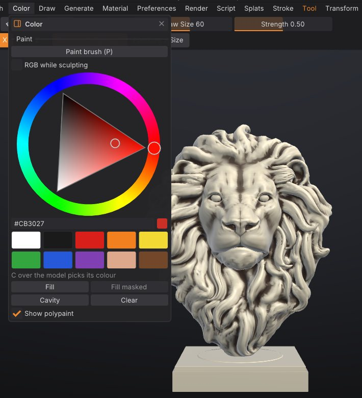
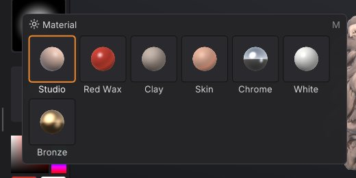

# Polypaint and materials

Polypaint stores a colour on every vertex of the mesh, so you can paint a sculpt without UVs or textures, as in
ZBrush. This chapter covers the Paint brush, painting while you sculpt, fills and cavity paint, picking colours,
paint layers with blend modes, and the MatCap materials that change how the model is shaded in the viewport.

## How polypaint works

- Colour is stored per vertex. The detail you can paint is limited by how dense the mesh is: on a light mesh,
  colour edges look soft. [Subdivide](geometry.md#subdivide) or [remesh](geometry.md#voxel-remesh) at a higher
  resolution before fine painting.
- Painting respects the [mask](masking.md) (masked areas keep their colour) and skips
  [hidden faces](polygroups.md).
- Symmetry works for painting as it does for sculpting.
- Polypaint is per SubTool and is saved in projects. It is exported as vertex colours to PLY, glTF/GLB, OBJ, USD
  (`displayColor`) and GoZ. FBX export doesn't include it.
- A mesh starts without polypaint. The first paint stroke or fill adds it (white everywhere you haven't painted).

> **Texture painting:** to paint finer than the mesh, give the SubTool a texture and paint into it instead; the
> Paint brush, fills and paint layers work the same way. **Polypaint > Texture** bakes polypaint into a texture.
> See [Texture painting](texture-painting.md).

## Paint with the Paint brush

1. Press <kbd>P</kbd>, click **Paint** on the top shelf, or pick **Paint** on the bottom shelf.
2. Choose a colour (see below).
3. Stroke over the model. Draw Size, Strength, the stroke type and the alpha work as they do for sculpting.

While the Paint brush is active:

- <kbd>Alt</kbd> paints back towards white.
- <kbd>Shift</kbd> still smooths the shape, as in ZBrush.
- The surface isn't changed.

Press <kbd>P</kbd> again, or click **Sculpt** on the top shelf, to go back to sculpting.



> **ZBrush:** **Paint** is ZBrush's Rgb on with Zadd off. **Sculpt** with **Rgb** on is Rgb with Zadd: the brush
> sculpts and paints at once.

## Paint while sculpting

Turn on **Rgb** on the top shelf (or **RGB while sculpting** in the Color palette). Every sculpt brush then also
paints the current colour along its stroke. The Smooth brush and <kbd>Shift</kbd>-smoothing never paint.

## Choose a colour

- The **left shelf** has a colour picker (a square plus a hue strip), two swatches and a **Fill** button. Clicking
  the second swatch swaps it with the main colour, like ZBrush's Alternate.
- The **Color** palette has a larger hue wheel with a hex value, ten preset swatches (white, near black, red,
  orange, yellow, green, blue, purple, skin and brown) and the fill buttons.
- Press <kbd>C</kbd> with the cursor over the model to pick the colour under it (the mesh needs polypaint for this,
  or a texture while painting into the texture).

## Fill, cavity paint and clear

The Color palette has four buttons:

| Button | What it does |
|---|---|
| **Fill** | Fills the unmasked area with the colour (the whole mesh when nothing is masked). Same as **Fill** on the left shelf |
| **Fill masked** | Fills only the masked area. Available when the mesh has a mask |
| **Cavity** | Darkens the creases and cavities with a dark brown, respecting the mask. A quick way to bring out detail |
| **Clear** | Removes all polypaint from the active SubTool |

All of them are undoable. **Show polypaint** in the same palette (or **Paint** on the right shelf) turns the colours
off in the viewport without deleting them.

> **Tip:** To paint a base colour and then dirt in the creases: **Fill** with the base colour, then **Cavity**. For
> a different cavity colour or strength, use the command (below).

## Paint layers

Paint layers stack polypaint the way Photoshop stacks image layers. Each layer has its own name, visibility,
opacity and **blend mode**, so you can paint dirt on a Multiply layer, glow on a Screen layer or tint on an
Overlay layer, then change or hide it later without repainting the rest. Every SubTool has its own stack.


### How paint layers work

- **Base** is the bottom layer: the SubTool's polypaint, always opaque. With only Base, polypaint works exactly as
  it did before, and nothing changes in your files.
- Layers above Base start transparent. Painting on a layer adds colour **and coverage**: where you haven't
  painted, the layer is see-through. Painting never touches the layers you aren't on.
- What you see, and what every export writes, is the stack composited from Base up: each visible layer blends
  its colour over the result below with its blend mode, scaled by its coverage and opacity.
- Blending happens on display colours, like Photoshop, so the modes behave as Photoshop users expect: 50% grey
  on an Overlay or Soft Light layer changes nothing, white on Multiply changes nothing, black on Screen changes
  nothing.
- The Paint brush, **Rgb** while sculpting, **Fill**, **Fill masked** and **Cavity** all write into the
  **active** layer (highlighted in the list; the Color palette shows "Painting on: ..."). They respect the mask and
  hidden faces on every layer.
- With the Paint brush on a layer, <kbd>Alt</kbd> **erases** the layer's paint (on Base it paints back towards
  white, as before).
- A hidden or locked layer can't be painted, filled or cleared; the status line says why.

### Blend modes

| Mode | Effect |
|---|---|
| Normal | The layer's colour covers what is below |
| Multiply | Darkens: dirt, shadows, cavity grime. White does nothing |
| Screen | Lightens: highlights, glow, dust. Black does nothing |
| Overlay | Adds contrast and tints the midtones. 50% grey does nothing |
| Soft Light | A gentler Overlay, good for skin tints and colour variation |
| Add | Adds the colours (Photoshop's Linear Dodge); strong highlights |
| Subtract | Subtracts the layer's colour |
| Darken / Lighten | Keeps the darker / lighter colour, channel by channel |
| Difference | The difference between the colours; useful for checking two paint passes against each other |

### The Paint Layers sub-palette

Open **Tool > Paint Layers** in the right tray (it sits under the sculpt **Layers** sub-palette). The list shows
the layers top first, with Base at the bottom, like Photoshop's Layers panel. Each row has the name, the blend mode
and opacity, a lock and an eye.

- **Click** a row to paint on that layer. **Double-click** it to rename. **Right-click** for Rename, Duplicate,
  Merge down, Clear and Delete.
- The **eye** shows or hides the layer; the **lock** protects it from painting, fills, clears and merges.
- Under the list: the active layer's **blend mode** and **Opacity** slider. The opacity previews live while you
  drag and is one undo step when you let go.
- **New** adds a transparent layer above the active one. **Duplicate** copies the active layer (Base becomes an
  opaque layer). **Delete** removes the active layer.
- The arrows move the active layer up or down. **Merge down** merges it into the layer below (into Base for the
  lowest layer). **Flatten** bakes every visible layer into Base and removes the layers; hidden layers are
  discarded.
- **Clear layer** makes the active layer transparent again (Base: white). **Fill layer** fills it with the current
  colour, like **Fill** in the Color palette.

Hold <kbd>Ctrl</kbd> over any control for its description. Every action is undoable with <kbd>Ctrl</kbd>+<kbd>Z</kbd>.

> **Tip:** Merging onto Base, and merging a layer onto a Normal layer it fully covers, keeps the look exactly.
> Merging a Multiply, Overlay or other blended layer onto a partly transparent layer can't always match, so the
> result takes the lower layer's blend mode, as in Photoshop.

### Paint layers and sculpt layers

They are separate stacks. **Tool > Layers** holds sculpt layers: shape changes exported as blend shapes. **Tool >
Paint Layers** holds colour. Selecting a sculpt layer doesn't change the paint layer you paint on, and the other
way round, so a stroke with **Rgb** on can sculpt into the "Smile" layer and paint into the "Blush" layer at once.

### Files, SubTools and geometry

- Paint layers are saved in projects (`.sfproj`) with their names, blend modes, opacity, visibility, lock and the
  active layer. Older versions of SculptForge open these projects with the paint flattened.
- Exports (OBJ, PLY, glTF/GLB, USD, GoZ) write the composited colours, exactly what the viewport shows.
- [Duplicating](subtools.md) a SubTool copies its layers, and [Split](subtools.md#split-a-subtool) keeps them on each piece.
  [Subdividing](geometry.md#subdivide) and [decimating](geometry.md#decimate) keep them too.
- [Merging](subtools.md#merge-subtools) SubTools, a [voxel remesh](geometry.md#voxel-remesh) and other rebuilds keep the look but
  flatten the layers into Base.

> **ZBrush and Mudbox:** ZBrush's polypaint layers only have opacity. Here every layer also has a blend mode, its
> own coverage and a lock, like the paint layers in Mudbox and Photoshop.

## Materials (MatCaps)

Materials change only how the model is shaded in the viewport. They aren't exported and don't change polypaint.

| Material | Look |
|---|---|
| Sculpt | The default, made for sculpting: neutral warm clay under a strong key light from the upper left, a crisp highlight and deep cavity shading, so small strokes and undulations stay readable |
| Red Wax | Glossy deep red wax, the classic sculpting look |
| Clay | Matte grey-brown clay |
| Skin | Warm, soft skin tones |
| Chrome | Mirror-like metal, good for checking surface flow |
| White | Neutral off-white for judging forms |
| Bronze | Polished bronze |
| Studio | Softer clay shading with studio lighting (the default in earlier versions). Its colour is **Base colour** in the Material palette |

To choose one:

- Press <kbd>M</kbd> for the material picker under the cursor, or click the **Material** tile on the left shelf.
  Point at a material to preview it on the model, click to keep it. <kbd>Esc</kbd> or clicking away puts the
  previous material back.
- Open the **Material** palette, or the **Material** tab of the LightBox.



Polypaint multiplies the material, and cavity shading stays on with every material (strongest with Sculpt). The
material is saved with the project: projects saved with Studio open with Studio.

> **Tip:** **Sculpt** is the material to judge strokes with. The prettier ones (Skin, Red Wax) soften small
> detail; switch to them for presenting.

> **Not yet:** loading your own MatCap images, and physically based materials or BPR-style renders.

## Scripting

| Command | What it does |
|---|---|
| `set_color color=#c08060` | Set the paint colour: `rrggbb`, `#rrggbb` (quote it in scripts), `r,g,b` or a name such as `white`, `skin`, `bone` |
| `paint_fill area=unmasked` | Fill; `area` is `unmasked` (default), `masked` or `all`; `strength` 0-1 |
| `paint_from_cavity color=#202020 strength=0.7 smoothing=2` | Cavity paint (defaults: dark brown, 0.7, 2 blur passes) |
| `paint_clear` | Remove all polypaint, paint layers included |
| `paint_layer_add name=Dirt blend=multiply opacity=0.8` | Add a paint layer above the active one and paint on it |
| `paint_layer_set index=0 opacity=0.5 blend=overlay visible=false locked=true name=Grime` | Change a layer (`layer=Dirt` picks it by name; default: the active layer) |
| `paint_layer_select layer=Base` | Paint on another layer (`index=-1` is Base, 0 the first layer above it) |
| `paint_layer_duplicate`, `paint_layer_delete`, `paint_layer_clear` | Copy, delete or clear the active (or given) layer |
| `paint_layer_move direction=up` | Move a layer up or down the stack |
| `paint_layer_merge` / `paint_layer_flatten` | Merge down / bake every visible layer into Base |
| `paint_layer_list` | List the layers, top first (`*` marks the active one) |
| `set_material name=Chrome` | Viewport material: a MatCap name (`Sculpt` is the default) or `studio` (desktop app only) |

```text
set_color color="#d9b38c"; paint_fill; paint_from_cavity strength=0.5
paint_layer_add name=Dirt blend=multiply opacity=0.8; paint_from_cavity color=4a2c18 strength=0.9
```

## See also

- [Masking](masking.md): protect areas from painting
- [Sculpt layers and blend shapes](layers.md): the shape counterpart of paint layers
- [Sculpting and brushes](sculpting.md): Draw Size, Strength, strokes and alphas also apply to painting
- [Exporting](exporting.md): which formats carry vertex colours
