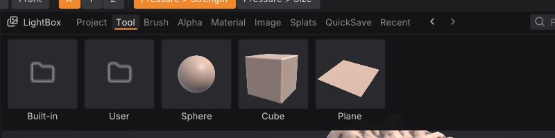

# Projects, autosave and QuickSave

A SculptForge project (`.sfproj`) saves your whole scene in one file, so you can close the app and carry on exactly
where you stopped. This chapter covers saving and opening projects, the unsaved-changes prompt, recent files,
autosave and crash recovery, QuickSave, and the LightBox tabs that show your work.

## What a project keeps

A `.sfproj` file holds everything SculptForge knows about the scene:

- every [SubTool](subtools.md), with its name, visibility, mesh, mask, polypaint, polygroups, hidden faces and UVs;
- every [sculpt layer](layers.md) with its weight, and the active layer of each SubTool;
- each SubTool's [QRemesh Guides](retopology.md#qremesh-guides), the curves QRemesh's edge loops follow;
- loaded [Gaussian splats](splats.md) and their placement;
- your custom brushes, so a project opened on another computer still has them;
- the camera, the material and display settings, the brush, Draw Size, Z Intensity (and Smooth's), RGB Intensity, Focal Shift, paint colour and symmetry;
- a thumbnail, shown in the LightBox.

Undo history isn't saved: an opened project starts with a clean history.

Model formats such as OBJ, GLB or FBX can't hold all of this (masks, hidden faces, splats, brushes), so writing
them is an export, not a save. See [Exporting](exporting.md).

> **ZBrush:** A `.sfproj` is the equivalent of a ZBrush project (`.ZPR`), and saving a single SubTool scene is close
> to saving a `.ZTL`. SculptForge can't read `.ZPR` files, and opens a `.ZTL` only after
> the [ZTool Export plug-in](coming-from-zbrush.md#bring-your-ztools-over) converted it in ZBrush; otherwise bring
> models over with [GoZ](exporting.md) or as OBJ, FBX or GLB.

## Save a project

- **File > Save** (<kbd>Ctrl</kbd>+<kbd>S</kbd>) saves to the current project. The first time, it asks for a file
  name.
- **File > Save As...** (<kbd>Ctrl</kbd>+<kbd>Shift</kbd>+<kbd>S</kbd>) saves under a new name.
- Clicking the document name in the title strip also saves.

The title strip shows the document name with `*` after it while there are unsaved changes, and the window title
starts with `*`. Any edit in any SubTool counts, as do splat edits and layer weight changes.

If you opened a model file (an OBJ, say) rather than a project, **Save** asks where to save a new `.sfproj`; the
original model file is left alone.

## Open a project or model

- **File > Open...** (<kbd>Ctrl</kbd>+<kbd>O</kbd>) opens a project, a model or a splat capture. Opening a project
  or model replaces the scene.
- **File > Open Recent** lists the last 10 files you opened or saved. Files that no longer exist are dropped from
  the list. **Clear Recent** empties it.
- Drop a file onto the window to open it.
- In the [LightBox](interface.md), double-click a project or model.

**File > New Sphere** (<kbd>Ctrl</kbd>+<kbd>N</kbd>) and **File > New Plane** start a fresh scene.

When you open a project, its saved camera, material and brush settings come back too.

## The unsaved-changes prompt

When the scene has unsaved changes, **New Sphere**, **New Plane**, **Open...**, **Open Recent**, dropping a model or
project, **Quit** (<kbd>Ctrl</kbd>+<kbd>Q</kbd>) and closing the window first ask:

- **Save** saves the project (asking for a name if it has none), then carries on;
- **Don't Save** discards the changes and carries on;
- **Cancel** goes back to your work.

Dropping an image or a `.sfbrush` file never asks, because it doesn't replace the scene.

## Autosave and crash recovery

While the scene has unsaved changes, SculptForge writes a recovery copy every few minutes (every 5 minutes by
default; it waits until you finish a stroke). Change the interval, or turn it off with 0, in
**Preferences > Autosave** or with the **Autosave (min)** slider in the File palette (0 to 60 minutes).

The recovery copy is `autosave.sfproj` in the SculptForge settings folder (see
[Troubleshooting](troubleshooting.md) for where that is on your system). It is deleted once your work is saved or
you discard the changes.

If SculptForge didn't close normally (a crash or power cut), the next start asks **Restore Autosave?**:

- **Restore** opens the autosaved scene as an untitled, unsaved document. Save it to keep it.
- **Discard** deletes the recovery copy.

The autosave also appears first in the LightBox **QuickSave** tab while it exists.

> **Note:** Autosave is a safety net, not a substitute for saving. It keeps only the latest copy and is removed as
> soon as you save.

## QuickSave

**QuickSave** in the title strip saves a timestamped copy of the whole scene, like ZBrush's QuickSave. Your project
file, its name and its unsaved state are not changed, so QuickSave is safe to press before any risky step.

- Copies go to the `QuickSave` folder of your library (by default `Documents/SculptForge/QuickSave`), named like
  `QuickSave 2026-10-21 23-15-04.sfproj`.
- The last 10 QuickSaves are kept; older ones are deleted.
- They appear in the LightBox **QuickSave** tab, newest first, labelled with their date and time. Double-click one
  to open it. The tab also has a **Save now** button.

QuickSave has no default shortcut. To give it one, hold <kbd>Ctrl</kbd>+<kbd>Alt</kbd>, click the **QuickSave**
button and press a key (see [The interface](interface.md)).

## Your library folder and the LightBox

SculptForge keeps a library folder for your work, by default `SculptForge` in your Documents folder. It is created
on first use with these sub-folders:

| Folder | LightBox tab | What goes there |
|---|---|---|
| `Projects` | Project | Your `.sfproj` files |
| `Tools` | Tool | Models to open or append as SubTools |
| `Brushes` | Brush | `.sfbrush` files |
| `Alphas` | Alpha | Grayscale images for brush alphas |
| `Images` | Image | Sketches and concept art for Generate 3D |
| `Splats` | Splats | Gaussian splat captures |
| `QuickSave` | QuickSave | QuickSave copies |

Change it in **Preferences > LightBox > Library folder**, then Store Config (<kbd>Ctrl</kbd>+<kbd>Shift</kbd>+<kbd>I</kbd>)
to keep the setting.

Press <kbd>,</kbd> (comma) to show the LightBox. The tabs that matter for projects:

- **Project**: the projects in your `Projects` folder, plus any recent project saved elsewhere. Each shows the
  thumbnail saved with it.
- **QuickSave**: the autosave (when there is one) and your QuickSaves, newest first.
- **Recent**: everything in **Open Recent**, of every kind.

Double-click a tile to open it (you are asked about unsaved changes first). In the **Tool** tab,
<kbd>Shift</kbd>+double-click a model to append it as a SubTool instead.

## Scripting

| Command | What it does |
|---|---|
| `save_project path=work/dragon.sfproj` | Save the project (without `path`, to the current project) |
| `open_project path=work/dragon.sfproj` | Open a project (`open` also recognises `.sfproj`) |
| `open path=scan.obj` | Open a model, splat capture or project |
| `new_sphere subdivisions=6` / `new_plane resolution=128` | Start a new scene |

Projects saved by `sculptforge-cli` or Python open in the app too. For the file layout, see
[docs/project-format.md](https://github.com/islandmed/SculptForge/blob/main/docs/project-format.md).

## See also

- [The interface](interface.md): LightBox, shortcuts and Store Config
- [SubTools](subtools.md)
- [Exporting](exporting.md): formats for other applications
- [Troubleshooting](troubleshooting.md): where settings and the autosave live
