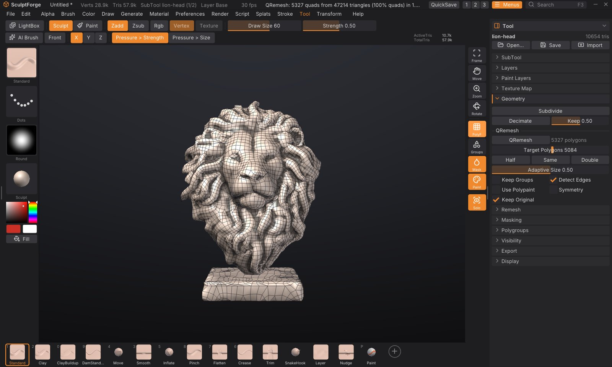
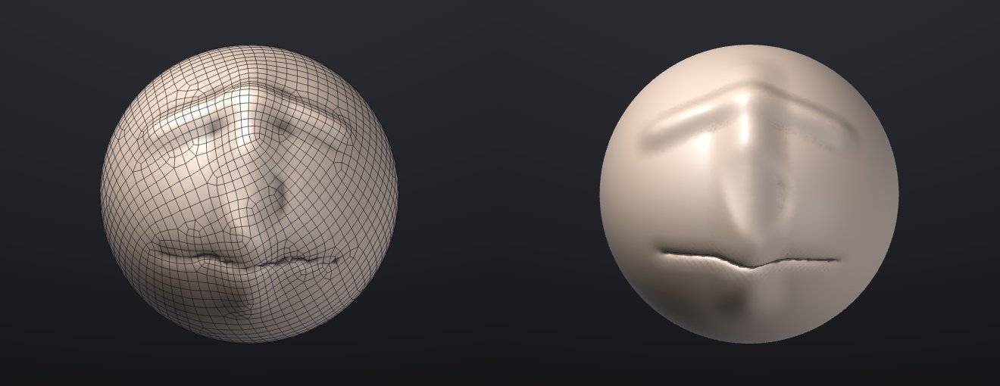
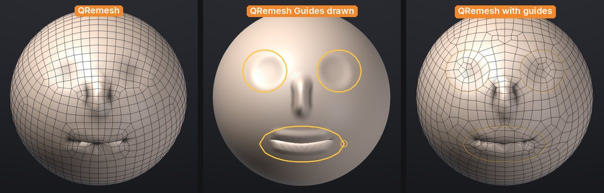

# Quad retopology and detail projection

**QRemesh** rebuilds a sculpt as clean, all-quad topology whose edge loops follow the forms, like ZBrush's
ZRemesher. **ProjectAll** then moves a mesh onto the surface of other SubTools, so the detail of the original
sculpt comes back onto the new topology, like ZBrush's Project All. Together they turn a dense, messy sculpt
(a voxel remesh, a scan, an AI-generated model) into a light quad mesh you can divide, sculpt on, unwrap and
animate.



## The usual workflow

1. Select the sculpt and open **Tool > Geometry**. Under **QRemesh**, turn on **Keep Original**.
2. Set **Target Polygons** (for example 5000) and click **QRemesh**. It runs in the background: a progress bar
   replaces the button, and **Cancel** stops it. The result replaces the SubTool, and the sculpt as it was is
   kept as a hidden SubTool called "*name* Original" right below it.
3. Divide the new mesh two or three times (**Tool > Geometry > Subdivide**, <kbd>Ctrl</kbd>+<kbd>D</kbd>).
4. Show the original again (the eye in **Tool > SubTool**) and click **ProjectAll** under **Tool > SubTool >
   Project**. The divided quads snap onto the sculpt and take its polypaint.
5. Hide or delete the original. You now have the same sculpt on clean quads.



Both steps are single undo steps (<kbd>Ctrl</kbd>+<kbd>Z</kbd>).

## QRemesh

**Tool > Geometry > QRemesh** works on the active SubTool.

| Control | What it does |
|---|---|
| **QRemesh** | Starts the retopology. The status line reports the result, e.g. "QRemesh: 4987 quads from 47214 triangles (100% quads) in 1.0 s" |
| **Target Polygons** | About how many quads to make (100 to 200,000 on the slider, more from scripts). The result is usually within 5% of it |
| **Half / Same / Double** | Set the target to half, the same as or twice the SubTool's current polygon count |
| **Adaptive Size** | 0 makes quads all about the same size. Higher values make smaller quads where the surface curves and bigger ones on flat areas, for the same total |
| **Keep Groups** | Edge loops run exactly along the polygroup borders, and the result keeps the polygroups |
| **Detect Edges** | Hard edges, where faces meet at more than 50 degrees, get an edge loop, so boxes and bevels stay crisp (on by default) |
| **Use Polypaint** | Paint where you want density: red areas get up to four times the quads, blue areas down to a quarter, white areas are unchanged |
| **Symmetry** | Remesh one half and mirror it, welded on the seam, for exactly symmetric topology (on by default). It mirrors on the axis chosen in the **Transform** palette (X if none), across the model's own middle plane: the world's centre plane when the model is symmetric about it, otherwise the plane through the model's middle, so a model moved away from the centre works too. A model that isn't mirror-symmetric is remeshed whole instead, and the status line says "Symmetry off: the model isn't mirror-symmetric"; one that is nearly symmetric (a bump on one side) gets mirrored topology that follows each side's own surface |
| **Keep Original** | Keep the SubTool as it was, hidden, below the new one, ready for ProjectAll. Off: the SubTool is replaced, as in ZBrush (undo brings it back) |
| **Keep Texture** | Shown when the SubTool has a painted texture (on by default): Auto UV the result and project the texture onto it. Off: the texture is dropped |
| **QRemesh Guides** | Picks the guides brush: draw curves on the model for the edge loops to follow. See [QRemesh Guides](#qremesh-guides) |
| **Delete Last** / **Clear** | Delete the last guide curve drawn (with its mirror copies), or all of them |
| **Curves Strength** | How far around each guide the edge flow follows it: 0 = only the loop on the curve, 100 = about six quads to each side (default 50) |

What happens to your data:

- The result is all quads (stored as pairs of triangles, so **PolyF** draws quads and OBJ, FBX, PLY, USD and GoZ
  export them as quads), closed wherever the sculpt is closed. Open edges of the sculpt stay open, along the
  same outline.
- Sculpt layers are baked into the surface: the result has no layers.
- Mask and polypaint are interpolated from the closest point of the sculpt (polypaint is blurred to the new
  resolution until you project it back onto a divided copy).
- Polygroups are kept with **Keep Groups**; otherwise the result is one polygroup. The old UVs are dropped. A
  painted texture is kept with **Keep Texture** (on by default): the result gets Auto UVs and the texture, every
  layer of it, is projected onto them from the old surface, in the same undo step. See
  [Texture painting](texture-painting.md#uvs-and-geometry).
- Hidden parts are remeshed too.
- Separate pieces stay separate and none is dropped: small ones (eyes, teeth, rivets, anything that would get
  fewer than about 100 quads) are remeshed on their own with at least 32 quads, more for small round pieces
  with Adaptive Size. A piece the grid can't cover at all is kept as it was (as triangles).
- Thin parts (a blade, a fin, a slab thinner than a quad) keep both their sides, and with **Detect Edges** their
  hard edges keep a loop each and their corners stay put. Their corners can still be cut a little when the
  part is much thinner than a quad: raise the target, or use polypaint density there.

### Guiding the edge flow

- **QRemesh Guides** put an edge loop exactly where you draw: around the eyes, the mouth, a joint. See below.
- **Polygroups** are as strong a guide. Paint a group around an eye, the mouth or a muscle, turn on **Keep
  Groups**, and loops will circle it. See [Polygroups](polygroups.md).
- **Polypaint** sets the density with **Use Polypaint**: paint the face red and the back of the head blue to
  spend the quads where they matter.
- **Adaptive Size** around 0.5 gives detailed areas more quads without your help; use 0 for an even mesh, for
  example before more sculpting.

### How it works

QRemesh is a field-aligned method after *Instant Field-Aligned Meshes* (Jakob, Tarini, Panozzo and
Sorkine-Hornung, 2015). It smooths a cross field (the directions the quad edges should take) over the surface
from coarse to fine, places a grid of the wanted size along it, extracts the polygons where neighbouring grid
corners meet, splits every polygon into quads and relaxes them back onto the sculpt. It is fast: about 2 seconds
for a 1.3-million-triangle sculpt to 5,000 quads, and 6 seconds to 100,000 quads, on a 10-core desktop.

> **ZBrush:** QRemesh Guides are ZBrush's ZRemesher Guides brush, and Curves Strength its slider of that name.
> Keep Groups, Use Polypaint, Adaptive Size, Half / Same / Double and symmetry work as you know them. There is no
> Freeze Border / Freeze Groups yet, and the mask doesn't steer QRemesh: use polypaint for density.

## QRemesh Guides

Draw curves on the sculpt and QRemesh puts an edge loop along each one, and turns the flow around it to follow,
like ZBrush's ZRemesher Guides brush. Use them where the topology has to work for animation: rings around the
eyes and the mouth, loops around the shoulders, elbows and knees, a line down the middle of a muscle.



1. Click **QRemesh Guides** under **Tool > Geometry > QRemesh** (or pick it in the brush picker, <kbd>B</kbd>).
   The cursor becomes a small ring.
2. Drag on the model to draw a curve. It is drawn on the surface and snapped to it. A curve that ends near where
   it started is closed into a loop: draw round an eye and let go where you began.
3. With symmetry on (<kbd>X</kbd> in the top shelf), each curve is mirrored to the other side as you draw. A
   curve that is its own mirror image, a loop round the mouth across the middle, is kept once.
4. Click **QRemesh**. The status line says how many guides it followed.

Editing the curves:

- **Alt**+click a curve to delete it (it turns red under the cursor while <kbd>Alt</kbd> is held), with its
  mirror copy.
- **Delete Last** removes the last curve drawn; **Clear** removes them all.
- <kbd>Ctrl</kbd> still masks and <kbd>Shift</kbd> still smooths while the guides brush is picked, and dragging
  the background still turns the view. Pick any brush to sculpt again.

The guides belong to the SubTool: each SubTool has its own, they are saved in the project, and **Keep Original**
gives the kept original a copy, so you can change them and remesh again. They show over the model, solid while
the guides brush is picked and thin otherwise, so you can see the loop QRemesh put on them. Drawing and deleting
guides isn't part of undo (<kbd>Ctrl</kbd>+<kbd>Z</kbd> undoes your sculpting as before).

Good to know:

- QRemesh snaps the guides onto the sculpt as it is when you run it, so sculpting after drawing them is fine. A
  guide left far from the surface, for example after moving the SubTool with the Gizmo, is ignored and the
  status line says so: draw it again.
- A loop gets an even number of quads around it, so it closes cleanly. Two guides closer together than about a
  quad compete for the same loop; draw them further apart or raise **Target Polygons**. A very small loop, about
  20 quads round or fewer, may not close: raise **Target Polygons**.
- **Curves Strength** doesn't change the loop on the curve, only how far around it the other edges turn to
  follow. Lower it when guides are close to each other or to the symmetry plane.

### How the guides work

Each curve constrains QRemesh's cross field (the directions the edges take) to run along it, falling off over a
few quads (**Curves Strength**), and adds a lattice line on the curve, so one edge loop lies on it. Along a closed
curve the lattice corners are placed at even steps, an even number of them (a ring of quads round a disk always
has an even number of sides), so the loop meets itself without a kink. With symmetry QRemesh remeshes one half,
so a loop across the middle is cut there: its corners start on the seam, where it meets its mirror image.
QRemesh then checks the loops and the quads near the guides; if a loop came out broken or a fan of seven or
more edges sits by a guide, it tries again with a different start for the field and keeps the best. Measured on
a sphere with a circular guide around an "eye", the edges near the curve are within about 2 to 8 degrees of its
direction (about 22 degrees without the guide), and the loop closes.

## ProjectAll

**Tool > SubTool > Project > ProjectAll** projects every other *visible* SubTool onto the active one. Each vertex
looks along its normal, both ways, and moves to the nearest surface it finds within **Dist**; if there is none
straight along the normal, it takes the closest point within **Dist**.

| Control | What it does |
|---|---|
| **ProjectAll** | Projects the visible SubTools onto the active one (one undo step) |
| **Dist** | How far to search, as a fraction of the SubTool's size (bounding-box diagonal). Default 0.02. Raise it if parts don't pick up the detail; lower it where two surfaces are close together (lips, eyelids, fingers) |
| **PA Blur** | Smooths the projected result this many times, to soften noise from the source |
| **Mean** | Where there is surface on both sides of a vertex, settle halfway between them instead of on the nearest |
| **Geometry** | Project the shape (into the active sculpt layer, if you have layers) |
| **Polypaint** | Project the polypaint (into the active paint layer) when a source has any |

- **The mask protects:** fully masked vertices don't move; partly masked ones move part of the way. Mask the
  areas you have already fixed and project again with a different **Dist**.
- Hidden faces of the source are ignored, and hidden parts of the target don't move.
- ProjectAll is fast enough to use on dense meshes: about 0.6 seconds to project 1.25 million vertices from a
  1.3-million-triangle sculpt.

> **Tip:** Project after each division, not only at the end: divide once, ProjectAll, divide again, ProjectAll.
> Each pass starts closer to the sculpt, so a small **Dist** is enough and thin parts don't jump to the wrong
> surface.

## Scripting

| Command | Options |
|---|---|
| `qremesh` | `target` (16 to 2,000,000, default 5000), `adaptive` (0-1, default 0.5), `keep_groups`, `detect_edges` (default true), `use_polypaint`, `symmetry` (`x`, `y` or `z`; off by default in scripts; the mirror plane is found from the model), `symmetry_center` (use this plane instead, e.g. `0` for the world's centre), `keep_original`, `smooth` (relaxation passes, default 6), `seed`, `keep_texture` (default true), `guides` (follow the SubTool's QRemesh Guides, default true), `curves_strength` (0-100, default 50) |
| `qremesh_guide` | `points` (the curve, `"x,y,z x,y,z ..."`), `view` (project the points onto the surface along this direction, as a stroke from the camera; default: each point to the closest surface point), `symmetry` (`x`, `xz`...; mirror the curve) |
| `qremesh_guide_delete_last`, `qremesh_guides_clear`, `qremesh_guides_info` | Delete the last curve, delete all, list them |
| `project_all` | `distance` (0.001-1, default 0.02), `mean`, `blur` (0-20), `geometry` (default true), `polypaint` (default true), `source` (one SubTool's name instead of all visible ones) |

```sh
sculptforge-cli -c 'open path=scan.glb; qremesh target=8000 adaptive=0.3 keep_original=true; subdivide levels=2; subtool_visibility index=1 visible=true; project_all distance=0.02; export_fbx path=retopo.fbx'
```

```sh
sculptforge-cli -c 'open path=head.glb; qremesh_guide points="0.2,0.3,2 0.3,0.4,2 0.4,0.3,2 0.3,0.2,2 0.2,0.3,2" view=0,0,-1 symmetry=x; qremesh target=4000 symmetry=x curves_strength=70'
```

From scripts `qremesh` runs straight away (it doesn't return until it's done); in the app the button runs it in
the background.

## See also

- [Subdivide, remesh, decimate and LODs](geometry.md): voxel remesh first to fuse pieces, subdivide after QRemesh
- [SubTools](subtools.md): show, hide and duplicate the original
- [Polygroups and visibility](polygroups.md): guides for Keep Groups
- [Projects](projects.md): QRemesh Guides are saved with each SubTool
- [Texture painting](texture-painting.md): Auto UV on the new topology
