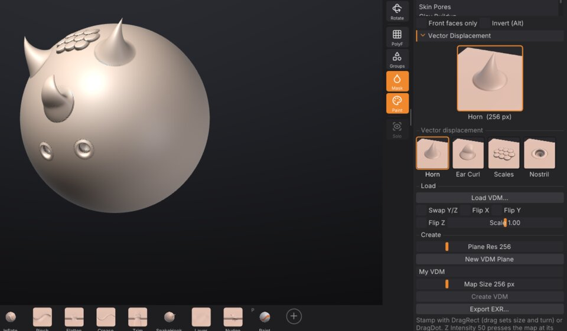

# Sculpting and brushes

This chapter covers everything that happens when you drag a brush across a model: the built-in brushes and
the custom brushes that ship with SculptForge, brush size and strength, modifier keys, stroke types, alphas,
symmetry and pen pressure. To design your own brushes, see [Brush Lab and sharing brushes](brush-lab.md).


## Your first stroke

1. Pick a brush: click it on the **bottom shelf**, press its number key, or press <kbd>B</kbd> to open the
   brush picker.
2. Left-drag on the model. The brush works on the surface under the cursor.
3. Hold <kbd>Alt</kbd> while dragging to invert the brush (dig in instead of building up), or hold
   <kbd>Shift</kbd> to smooth.
4. Press <kbd>Ctrl</kbd>+<kbd>Z</kbd> to undo a stroke, <kbd>Ctrl</kbd>+<kbd>Shift</kbd>+<kbd>Z</kbd> (or
   <kbd>Ctrl</kbd>+<kbd>Y</kbd>) to redo it. Each SubTool keeps its own history of up to about 1 GB; the
   oldest steps are dropped beyond that.

Dragging on the background never sculpts: it rotates the view (see [Navigation](navigation.md)). The brush only
works on the active SubTool, and only on parts that are visible and not masked.

> **ZBrush:** the modifiers are the ones you know. <kbd>Alt</kbd> flips Zadd and Zsub for one stroke,
> <kbd>Shift</kbd> smooths with any brush, <kbd>Ctrl</kbd> paints a mask (see [Masking](masking.md)).

## Built-in brushes

SculptForge has fourteen sculpting brushes plus the Paint brush. The first ten have number keys; all of them
are on the bottom shelf by default and in the brush picker.

| Brush | Key | What it does | With <kbd>Alt</kbd> |
|---|---|---|---|
| **Standard** | <kbd>1</kbd> | Raises the surface along the stroke, the all-purpose brush. | Digs in |
| **Clay** | <kbd>2</kbd> | Builds up clay that fills the hollows first, with a slightly flat top. | Carves away |
| **Smooth** | <kbd>3</kbd> | Relaxes the surface, evening out bumps. The same brush <kbd>Shift</kbd> gives you. | No change |
| **Move** | <kbd>4</kbd> | Grabs the surface under the cursor and pulls it along, parallel to the screen. | No change |
| **Inflate** | <kbd>5</kbd> | Swells the surface outward along its normals. | Deflates |
| **Crease** | <kbd>6</kbd> | Cuts a sharp crease and pinches its sides in. | Raises a ridge |
| **Flatten** | <kbd>7</kbd> | Presses the surface toward a plane through the brush area. | Pushes away from the plane |
| **Pinch** | <kbd>8</kbd> | Pulls the surface toward the stroke to tighten edges. | Spreads it apart |
| **DamStandard** | <kbd>9</kbd> | A narrow, deep V-shaped crease with the sides pinched in. | A sharp ridge |
| **ClayBuildup** | <kbd>0</kbd> | Square, flat-topped clay strokes for blocking in forms. | Carves flat-bottomed |
| **SnakeHook** | | Pulls the surface out into horns and tendrils that taper as you drag. | No change |
| **Trim** | | Trim Dynamic: shaves away everything above a plane for hard surfaces. | Fills up to the plane |
| **Layer** | | Raises the surface to one fixed height per stroke; overlapping passes never stack. | Lowers to a fixed depth |
| **Nudge** | | Slides the surface sideways along the stroke without lifting it. | No change |
| **Paint** | <kbd>P</kbd> | Paints colour without sculpting. See [Polypaint and materials](polypaint.md). | Paints back to white |

Notes on particular brushes:

- **Move** and **SnakeHook** move the surface with the cursor instead of placing dabs, so stroke types
  (Dots, Spray and so on) don't apply to them.
- **Layer** sets its height from the brush size and **Z Intensity**. Pen pressure lowers the height when
  **Pressure > Strength** is on, so you can feather the edge of a layer.
- **Trim** gives crisp planes on cylinders and edges. Use it with **Front** on when you work on thin shapes.

> **ZBrush:** DamStandard, ClayBuildup, SnakeHook, Trim (Dynamic), Layer and Nudge behave like their
> ZBrush namesakes. Brushes such as hPolish, ClayTubes, Slash or the IMM and curve brushes are not built in;
> you can get close to several of them with a custom brush in [Brush Lab](brush-lab.md).

## Custom brushes that ship with SculptForge

Besides the built-in brushes, SculptForge ships seven custom brushes. They are *recipes*: data that you can
open and change in [Brush Lab](brush-lab.md). They appear in the **Custom** section of the brush picker and
in **Brush > Custom brushes**.

| Brush | What it does |
|---|---|
| **Wrinkle** | Fine, sharp creases for skin folds and fabric wrinkles. |
| **Palette Knife** | Flattens and drags clay sideways like a sculptor's knife. |
| **Dragon Scales** | Stamps rounded overlapping scales along the stroke. |
| **Stone Chisel** | Scrapes hard planes and breaks them up with cracks for rocks and ruins. |
| **Skin Pores** | Sprinkles tiny pores for close-up skin detail. |
| **Clay Buildup** | Builds up flat-topped strokes of clay for blocking in forms. |
| **Edge Wear** | Chips and softens only the sharp edges and ridges, for weathered props. |

Custom brushes respond to <kbd>Alt</kbd>, <kbd>Shift</kbd>, the mask, symmetry and the stroke settings just
like built-in ones. Their thumbnails carry a small sparkle when you put them on the bottom shelf.

## Pick a brush

You can choose a brush in several places:

- **Bottom shelf**: click a tile. The active brush has an orange outline and the number key is shown in the
  corner of each tile.
- **Number keys**: <kbd>1</kbd> to <kbd>9</kbd> and <kbd>0</kbd> pick the first ten built-in brushes (see the
  table above); <kbd>P</kbd> toggles the Paint brush.
- **Brush tile** at the top of the left shelf: click it to open the brush picker beside it.
- **Brush palette**: the same grid of thumbnails, with a filter field, plus your custom brush list.
- **Command palette** (<kbd>F3</kbd>): type the brush name and press <kbd>Enter</kbd>.

### The brush picker

Press <kbd>B</kbd> to open the brush picker under the mouse. It shows a **Recent** row (once you have picked
brushes), then **Built-in**, **Custom** and **Library** sections. The Library section lists `.sfbrush` files in
the `Brushes` folder of your LightBox library that aren't loaded yet; picking one loads it.


The picker works the ZBrush way, by typing letters:

1. Press <kbd>B</kbd>.
2. Type the first letter of the brush. Only brushes starting with that letter stay, and each shows an orange
   key badge: the next letter that tells it apart from the others.
3. Press the letter on the badge to pick that brush. For example <kbd>B</kbd>, <kbd>S</kbd>, <kbd>T</kbd>
   picks Standard, and with the brushes that ship, <kbd>B</kbd>, <kbd>C</kbd>, <kbd>L</kbd>
   picks Clay.

If no brush name starts with what you typed, the picker falls back to names that *contain* it.
<kbd>Backspace</kbd> removes the last letter, <kbd>Enter</kbd> picks the first match, and <kbd>Esc</kbd> or a
click outside closes the picker. The letter chips along the top (A 2, C 4 ...) show how many brushes start
with each letter; click one to filter by it.

Hover a tile for a large preview and the brush's description. Right-click a tile for **Add to bottom shelf**,
and on custom brushes also **Copy brush code**, **Rename...**, **Save as .sfbrush...**, **Delete...** and
**Reveal in folder** (see [Brush Lab and sharing brushes](brush-lab.md)).

> **ZBrush:** <kbd>B</kbd> then two letters is the same muscle memory. Holding <kbd>Ctrl</kbd> while picking
> to choose a masking brush is not supported; mask strokes always use <kbd>Ctrl</kbd> with the current
> settings.

## Draw Size, Z Intensity, RGB Intensity and Focal Shift

These values control every brush, with ZBrush's names and keys. Draw Size and Z Intensity are on the top shelf;
all four are in the **Draw** palette and the [QuickMenu](#the-quickmenu).

| Setting | Range | Default | How to change it |
|---|---|---|---|
| **Draw Size** | 2 to 800 | 60 | Brush radius in screen pixels. <kbd>[</kbd> and <kbd>]</kbd> make it 10% smaller or larger (hold to repeat). <kbd>S</kbd> opens a slider at the cursor. |
| **Z Intensity** | 1 to 100 | 50 | How strongly each dab changes the surface. <kbd>U</kbd> opens a slider at the cursor. |
| **RGB Intensity** | 1 to 100 | 100 | How strongly painting colours the surface (the Paint brush, and sculpting with Rgb on). <kbd>I</kbd> opens a slider at the cursor. |
| **Focal Shift** | -100 to 100 | 0 | The brush falloff. Below 0 the full-strength centre widens into a broad, hard tip; above 0 it narrows to a soft point. <kbd>O</kbd> opens a slider at the cursor. |

Because **Draw Size** is measured on screen, the brush covers less of the model as you zoom in, which is what
you want for detail work.

The brush cursor shows two rings, as in ZBrush: the outer one is the Draw Size, the inner one is Focal Shift
(where the brush works at half strength). Masking, painting, Move and SnakeHook follow Focal Shift too; custom
brushes made in Brush Lab keep their own tip shape.

The <kbd>S</kbd>, <kbd>U</kbd>, <kbd>I</kbd> and <kbd>O</kbd> pop-ups take the mouse or the keyboard: drag the
slider and release to close it, or type a number and press <kbd>Enter</kbd> (a minus first for a negative Focal
Shift). <kbd>Esc</kbd> closes the pop-up without typing anything new.

### Smooth's own Z Intensity

Smooth keeps a Z Intensity of its own, as in ZBrush, so a gentle Standard stroke at 10 still smooths at full
speed. Hold <kbd>Shift</kbd> (or pick the Smooth brush) and the Z Intensity slider shows **Smooth Z Intensity**:
change it there, or hold <kbd>Shift</kbd> and press <kbd>U</kbd>. It starts at 50.


## Sculpt, Paint, Zadd, Zsub, Rgb and Front

These toggles sit on the top shelf and in the **Draw** palette:

| Control | What it does |
|---|---|
| **Sculpt** / **Paint** | **Sculpt** makes brushes change the shape. **Paint** (<kbd>P</kbd>) paints colour only. |
| **Zadd** / **Zsub** | **Zadd** makes brushes add (the default), **Zsub** makes them subtract. <kbd>Alt</kbd> flips the current choice for one stroke. |
| **Rgb** | Sculpt brushes also paint the current colour as they sculpt (ZBrush Rgb with Zadd). |
| **Front** | Front faces only: brushes leave the far side of thin parts alone, such as the back of an ear or a cape. |

The **Brush** palette has the same Front and invert settings as the checkboxes **Front faces only** and
**Invert (Alt)**.

## Modifier keys while sculpting

| Hold | Effect |
|---|---|
| <kbd>Alt</kbd> | Inverts the brush for this stroke (see the table of brushes). |
| <kbd>Shift</kbd> (before the stroke) | Smooths with the Smooth brush, whatever brush is active, at Smooth's own Z Intensity. With the Paint brush active, <kbd>Shift</kbd> still smooths the shape. |
| <kbd>Shift</kbd> (after the stroke started) | Draws a straight line from where you pressed <kbd>Shift</kbd>, snapped to 45 degree steps on screen. Let go of <kbd>Shift</kbd> to carry on freehand. |
| <kbd>Ctrl</kbd> | Paints a mask instead of sculpting; <kbd>Ctrl</kbd>+<kbd>Alt</kbd> erases it. A <kbd>Ctrl</kbd>+click without dragging blurs the mask (<kbd>Ctrl</kbd>+<kbd>Alt</kbd>+click sharpens it). See [Masking](masking.md). |
| <kbd>Ctrl</kbd>+<kbd>Shift</kbd> | Visibility gestures: isolate, hide and show polygroups. See [Polygroups and visibility](polygroups.md). |

## The QuickMenu

Press <kbd>Space</kbd> for ZBrush's QuickMenu under the cursor: the Brush, Stroke, Alpha and Material tiles,
Draw Size, Focal Shift, Z Intensity and RGB Intensity, Zadd / Zsub, Sculpt / Paint, Rgb and X symmetry. Hold
<kbd>Space</kbd> and let go to close it again (it stays while the pointer is on it), or tap <kbd>Space</kbd> to
keep it open until you click elsewhere or press <kbd>Esc</kbd>. Clicking a tile opens its picker.

## Strokes

The stroke type decides how cursor movement becomes brush dabs. Choose it from the **Stroke** tile on the left
shelf, which opens the stroke picker, or from the **Stroke** palette.


| Stroke | What it does | Setting |
|---|---|---|
| **Dots** | Even dabs along the path: the classic brush stroke (default). | None; spacing comes from the brush. |
| **DragRect** | Click and drag one stamp: the drag length sets its size and its direction the rotation. Great with alphas. | None |
| **DragDot** | Click and drag one stamp of the brush's Draw Size: it slides over the surface under the cursor and lands where you let go. Great for VDMs. | None |
| **Spray** | Scattered dabs of random size, strength and rotation, for organic texture. | **Scatter** (0 to 2, default 1): how far dabs land from the cursor, as a fraction of the brush size. |
| **LazyMouse** | The brush trails the cursor on a string, for smooth, steady lines. | **Lazy radius** (1 to 300 px, default 40): longer is steadier. |

The setting slider appears under the stroke tiles when **Spray** or **LazyMouse** is selected. With LazyMouse,
the viewport draws the string between the cursor and the brush point.

Notes:

- With **DragRect**, the stamp is placed where you first click. While you drag, it is redrawn at the new size
  and angle, and it is committed when you release.
- With **DragDot**, the stamp appears under the cursor at once and follows it while you drag; the mesh under it
  goes back to how it was as it moves on.
- Mask strokes (<kbd>Ctrl</kbd>) always use dots, even when DragRect or DragDot is selected.
- Custom brushes set their own dab spacing and can add jitter (see [Brush Lab](brush-lab.md)).

> **ZBrush:** DragRect, DragDot, Spray and LazyMouse match ZBrush's. Freehand and Dots are the same thing here.
> Roll and curve strokes are not available yet.

## Alphas

An alpha is a grayscale stamp that shapes the brush tip: white is full effect, black is none. It affects every
brush, built-in or custom. Choose one from the **Alpha** tile on the left shelf (the alpha picker) or the
**Alpha** palette, which also shows a large preview of the current alpha.


| Alpha | What it does |
|---|---|
| **Round** | The plain round falloff (no alpha). The default. |
| **Square** | A square stamp with soft edges. |
| **Noise** | A noisy stamp for rough, organic texture. |

To use your own image:

1. Click **Load image...** in the alpha picker or the **Alpha** palette.
2. Choose a PNG, JPG, BMP, TGA, PSD or GIF. Colour images are converted to grayscale.
3. Turn on **Invert loaded image** *before* loading if your image is white where it should have no effect.

Images you keep in the `Alphas` folder of your LightBox library (Documents/SculptForge/Alphas by default)
appear in the picker's **Images** section, so you can switch between them with one click. The alpha's top edge
points up the screen; with **DragRect** it follows the drag direction instead.

From a script: `brush_set_alpha name=square`, or `brush_set_alpha path=bark.png invert=true`.

> **ZBrush:** there is no alpha library browser with hundreds of alphas yet, and alpha options such as
> MidValue, Rf (radial fade) or tiling are not available. Any grayscale image works, including alphas you
> already have as PNG.

## Vector displacement brushes

A vector displacement brush (ZBrush's VDM brushes, Blender's "VDM brushes") stamps a whole 3D shape in one
click: a horn, an ear, a cluster of scales, a nostril. An alpha can only push the surface up or down; a vector
displacement map (VDM) moves every point of the stamp in any direction, so the shape can lean over, curl and
overhang, as nothing made with a height ever can.



### Stamp a VDM

1. Open the **Brush** palette and its **Vector Displacement** section, and click a map: **Horn**, **Ear Curl**,
   **Scales** or **Nostril**. The **VDM** brush becomes the brush and the stroke becomes **DragRect**. (While the
   VDM brush is the brush, the Alpha tile on the left shelf shows its map, and the alpha picker lists the maps
   first. The VDM brush is also in the brush picker: <kbd>B</kbd> <kbd>V</kbd> <kbd>D</kbd>.)
2. Click on the model where the stamp should sit and drag: the drag's length sets the size and its direction
   points the top of the map, so a horn leans the way you drag. Let go to keep it.

- **DragDot** stamps at the Draw Size instead and slides the stamp under the cursor until you let go.
- **Z Intensity 50** (the default) presses the map at its own shape; 100 doubles it, lower values flatten it.
- **Alt** digs the shape in: the sideways motion stays and the height flips (a horn becomes a curved hole, a
  nostril a bump). Blender's VDM brushes invert the same way.
- **Symmetry** mirrors the stamp exactly (the mirrored horn leans the mirrored way), the **mask** holds it back,
  and each stamp is one undo step. Sculpt layers record it like any stroke.
- The **Dots** stroke works too: each dab adds the shape again, for rows of studs or scales.

> **Tip:** a VDM moves points sideways, so it needs points to move: on a coarse mesh the shape breaks up into
> spikes. Divide first (the model above has 330 000 triangles), and stamp at the highest
> [subdivision level](subdivision-levels.md); stepping down and back up keeps the stamp. Use Front faces only
> on thin parts so the stamp doesn't reach through to the other side.

### Make your own VDM

1. In **Brush > Vector Displacement**, click **New VDM Plane**. A flat 2 x 2 grid appears as a new SubTool,
   seen from the top, with its border masked (so the stamp blends into any surface); the other SubTools are
   hidden. **Plane Res** sets how many quads it has (256 by default).
2. Sculpt the shape with any brush: overhangs are welcome (Move, SnakeHook, Inflate). Divide the plane for finer
   detail. Keep the border flat.
3. Type a name, choose the **Map Size** (256 pixels holds most shapes, 512 fine detail) and click **Create VDM**.
   The new map is saved in your brush library, shows in the list and becomes the VDM brush's map.
4. Show your model again in the [SubTool](subtools.md) palette (its eye) and stamp away.

The top of the screen when you look at the plane from the top is the top of the map: the side a DragRect drag
points to. The plane's UVs record where each point started, so what Create VDM captures is how far each point
moved, sideways and up.

### Load and export maps (Blender, ZBrush)

**Load VDM...** reads an OpenEXR (16- or 32-bit, any compression) or a `.sfvdm`; dropping an `.exr` on the window
does the same. A loaded EXR is kept in your brush library as a `.sfvdm`, so it's there next time. **Export
EXR...** writes the brush's map as a 32-bit float EXR. Right-click a map you made or loaded to delete it.

Maps use the convention of Blender's **VDM Brush Baker** and its Draw brush with *Vector Displacement*:

| Channel | Means |
|---|---|
| R | X: toward the stamp's right |
| G | Y: toward the stamp's top (the image's top row; the drag direction of DragRect) |
| B | Z: out of the surface |
| Units | brush radii: (0, 0, 0.5) lifts the surface by half the radius; the map covers the brush's square |

So maps from Blender's VDM Brush Baker load as they are, and exported maps work in Blender: add an image texture
with the EXR (Color Space: Non-Color) to a Draw brush, set the texture's **Mapping** to **Area Plane**, turn on
**Vector Displacement** in the brush's Texture panel, and use the **Anchored** stroke at Strength 1 (see
[Working with Blender](blender.md#vector-displacement-maps)). Blender's brush touches only the round area of the
brush, so the corners of a map are cut off there; in SculptForge the whole square stamps.

ZBrush keeps its VDMs inside brushes (as 3D alphas) and doesn't export them as EXR by itself; maps made with
**Tool > Vector Displacement Map** or third-party exporters use axes set by ZBrush's *Vector Displacement Flip*
options. If a map from ZBrush stamps lying on its side, load it again with **Swap Y/Z**; if it is mirrored or leans
the wrong way, with **Flip X** or **Flip Y** (**Flip Z** for a map that digs in where it should rise). **Scale**
multiplies a map made in other units.

From a script: `vdm_set name=horn` or `vdm_set path=ear.exr swap_yz=true`, `vdm_stamp point=0,0.5,0 radius=0.3
angle=30`, `vdm_new_plane`, `vdm_capture name="My horn" exr=horn.exr`, `vdm_export path=horn.exr`, `vdm_list`,
`vdm_delete name="My horn"`.

> **ZBrush:** the VDM brush works like ZBrush's VDM brushes with DragRect or DragDot. Not available yet:
> several VDMs in one brush (ZBrush's *Create Multiple Alpha Brush*), MidValue and the alpha options for 3D
> alphas, and reading ZBrush's own brush files.

## Symmetry

Symmetry mirrors every stroke, including mask and paint strokes.

- **X** mirrors left and right. It is **on by default**; press <kbd>X</kbd> to toggle it.
- **Y** mirrors top and bottom, and **Z** mirrors front and back. They have no default key (you can assign one;
  see [The interface](interface.md)).

The **X**, **Y** and **Z** buttons are on the top shelf and in the **Transform** palette. You can combine them:
X and Z together give four-way symmetry.

Symmetry mirrors across the scene's axes through the origin. Models that are centred on the origin, such as
SculptForge's primitives and most character exports, mirror correctly. If a stroke lands in the wrong place on
the other side, the model is off-centre.

> **ZBrush:** this is ZBrush's world symmetry with the >X< axis on. Local symmetry, radial symmetry and
> topological (poseable) symmetry are not available yet.

## Pen pressure and tablets

SculptForge reads pen pressure from graphics tablets and pen displays through the operating system. When it
receives pen input, the **Draw** palette shows **Pen pressure** with the current value; before that it says
**No pen detected**.

Two toggles decide what pressure does. They are on the top shelf and in **Draw > Tablet**:

| Toggle | Default | Effect |
|---|---|---|
| **Pressure > Strength** | On | Pen pressure scales the brush strength. |
| **Pressure > Size** | Off | Pen pressure scales the brush size (down to 5% at the lightest touch). |

Pressure applies only to strokes made with the pen; mouse strokes always use full pressure. Custom brushes
also have a **Pressure curve** setting that makes them respond to a light or a firm touch (see
[Brush Lab](brush-lab.md)). If the pen moves the cursor but pressure does nothing, see
[Troubleshooting](troubleshooting.md).

**Preferences > Tablet** checks and tunes the pen:

- a pressure meter and a draw-test area, to see what the tablet reports at a light touch and a full press;
- a pressure curve for all brushes (Soft, Linear or Firm, or set **Curve**, **Minimum**, **Maximum**, **Threshold**
  and **Full pressure at** yourself), applied before each brush's own curve;
- the eraser end (default **Invert**, like holding <kbd>Alt</kbd>) and the side buttons (default:
  lower button right-click to rotate the view, upper button **Invert**, third button **Pan view**).

**Store Config** (<kbd>Ctrl</kbd>+<kbd>Shift</kbd>+<kbd>I</kbd>) keeps these settings. Setup notes for Windows
Ink, macOS and Linux are in
[docs/tablet.md](https://github.com/islandmed/SculptForge/blob/main/docs/tablet.md).

## Customize the bottom shelf

The bottom shelf holds your most-used brushes. By default it shows Standard, Clay, ClayBuildup, DamStandard,
Move, Smooth, Inflate, Pinch, Flatten, Crease, Trim, SnakeHook, Layer, Nudge and Paint.


- **Add a brush**: click the **+** tile at the end of the shelf and pick a brush, built-in or custom. Or
  right-click any tile in the brush picker and choose **Add to bottom shelf**.
- **Remove a brush**: right-click its tile and choose **Remove from shelf**.
- **Reorder**: turn on **Preferences > Config > Enable Customize**, then <kbd>Ctrl</kbd>+<kbd>Alt</kbd>+drag a
  tile to a new place.
- **Change a brush's key**: <kbd>Ctrl</kbd>+<kbd>Alt</kbd>+click its tile, then press the new key.

Shelf changes last until you quit. Press <kbd>Ctrl</kbd>+<kbd>Shift</kbd>+<kbd>I</kbd> (**Store Config**) to keep
them. See [The interface](interface.md) for more on customizing.

## Sculpt from a script

The `stroke` command applies a brush along a path on the active SubTool, as one undo step. It is useful for
scripted detailing and for AI agents:

```sh
sculptforge-cli -c 'new_sphere subdivisions=6; stroke brush=Crease points="-0.6,0.2,0 0,0.4,0 0.6,0.2,0" symmetry=x; export_glb path=out.glb'
```

Points are projected onto the surface along `view` (default `0,0,-1`, the front view). `radius` (world units),
`strength`, `pressure`, `invert`, `spacing`, `curve` and `seed` work as in the viewport. See
[Scripting and automation](scripting.md).

## See also

- [Brush Lab and sharing brushes](brush-lab.md): design brushes with AI, the brush library and brush codes
- [Masking](masking.md): protect areas from every brush
- [Polypaint and materials](polypaint.md): Paint brush, Rgb and colour
- [Sculpt layers and blend shapes](layers.md): sculpt into a layer you can dial in and out
- [Dynamic topology](dynamic-topology.md): brushes that add triangles where they need them (Sculptris Pro)
- [Keyboard and mouse reference](shortcuts.md)
