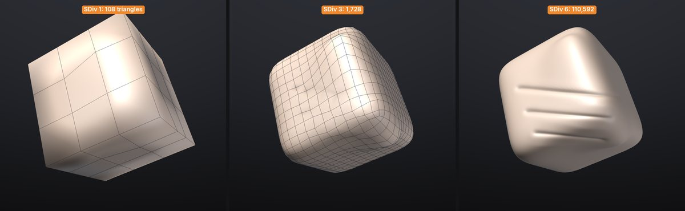

# Subdivision levels

Subdivision levels let you sculpt one model at several resolutions, as with ZBrush's **SDiv**: block in the big
forms on a light version of the mesh, add pores and wrinkles on a dense one, and go back down to change the
silhouette without losing the detail. Every SubTool has its own levels.

Everything is in **Tool > Geometry**:

| Control | Shortcut | What it does |
|---|---|---|
| **Divide** | <kbd>Ctrl</kbd>+<kbd>D</kbd> | Adds a level above the highest one and steps to it |
| **Smt** | | Smooths the next Divide (on by default) |
| **Lower Res** | <kbd>Shift</kbd>+<kbd>D</kbd> | Steps one level down |
| **Higher Res** | <kbd>D</kbd> | Steps one level up |
| **SDiv** slider | | Steps to any level (1 is the base cage) |
| **Del Lower** | | Deletes the levels below the current one |
| **Del Higher** | | Deletes the levels above the current one |
| **Reconstruct Subdiv** | | Finds a lower level for a mesh that was subdivided elsewhere |

Under the buttons the palette says where you are ("SDiv 3 of 5") and how many triangles the base and the top
have. The **SubTool** list shows the level of every SubTool that has them ("SDiv 3/5").

## Divide

**Divide** (<kbd>Ctrl</kbd>+<kbd>D</kbd>) adds a level with four times the polygons. The lower levels stay, so you
can step back down at any time.

- **Quads stay quads.** A mesh with quads is divided with Catmull-Clark subdivision: each quad becomes four
  quads, and a triangle among them becomes three quads. A mesh of triangles only (a sphere from **New Sphere**,
  a scan) is divided with Loop subdivision: each triangle becomes four.
- **Smt** (next to Divide) smooths the new level, rounding off the shape the way ZBrush does. Turn it off to
  divide flat: the new level keeps the hard edges and flat faces of the one below, for hard-surface pieces.
- Divide always adds the level on top. If you are at a lower level it steps to the highest first.
- Mask, polypaint, paint layers and UVs are interpolated onto the new level; polygroups and hidden faces carry
  over; sculpt layers are divided with the shape.
- SculptForge refuses to go past 50 million triangles.

> **Tip:** Start from a light mesh. A cube of 108 triangles divided five times is a smooth 110,000-triangle
> head-sized blob; a 25,000-triangle base divided four times is already 6.5 million.

## Stepping between levels

Press <kbd>Shift</kbd>+<kbd>D</kbd> to step down and <kbd>D</kbd> to step up, or drag the **SDiv** slider. Each
step is instant once you have visited a level; the first visit after a big edit lower down takes a moment on
millions of triangles.

What happens to your sculpting when you change level:

- **Detail survives.** Each level stores its detail as a small offset from the smoothed shape of the level
  below, measured along that surface (its normal and tangents). Stepping up and down without sculpting gives back
  exactly the same mesh.
- **Big changes low, detail follows.** Sculpt, move or inflate at a low level and step up: the higher levels
  follow the new shape and the wrinkles, pores and scales you sculpted on them ride along on top.
- **Detail edits show up below.** Sculpt at a high level and step down: the lower levels take on a softened
  version of the change, so the silhouette stays honest whichever level you look at. Fine detail is too small for
  a low level and only shows as a gentle swelling there.

## What follows the levels

| | When you change it at one level |
|---|---|
| Shape | Carried up as detail, softened down (see above) |
| Sculpt layers | Each layer has its own detail on every level; weights apply to all levels. See [Layers](layers.md) |
| Mask | Copied down to the vertices below, interpolated up where it changed |
| Polypaint and paint layers | As the mask: paint at a low level for broad colour, at a high level for detail. Painting low only changes the higher levels where you painted |
| Polygroups, hidden faces | Copied down to the parent faces, inherited up by the faces they contain |
| UVs | Copied down and interpolated up |
| Texture | Shared by every level (it lives on the UVs) |

Clearing the mask, removing a layer or deleting the paint layers does it on every level.

## Del Lower and Del Higher

**Del Lower** deletes the levels below the current one: the current level becomes the new base cage (SDiv 1).
**Del Higher** deletes the levels above, and the detail sculpted on them. Both are undoable. Deleting down to a
single level leaves an ordinary mesh.

## Reconstruct Subdiv

A model that was subdivided in another application (or exported from SculptForge at its top level) comes in as
one dense mesh. **Reconstruct Subdiv** finds the mesh it was subdivided from and adds it as a new lowest level,
keeping the dense mesh exactly as it was. Press it again for more levels.

- It works at the lowest level (SDiv 1).
- The mesh must be a regular subdivision: all quads from Catmull-Clark subdivision (Blender's Subdivision
  Surface, Maya's Smooth, ZBrush's Divide), or all triangles from Loop subdivision. Otherwise it says so and
  leaves the mesh alone.
- The vertices of the new lower level sit on the dense mesh's corner vertices, as in ZBrush.

> **Tip:** The **Cube** from **Tool > SubTool > Append** is a regular quad grid, so Reconstruct Subdiv takes it
> down to a 3 x 3 cube in four steps.

## Undo, projects and exporting

- **Undo** (<kbd>Ctrl</kbd>+<kbd>Z</kbd>) is one step per stroke at any level, and one step per level change,
  so undo walks back through your strokes and level changes in the order you made them. Divide, Del Lower,
  Del Higher and Reconstruct are single undo steps. Steps share the levels they didn't change, so they cost
  little memory.
- **Projects** (`.sfproj`) save every level of every SubTool and open at the level you saved at. They use
  project format 4, so older SculptForge versions ask you to update before opening them.
- **Exports and GoZ** write the current level. To write another one, step to it first, or use the
  `subdiv_export` command (`subdiv_export path=base.obj level=1` writes the base cage of every visible SubTool,
  in any export format). LODs and **Send to Unreal** start from the current level too.
- **Tools that rebuild the mesh** (Voxel Remesh, Decimate, Subdivide, Delete hidden, merging and splitting
  SubTools) make a new mesh without levels. Undo brings the levels back.

> **Note:** **Subdivide** (in **Tool > Geometry**, below Divide) is still there: it replaces the mesh with a
> denser one and keeps no levels. Use Divide unless you want exactly that.

## Commands

Every control is a command you can run in the console, from a script or over MCP (see
[Scripting](scripting.md)):

| Command | What it does |
|---|---|
| `subdiv_divide smooth=true` | Divide; `smooth=false` divides flat (Smt off) |
| `subdiv_level level=2` | Step to a level (1 = base) |
| `subdiv_lower`, `subdiv_higher` | Lower Res, Higher Res |
| `subdiv_delete_lower`, `subdiv_delete_higher` | Del Lower, Del Higher |
| `subdiv_reconstruct` | Reconstruct Subdiv |
| `subdiv_info` | List the levels and their triangle counts |
| `subdiv_export path=base.obj level=1` | Export the visible SubTools at a level |

## Speed and memory

Measured on an Apple M1 Pro (Asahi Linux), a cube divided four times to 6.5 million triangles:

| | 1.6M triangles at the top | 6.5M triangles at the top |
|---|---|---|
| Divide to the top level | 0.4 s | 4.3 s |
| Step down / up between visited levels | 1-4 ms | 0.1-45 ms |
| Step down right after sculpting the top | 0.05-0.13 s | 0.2-0.6 s |
| Step up after reshaping the base | 0.05-0.15 s | 0.6 s |
| Memory for all levels | 120 MB | 480 MB |

SculptForge keeps the two levels you visited last ready to show, so going back and forth between a low and a
high level (the usual rhythm) is instant.

> **ZBrush:** Divide, Smt, Lower Res, Higher Res, SDiv, Del Lower, Del Higher and Reconstruct Subdiv work as in
> ZBrush. Not yet: Freeze SubDivision Levels, Cage, Rstr, Suv (UV smoothing on divide) and creased edges.
