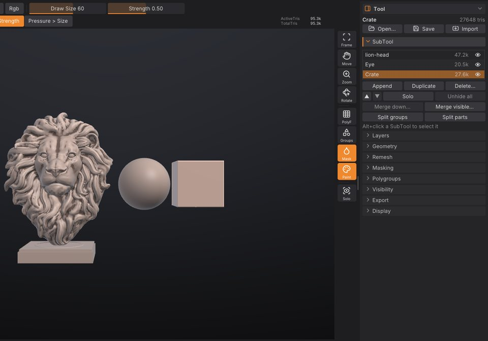

# SubTools

A scene in SculptForge can hold several separate meshes, called SubTools, just as in ZBrush: a body, eyes, teeth,
a helmet and a sword can each live in their own SubTool. This chapter covers the SubTool list, selecting, adding,
hiding, reordering, merging and splitting SubTools, and how they travel through files.

## How SubTools work

- Only the **active** SubTool is sculpted, painted, masked or changed by a command. The others are drawn slightly
  darker and greyer so you can see which one you are working on.
- Each SubTool keeps its own mesh, mask, polypaint, polygroups, hidden faces, UVs and
  [sculpt layers](layers.md).
- Each SubTool has its own undo history. <kbd>Ctrl</kbd>+<kbd>Z</kbd> undoes the last change in the active
  SubTool, and switching SubTools doesn't lose the history of the others.
- Adding, deleting, reordering, merging and splitting SubTools are **not undoable**, as in ZBrush. Merges and
  deletes ask for confirmation first.
- The title strip shows the active SubTool and its place in the list, for example `SubTool Helmet (2/5)`.

> **ZBrush:** SubTools work the way you expect: one active SubTool, the rest dimmed, Alt+click in the viewport to
> switch. There is no folder grouping of SubTools yet.

## The SubTool list

The list is in **Tool > SubTool**, which is open in the right tray by default.



Each row shows the SubTool's name, its triangle count and an eye.

| To | Do this |
|---|---|
| Select a SubTool | Click its row, or <kbd>Alt</kbd>+click it in the viewport |
| Rename it | Double-click the row (or right-click > **Rename**), type, press <kbd>Enter</kbd> |
| Hide or show it | Click the eye at the end of the row |
| Duplicate or delete it | Right-click the row > **Duplicate** or **Delete...** |
| See its vertex and triangle counts | Point at the row for a moment |

The list shows six rows and scrolls when there are more. Names are kept unique: renaming a SubTool to a name that
is already taken adds a number.

Selecting a hidden SubTool shows it again, because you can't sculpt what you can't see.

### Select a SubTool in the viewport

Hold <kbd>Alt</kbd> and click another SubTool on the canvas. It becomes the active one and the list scrolls to it.

<kbd>Alt</kbd>+click only selects when you click a SubTool other than the active one and release without moving.
If you drag instead, <kbd>Alt</kbd> keeps its usual meaning: an inverted stroke on the active SubTool, or a pan when
you start off the model.

## Add a SubTool

Click **Append** and choose:

- **Sphere**, **Cube** or **Plane**: a new primitive placed beside the visible model (to the right, on +X), sized
  to about a third of the largest visible SubTool.
- **From file...**: a model (`.obj`, `.fbx`, `.glb`, `.gltf`, `.ply`, `.stl`, `.GoZ`, `.usda`, `.usd`, `.usdz`) or
  a project (`.sfproj`). A file with several objects adds one SubTool per object.

The new SubTool becomes the active one.

You can also add files as SubTools from elsewhere:

- **Import** in the Tool palette header (or **File > Import**) adds a model file as a new SubTool.
- In the [LightBox](interface.md) **Tool** tab, <kbd>Shift</kbd>+double-click a model, or right-click it
  and choose **Append as SubTool**.

> **Tip:** **Duplicate** copies the active SubTool with its layers and attributes, names it `<name> copy` and puts it
> right under the original. Use it to keep a safe copy before a destructive step such as a remesh.

## Show, hide and solo

- The eye on each row shows or hides that SubTool.
- **Solo** shows only the active SubTool. Click it again to bring the others back. The **Solo** button on the right
  shelf does the same.
- **Unhide all** shows every SubTool.

Hidden SubTools aren't drawn, can't be selected with <kbd>Alt</kbd>+click, and are left out of exports.

> **Note:** SubTool visibility is different from hiding part of a mesh with polygroups or a rectangle. That hides
> faces inside one SubTool; see [Polygroups and visibility](polygroups.md).

## Reorder SubTools

The up and down arrow buttons under the list move the active SubTool one place up or down. The order matters for
**Merge down** and is the order objects are written to files.

## Merge SubTools

- **Merge down...** merges the active SubTool with the one below it.
- **Merge visible...** merges every visible SubTool into one new SubTool called `Merged`. Hidden SubTools stay as
  they are.

Merging keeps every attribute, gives each original mesh its own polygroups (so you can split them again later) and
matches sculpt layers by name. The merged SubTool starts with an empty undo history.

Painted textures are kept too: the merged SubTool gets new Auto UVs and one texture, the size of the largest,
holding each part's paint exactly (texture layers are flattened; parts without a texture are white). On big
meshes the Auto UV takes a while. Scripts can skip it with `keep_texture=false`, which drops the textures.

> **Tip:** Merge first when you want one [voxel remesh](geometry.md#voxel-remesh) to fuse several pieces into a
> single watertight surface.

## Split a SubTool

- **Split groups** makes one SubTool per polygroup. It is available when the active SubTool has more than one
  polygroup.
- **Split parts** makes one SubTool per disconnected piece, largest first.

Both replace the active SubTool with the pieces. Because a merge keeps each original mesh in its own polygroup,
**Split groups** undoes a merge.

## Delete a SubTool

Click **Delete...** (or right-click a row > **Delete...**) and confirm. The last SubTool can't be deleted, and a
delete can't be undone.

## SubTools in files

| Format | What happens to SubTools |
|---|---|
| Project (`.sfproj`) | Every SubTool is saved with its name, visibility, attributes, layers and active layer |
| OBJ | Each visible SubTool is an `o` object; on import, `o` objects become SubTools and `g` groups become polygroups |
| glTF / GLB | One node and mesh per visible SubTool, both ways |
| FBX | One model per visible SubTool (with LODs, an LOD group each), both ways |
| USD | One Mesh prim per visible SubTool, both ways |
| GoZ | Each visible SubTool is sent to ZBrush as its own SubTool |
| PLY, STL, splat conversion | The visible SubTools are merged into one mesh |

Opening a multi-object file replaces the scene with one SubTool per object. See [Exporting](exporting.md) for the
details of each format.

## Scripting

Every SubTool action is a command, so you can use them in the [console](scripting.md), scripts, Python and MCP
agents. SubTools are addressed by `index` (0 is the top of the list) or `name`; without either, the active one is
used.

| Command | What it does |
|---|---|
| `subtool_list` | List the SubTools |
| `subtool_select index=1` | Make a SubTool active |
| `subtool_append type=cube` | Add a primitive (`sphere`, `cube`, `plane`); `path=` adds a file; `size=` (0.05-2, default 0.35) |
| `subtool_duplicate` | Copy a SubTool |
| `subtool_delete name=Helmet` | Delete a SubTool |
| `subtool_rename to=Body` | Rename a SubTool |
| `subtool_visibility visible=false` | Show or hide (toggles when `visible` is left out) |
| `subtool_solo` / `subtool_show_all` | Solo the active SubTool / show every SubTool |
| `subtool_move direction=up` | Move a SubTool up or down the list |
| `subtool_merge_down` / `subtool_merge_visible` | Merge |
| `subtool_split_groups` / `subtool_split_parts` | Split |

```text
subtool_append type=sphere name=EyeL size=0.12; subtool_duplicate; subtool_rename to=EyeR
```

## See also

- [Polygroups and visibility](polygroups.md): hide parts of one SubTool
- [Sculpt layers and blend shapes](layers.md): layers belong to each SubTool
- [Exporting](exporting.md): how SubTools reach other applications
- [Projects, autosave and QuickSave](projects.md)
