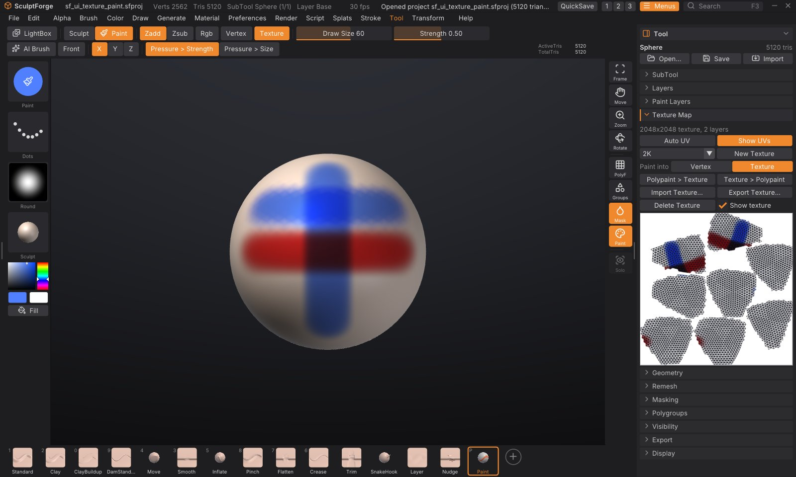

# Texture painting

Texture painting puts the colour into an image laid over the model's UVs, instead of on its vertices. The
detail you can paint then comes from the texture's resolution, not from how dense the mesh is: a 4K texture on a
light, game-ready mesh holds pores, freckles and sharp decals that polypaint could only show on millions of
polygons. Everything you know from [polypaint](polypaint.md) still applies: the same Paint brush, colours, fills,
symmetry, mask and paint layers with blend modes.

## Paint a texture in four steps

1. Open **Tool > Texture Map** in the right tray.
2. If the SubTool has no UVs (the sub-palette says "No UVs"), click **Auto UV**. SculptForge cuts the model
   into UV islands and packs them into the texture square. It works in the background with a progress bar; on
   a few hundred thousand triangles it takes seconds, on millions it can take a minute or more. Models imported
   with UVs (from ZBrush, Maya, Blender...) already have them: skip this step.
3. Choose a size (**1K**, **2K**, **4K** or **8K**; 2K is the default) and click **New Texture**. The model now
   carries a white texture, and painting goes into it: **Texture** lights up next to **Vertex** on the top
   shelf.
4. Press <kbd>P</kbd> and paint. Draw Size, Strength, pen pressure, the stroke type, the alpha, symmetry and the
   mask work as they do for polypaint.

Click **Show UVs** to see the texture with the UV layout drawn over it, below the buttons. Paint on the model and
watch the texture fill in.

## Vertex or Texture

When a SubTool has a texture, **Vertex** and **Texture** appear on the top shelf next to **Rgb** (and in the Color,
Paint Layers and Texture Map palettes). They choose where paint goes:

- **Texture**: the Paint brush, **Rgb** while sculpting, **Fill**, **Fill masked**, **Cavity**, **Clear** and
  the Paint Layers palette work on the texture.
- **Vertex**: they work on the polypaint, exactly as before.

The model shows both: the polypaint multiplied by the texture, over the material. Each SubTool keeps its own
choice, saved in the project. **Show texture** (Texture Map, or the Color palette) hides the texture in the
viewport without deleting it.

## How texture painting works

- Each texel under the brush gets its 3D position on the surface, so the falloff, the alpha and the brush size are
  the same as for polypaint, and a stroke looks the same whatever the UV layout.
- **Front faces only:** the brush never paints through a thin part onto its far side, and never on surfaces facing
  away from you.
- The **mask** keeps masked areas as they are, and **hidden faces** are never painted.
- **Symmetry** paints the mirrored side too, even where the two sides have different UV islands.
- Around every UV island the paint runs on a few texels into the empty space (padding), so seams don't show as
  thin lines when the texture is filtered or mipmapped.
- One stroke is one undo step. SculptForge stores only the 64x64-texel tiles the stroke touched, so undo stays
  light even on an 8K texture. Layer edits (new layer, fill, clear, merge, flatten, delete) also keep only the
  tiles they changed, and an empty or single-colour tile costs almost nothing. Only an edit that changes a whole
  painted layer at once, like clearing a fully painted Base, stores the full layer.
- <kbd>Alt</kbd> paints back towards white on Base, and erases on a paint layer, as with polypaint.
- <kbd>C</kbd> over the model picks the texture's colour under the cursor.

> **Tip:** Painting stays fast with big textures on big meshes: only the triangles under the brush are visited and
> only the changed part of the texture is sent to the graphics card. Memory is the limit: a 4K texture takes
> 64 MB per layer, an 8K texture 256 MB.

## Paint layers on a texture

**Tool > Paint Layers** works on the texture's own stack while painting goes into the texture: new layers, blend
modes, opacity, visibility, lock, Merge down, Flatten, Clear and Fill layer behave exactly as described in
[Paint layers](polypaint.md#paint-layers). Switch to **Vertex** and the palette shows the polypaint layers again;
the two stacks are separate.

## Convert between polypaint and texture

| Button | What it does |
|---|---|
| **Polypaint > Texture** | Bakes the polypaint (all its layers, as shown) into the active texture layer. Makes a 2K texture if there is none |
| **Texture > Polypaint** | Sets the polypaint of every vertex to the texture's colour under it. Detail finer than the mesh is lost; vertices on a UV seam take the average of both sides |

Both are undoable. Polypaint > Texture is a quick way to move an existing polypainted sculpt onto a game mesh's
texture after giving it UVs.

## Import and export

- **Export Texture...** saves the texture (every visible layer composited) as a PNG.
- **Import Texture...** loads a PNG, JPEG, TGA, BMP or PSD as the SubTool's texture (it replaces the texture's
  layers; undoable). The image is laid on the UVs as it is, so a texture made for these UVs in another app lines
  up.
- Projects (`.sfproj`) save the texture with all its layers, blend modes and settings.
- Exporting the model writes the texture next to it as a PNG and references it, so other apps pick it up:
  OBJ writes a `.mtl` material with `map_Kd`; glTF/GLB embeds it as the base colour texture; USD binds a preview
  material that reads it; FBX and GoZ export write the PNG beside the file. See [Exporting](exporting.md).
- **Delete Texture** removes it (undoable); painting goes back to the vertices.

## UVs and geometry

- **Auto UV** replaces any existing UVs. If the SubTool already has a painted texture, the paint moves with it:
  every texel of the new layout takes the colour of the same point of the surface from the old one, for the Base
  and every texture layer (with their blend modes, opacity and names), and the islands get a padded border. It
  is one undo step: undo brings back the old UVs and the old texture exactly. Moving a 4K texture takes a fraction
  of a second on a million triangles (the unwrap itself takes longer; see below). The paint is resampled once,
  so very fine detail softens slightly (well under one texel).
- [Subdividing](geometry.md#subdivide), [decimating](geometry.md#decimate), [splitting](subtools.md#split-a-subtool)
  and duplicating keep the UVs, so the texture stays on. Decimate leaves the vertices on UV seams in place, so the
  texture stays exact across seams.
- **Keep Texture** (on by default, shown under **Tool > Remesh** and **Tool > Geometry > QRemesh** when the
  SubTool has a texture): a [voxel remesh](geometry.md#voxel-remesh) or [QRemesh](retopology.md) builds a new
  surface without UVs, so SculptForge unwraps the result with Auto UV and projects the texture onto it from the
  old surface (each new texel takes the colour of the closest point of the old one), keeping every layer. It is
  part of the same undo step. It adds the time of an Auto UV of the result, so a voxel remesh of a painted
  SubTool runs in the background with a progress bar and **Cancel**. Turn it off to drop the texture instead
  (the status line says so). Paint finer than the new surface's detail is kept, since it lives in the texture.
- [Merging](subtools.md#merge-subtools) SubTools keeps their textures: the merged SubTool gets Auto UVs and one
  texture (the size of the largest) holding each part's paint, with the texture layers flattened. Parts without
  a texture come out white.
- Auto UV on dense meshes: the islands are kept to about 4,000 triangles each, so a million-triangle sculpt
  unwraps in a quarter of a minute or so and gets a few hundred islands.
- UVs outside the 0-1 square (tiles, UDIMs) aren't painted.

> **ZBrush:** ZBrush paints polypaint and converts it to a texture afterwards (**Texture Map > New From
> Polypaint**). SculptForge can do both: paint the texture directly, or bake polypaint with **Polypaint >
> Texture**. **Auto UV** plays the part of UV Master's Unwrap.

## Scripting

| Command | What it does |
|---|---|
| `uv_auto` | Unwrap the active SubTool (xatlas); `resolution=4096` packs the islands for that texture size. A painted texture moves onto the new UVs (`keep_texture=false` leaves it as it was) |
| `texture_create size=2048` | Give the SubTool a texture (1024, 2048, 4096, 8192 or `1k`...`8k`) and paint into it; `from_polypaint=true` starts from the polypaint |
| `paint_target target=texture` | Where painting goes: `vertex` or `texture` |
| `texture_from_polypaint` | Bake the polypaint into the active texture layer |
| `polypaint_from_texture` | Copy the texture into the polypaint |
| `texture_export path=skin.png` | Save the texture as a PNG |
| `texture_import path=skin.png` | Load an image as the texture |
| `texture_delete` | Remove the texture |

`remesh`, `qremesh`, `subtool_merge_down` and `subtool_merge_visible` keep a texture unless you add
`keep_texture=false`.

`paint_fill`, `paint_from_cavity`, `paint_clear` and every `paint_layer_*` command work on the texture while
`paint_target` is `texture`. See [Scripting and automation](scripting.md).
