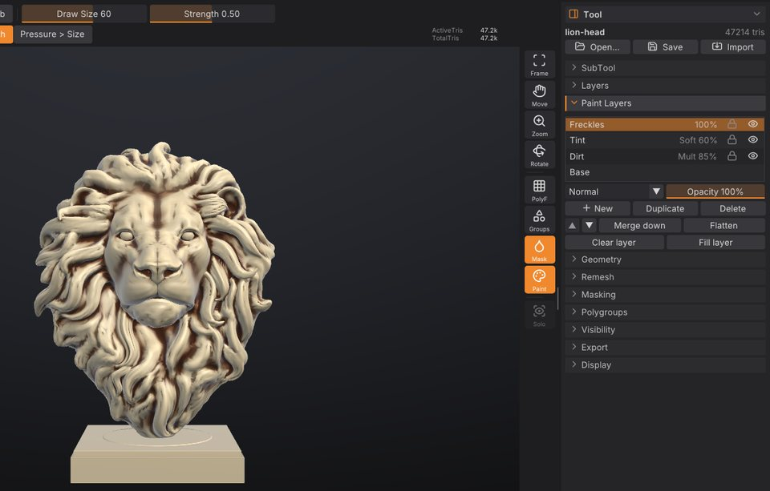

# What's new

What changed in each version of SculptForge, newest first, with links to the chapters that explain it. This
chapter opens by itself the first time you start a new version; you can always find it again under
**Help > What's New**. Every detail is in the
[changelog](https://github.com/islandmed/SculptForge/blob/main/CHANGELOG.md).

## Next version (in development)

### Lighter sculpts

A sculpt with subdivision levels takes half the memory it did: a 33 million triangle model with its levels needs
about 3 GB instead of 5.3, so a laptop with 32 GB holds models of 100 million triangles and more.

- **Divide goes past 100 million triangles.** The limit now follows your computer's memory instead of stopping at
  50 million.
- **Opening a project is twice as fast** and no longer needs twice the model's memory while it loads. Project files
  of divided models are about 30% smaller. Projects from 0.5 open as before; save a copy if you still need to open
  it in 0.5.
- Sculpting gives exactly the same results as before: only the way the levels and the mesh's neighbour lists are
  stored changed.

See [Performance and big meshes](performance.md).

### Big brushes on huge meshes

Large Move, Smooth, Inflate and Standard strokes are much quicker on tens of millions of polygons: on a 33
million triangle model a brush covering a tenth of it (a million vertices per dab with symmetry) takes about 39
ms per dab instead of 63, Move at that size 12 instead of 22, a medium brush 6.5 ms instead of 11, and undoing a
big stroke is about twice as fast.
Sculpting also needs about 300 MB less memory at that size. See
[Performance and big meshes](performance.md).

### A faster, lighter viewport

Turning the view around a huge sculpt is now about twice as fast, and the graphics card needs about a third of
the memory it did.

- **Only what you can see is drawn.** The mesh is drawn in patches of a few thousand triangles; patches outside
  the view, and on closed meshes the ones facing away from you, are skipped.
- **Fast Navigation draws a lighter version** of big meshes while the view moves, about a fifth of the triangles,
  and the full mesh again as soon as it stops. A 100 million triangle sphere turns at about 100 frames a second
  on an M1 Pro laptop.
- **A third of the graphics memory**: about 15 bytes per triangle (it was over 40 on meshes with quads), so
  bigger sculpts fit on the graphics card. The wireframe's edges are only kept while the wireframe is on.
- Opening a big model or dividing it sends it to the graphics card about 40% faster.

See [Performance and big meshes](performance.md).

## Version 0.5

The ZBrush workflow core: subdivision levels, quad retopology, map baking, the Gizmo 3D, and speed at tens of
millions of polygons.

### Subdivision levels

Sculpt one model at several resolutions, as with ZBrush's SDiv: big forms low, fine detail high, and back down
without losing anything.

- **Divide** (<kbd>Ctrl</kbd>+<kbd>D</kbd>) adds a level and keeps the ones below. Quads stay quads
  (Catmull-Clark); **Smt** off divides without smoothing.
- **Lower Res** / **Higher Res** (<kbd>Shift</kbd>+<kbd>D</kbd> / <kbd>D</kbd>) and the **SDiv** slider step
  between levels. Detail sculpted high rides along when you reshape low, and edits high show up softened below.
  Stepping back and forth is instant, even at millions of polygons.
- Mask, polypaint, paint layers, polygroups, hidden faces, UVs and sculpt layers follow the levels.
- **Del Lower**, **Del Higher** and **Reconstruct Subdiv** (find the lower levels of a model subdivided
  elsewhere). Undo walks back through strokes and level changes; projects save every level; the SubTool list
  shows "SDiv 3/5".
- <kbd>Ctrl</kbd>+<kbd>D</kbd> now divides with levels; the old one-way **Subdivide** is still in
  **Tool > Geometry**.

See [Subdivision levels](subdivision-levels.md).

### Gizmo 3D: move, scale, rotate and pose

ZBrush's Gizmo 3D, with the same keys: <kbd>W</kbd> Move, <kbd>E</kbd> Scale, <kbd>R</kbd> Rotate, <kbd>Q</kbd>
back to Draw (also on the top shelf and in the **Transform** palette).

- **Handles over the model.** Arrows, plane squares and a free-move centre; axis rings and a view ring; axis
  boxes and a uniform centre. <kbd>Shift</kbd> snaps to 15 degrees, the grid or 10% steps.
- **Only the unmasked part moves**, so posing is: mask the body, <kbd>Alt</kbd>+click the shoulder to put the
  pivot there, raise **Falloff** for a soft joint, turn the arm. With X symmetry both arms move together.
- **Pivot tools**: <kbd>Alt</kbd>+drag the gizmo to move it alone, **Reset**, **To Surface**, World or Surface
  axes.
- **Numeric entry** in the Gizmo 3D panel, **All SubTools** (Transpose All), one undo step per drag, sculpt
  layers move with the surface, and the `transform` command for scripts.
- Fast on big models: a drag frame on 1.3 million triangles takes about 10 ms.

<kbd>W</kbd> no longer toggles the wireframe: use <kbd>Shift</kbd>+<kbd>F</kbd> (as in ZBrush) or **PolyF** on the
right shelf. See [Moving, rotating and posing](gizmo.md).

### Normal, displacement and AO map baking

Bake the detail of a high-poly sculpt into maps on a low-poly's UVs, for game engines and renderers:
**Tool > Bake**.

- **Six maps in one go**: tangent-space normal, object-space normal, displacement (16-bit PNG with mid-grey =
  0, plus a 32-bit EXR in world units), ambient occlusion, cavity and colour (polypaint or texture).
- **Right in every engine.** Tangent-space maps use MikkTSpace tangents, as Blender, Unreal, Unity and Godot
  do; pick the OpenGL or DirectX green convention.
- **Check it on the model.** The low-poly shows its baked normal map in the viewport as soon as the bake ends,
  next to the high-poly.
- **ZBrush-style controls**: source SubTool, 1K-8K, anti-aliasing, automatic or manual front and rear ray
  distances, padding around UV islands. Bakes run in the background on every core, with progress and Cancel.
- **Send to Unreal** brings the normal map along, set up as a normal map. The `bake` command does it all from
  scripts.

See [Baking normal and displacement maps](baking.md).

### Quad retopology and detail projection

- **QRemesh** (**Tool > Geometry**, like ZRemesher) rebuilds a sculpt as clean quads whose edge loops follow
  the forms, near a **Target Polygons** count, in the background. **Keep Groups**, **Adaptive Size**,
  **Use Polypaint**, **Symmetry** and **Half / Same / Double** work as in ZBrush.
- **ProjectAll** (**Tool > SubTool > Project**) puts the sculpted detail and polypaint back onto the divided
  quads, with **Dist**, **Mean** and **PA Blur**, and respects the mask.

See [Quad retopology and detail projection](retopology.md).

### Performance at tens of millions of polygons

Sculpting a 33 million triangle model on a laptop now keeps up with the display: a medium brush costs about
10 ms per dab instead of 400, and turning the view runs at 50-70 frames a second instead of 32.

- **Brushes use every core**: every brush, mask and paint stroke, the normal updates and the picking structure.
  Results are exactly the same as on one core.
- **Strokes send the graphics card only what they changed.** Before, a dab with symmetry on a subdivided model
  re-sent most of the mesh.
- **Fast undo**: undo keeps only the vertices a stroke changed, and the first polypaint stroke on a model no
  longer copies the whole mesh for undo.
- **Less memory**: about 30% less per triangle for a sculpting mesh.
- **Faster projects**: saving and opening big projects is faster, and projects over 4 GB save (ZIP64).
- **Preferences > Performance**: Antialiasing (Off to 8x), **Fast Navigation** (big scenes drop antialiasing
  while the view moves), Multithreading, what your last stroke cost per dab, and the memory the scene holds. A
  SubTool too big for the graphics card is left out of the view with a message, instead of failing.
- `sculptforge --bench` measures your machine.

See [Performance and big meshes](performance.md).

### Polish

- **Your paint survives Auto UV and retopology.** Auto UV on a painted SubTool moves the texture and its layers
  onto the new UVs. Voxel Remesh and QRemesh have a **Keep Texture** option (on by default) that unwraps the new
  surface and projects the texture onto it, and merging SubTools keeps their textures in one. Each is a single
  undo step. See [Texture painting](texture-painting.md#uvs-and-geometry).
- **Faster, safer Auto UV on dense sculpts:** no more crash or folded UVs on dense smooth meshes, and a
  million-triangle sculpt unwraps in a quarter of a minute or so. Decimate keeps the texture exact across UV
  seams.
- **Subdivision levels, polished.** Tools that rebuild the mesh (remesh, Decimate, QRemesh, Subdivide, Delete
  Hidden, merge and split) tell you they removed the levels and that the level you were on became the new base;
  <kbd>Ctrl</kbd>+<kbd>Z</kbd> brings them all back. Sculpt layers' fine detail turns with a low level you pose
  with the Gizmo, and SubTools you aren't working on no longer hold cached levels in memory.
- **QRemesh symmetry follows your model.** Symmetry (now on by default) mirrors across the model's own middle, so
  a model away from the centre comes out mirror-symmetric too. If the model isn't symmetric, QRemesh remeshes it
  whole and tells you. Eyes, teeth and rivets get their own quads instead of disappearing, and thin hard-edged
  parts such as blades and fins keep both sides and their edges. See [Quad retopology](retopology.md).
- **Tidier top shelf:** the **Vertex / Texture** paint target only shows when the SubTool has a texture.
- **Exports checked by other tools:** textured GLB, USD/USDZ, FBX and OBJ files were checked with the Khronos
  validator, OpenUSD and ufbx, and the texture is the right way up in each. A model saved as `my scene.obj` now
  writes `my_scene.mtl` so other apps find it. See [Exporting](exporting.md).

## Version 0.4.2

### Texture painting on UV maps

Paint into a texture instead of the vertices, so the colour detail comes from the texture (1K to 8K), not from
the mesh: sharp decals, pores and freckles on a light game mesh.

- **Auto UV.** **Tool > Texture Map > Auto UV** unwraps any sculpt in the background. Models that come in with
  UVs keep them, and now OBJ, FBX, USD and glTF carry UVs in and out too.
- **New Texture.** Pick a size and click **New Texture**: the Paint brush, **Rgb** sculpting, fills, cavity paint
  and colour picking (<kbd>C</kbd>) now work on the texture, with the mask, symmetry, pen pressure and alphas.
  Strokes never paint through to the far side, and seams stay invisible.
- **Vertex or Texture.** A toggle on the top shelf chooses where paint goes for each SubTool.
- **The same paint layers.** **Tool > Paint Layers** works on the texture's layers: blend modes, opacity,
  merge, flatten, all undoable.
- **Convert both ways**, **Show UVs**, **Import / Export Texture** (PNG). Projects save textures and their
  layers, and model exports write the texture next to the model (OBJ `.mtl`, glTF, USD, FBX, GoZ).

See [Texture painting](texture-painting.md).

## Version 0.4.1

A fix for graphics tablets: the brush ring no longer flickers between two places on the model (it looked like
a second brush blinking, most often while masking or smoothing). Some tablet drivers, Windows Ink among them,
send extra mouse movements beside the pen's; now, while the pen is in range, only the pen moves the brush. See
[Pen tablets](troubleshooting.md#pen-tablets) if your pen still misbehaves.

## Version 0.4

Version 0.4 is about making SculptForge feel like home to ZBrush artists. It was shaped by feedback from a
working ZBrush modeler and by what sculptors say on the ZBrush and Mudbox forums.

### Navigation that works like ZBrush

- **Free rotation.** Dragging turns the model the way the cursor moves and can roll it right over the top,
  as in ZBrush. If you prefer the model to stay upright, set **Preferences > Interface > Rotation** to
  **Turntable**.
- **Snap to a view.** Hold <kbd>Shift</kbd> while rotating to snap to the nearest front, back, side, top or
  bottom view.
- **ZBrush zoom.** <kbd>Alt</kbd>+drag on the background pans; let go of <kbd>Alt</kbd> while still dragging
  and the rest of the drag zooms. With the right mouse button, <kbd>Alt</kbd> pans and <kbd>Ctrl</kbd> zooms.

See [Navigating the view](navigation.md).

### Mask and isolate with a lasso or rectangle

- **MaskLasso and MaskRect.** Pick the shape at the top of **Tool > Masking**, then <kbd>Ctrl</kbd>+drag to
  mask everything inside it; add <kbd>Alt</kbd> to unmask. The drag can start on the model or beside it.
- **SelectLasso.** In **Tool > Visibility**, pick **SelectLasso** next to SelectRect, then
  <kbd>Ctrl</kbd>+<kbd>Shift</kbd>+drag a free-hand shape to keep only what's inside (add <kbd>Alt</kbd> to
  hide it instead).

See [Mask with a lasso or rectangle](masking.md#mask-with-a-lasso-or-rectangle) and
[Polygroups and visibility](polygroups.md).

### A material made for sculpting

The new **Sculpt** material is the default: plain clay under a strong key light, with crisp highlights and
deep shading in the creases, so even small strokes stay easy to read. The other materials are still in the
material picker (<kbd>M</kbd>), and projects keep the material they were saved with. See
[Polypaint and materials](polypaint.md).

### Quads stay quads

Models you bring in from ZBrush (GoZ) or as OBJ, FBX, PLY or USD keep their quads: **PolyF** shows them as
quads, and exporting writes them back as quads. Subdivide turns each quad into four, voxel remesh now gives
an even grid of quads (like DynaMesh), and new cubes and planes are made of quads. See
[Quads and triangles](geometry.md#quads-and-triangles).

### Paint layers

Polypaint now has layers, like Photoshop: each SubTool can have a stack of colour layers with their own
opacity, visibility, lock and blend mode (Multiply, Screen, Overlay, Soft Light, Add and more). Painting on a
layer never destroys what's underneath, and you can merge, flatten, duplicate and reorder layers. ZBrush has
never had this. Find it in **Tool > Paint Layers**, and see [Paint layers](polypaint.md#paint-layers).

### Easier to install

The [download links](installing.md) now always get the newest version, and there are one-command installers
for Windows, macOS and Linux.

## Version 0.3

- **SubTools**: several separate meshes in one scene. Append, duplicate, split, merge, solo, and
  <kbd>Alt</kbd>+click to select. See [SubTools](subtools.md).
- **A ZBrush-style interface**: shelves around the canvas, alphabetical palettes, the LightBox
  (<kbd>,</kbd>), the brush, stroke, alpha and material pickers, hold-<kbd>Ctrl</kbd> help on every control
  and a command palette (<kbd>F3</kbd>). See [The interface](interface.md).
- **Graphics tablets**: pen pressure, the eraser end and pen buttons. See [Sculpting and brushes](sculpting.md).
- **A brush library** with brush codes to share and a community gallery. See
  [Brush Lab and sharing brushes](brush-lab.md).
- **ComfyUI** workflows for image and text to 3D. See [Image and text to 3D](generate-3d.md).
- **This user guide**, built into the app (**Help > User Guide**, <kbd>Shift</kbd>+<kbd>F1</kbd>).

## Version 0.2

- [Masking](masking.md), [polygroups and visibility](polygroups.md), and
  [polypaint with MatCaps](polypaint.md).
- New brushes: DamStandard, ClayBuildup, SnakeHook, Trim, Layer and Nudge, with strokes and alphas.
- [Project files](projects.md) with autosave, recent files and QuickSave, and
  [GoZ exchange with ZBrush](exporting.md).

## Version 0.1

The first release: sculpting with symmetry and sculpt layers, voxel remesh and decimation, game-ready LOD
chains and Send to Unreal, image and text to 3D with free AI models, Gaussian splats, OpenUSD, and scripting
from the command line, Python and AI agents.
